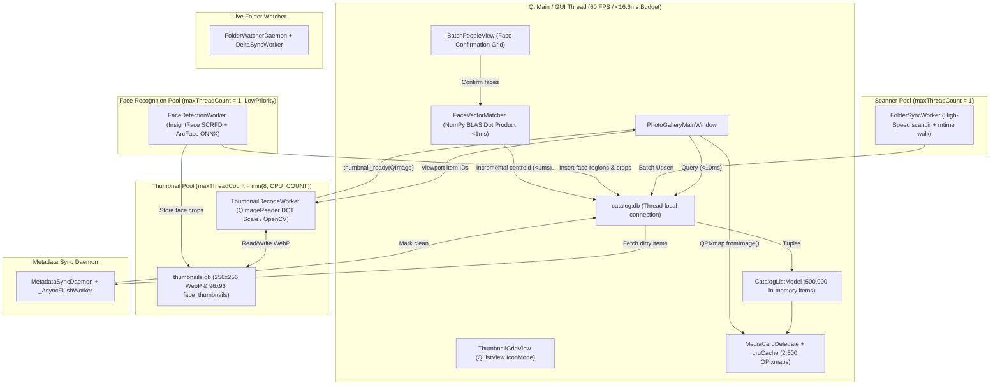

# Essentials Photo Gallery — Consolidated System Architecture & Technical Specification (`ARCHITECTURE.md`)

**Target System:** High-Performance 64-Bit Desktop Photo Management & Non-Destructive Editing Workstation  
**Inspiration & Heritage:** Authentic Windows Live Photo Gallery (WLPG) Wave 4 (2012) UX elevated with modern computer vision, biometric face clustering, interactive world map geotagging, multi-photo creation studio, and 32-bit perceptual image processing  
**Scale Target:** **500,000+ Photos & Videos**, 60 FPS Virtualised Grid, Sub-10ms Faceted Queries  
**Design Principles:** Non-destructive image editing, zero UI-blocking disk I/O, strict SQLite WAL concurrency, dual XMP/MWG metadata interop, local AI face clustering, and 100% offline privacy  

---

## 1. Project Directory & Module Tree

```text
Gallery/
├── main.py                                      # Application bootstrap, QApplication lifecycle, QSS stylesheet loader
├── SPEC.md                                      # Executive system specification & requirements summary (links here)
├── ARCHITECTURE.md                              # Definitive system architecture & technical specification
├── editing_engine.md                            # Mathematical & algorithmic specification of image processing engines
├── futureideas.md                               # Forward-looking innovation roadmap (semantic search, deduplication, OCR)
├── README.md                                    # Project overview, installation, testing, and feature guide
├── photogallery.spec                            # PyInstaller standalone 64-bit executable packaging specification
├── 1_build_exe.bat                              # One-click PyInstaller executable compiler
├── 2_test_exe.bat                               # Verification script running the compiled executable
├── 3_build_installer.bat                        # Inno Setup installer package builder
├── installer.iss                                # Inno Setup 6 script (desktop shortcuts, registry, uninstallers)
├── db/
│   └── schema.sql                               # Complete SQLite DDL: WAL, R*Tree, closure tables, indexes, triggers
├── assets/
│   ├── app_icon.png
│   ├── icons/                                   # High-DPI UI icons & procedural SVG vector generators
│   └── themes/
│       ├── wlpg_aero.qss                        # Authentic Windows Live Photo Gallery Aero (Light) theme
│       ├── dark.qss                             # Dark studio theme
│       └── modern.qss                           # Modern Microsoft Fluent UI theme
├── src/
│   ├── __init__.py
│   ├── core/
│   │   ├── __init__.py
│   │   ├── duplicate_finder.py                  # DuplicateDetectionEngine: Exact byte hashing, pHash/dHash, burst analysis & rules
│   │   ├── face_engine.py                       # FaceEngine: Dual InsightFace SCRFD+ArcFace & deterministic OpenCV fallback
│   │   ├── face_matcher.py                      # FaceVectorMatcher: NumPy N×512 BLAS matrix similarity & running centroids (<1ms)
│   │   ├── gazetteer_data.py                    # Built-in offline gazetteer dataset (3,500+ world cities & UK settlements)
│   │   └── geotag_resolver.py                   # GeotagResolver: Sub-2ms KD-tree reverse geocoding & Nominatim SQLite cache
│   ├── db/
│   │   ├── __init__.py
│   │   ├── connection.py                        # DualDatabaseEngine: Thread-local WAL connection manager, backup & optimize
│   │   └── repository.py                        # CatalogRepository & ThumbnailRepository: Sub-10ms queries, R*Tree, tag_closure
│   ├── imaging/
│   │   ├── __init__.py
│   │   ├── opencv_engine.py                     # 32-bit floating-point perceptual tone engine, U-Point, auto-straighten
│   │   ├── create_tools.py                      # Multi-Photo Studio: Panorama stitcher (ICE crop), Collages, Photo Fuse
│   │   └── creative_effects.py                  # Creative Effects: Color Pop, Portrait Bokeh, Parallax 3D Motion MP4
│   ├── ui/
│   │   ├── __init__.py
│   │   ├── batch_people_view.py                 # BatchPeopleView: Virtualised face suggestion confirmation grid & quick preview
│   │   ├── crop_tool.py                         # CropOverlayItem: Interactive Rule-of-Thirds overlay with aspect-ratio locks
│   │   ├── dialogs.py                           # AppSettingsDialog, ChangeTimeTakenDialog (relative Δt math), FilePropertiesDialog
│   │   ├── duplicate_finder_dialog.py           # DuplicateFinderDialog: Side-by-side photo comparison, auto-select rules, trash
│   │   ├── grid_model.py                        # CatalogListModel (QAbstractListModel) with O(log G) binary-searched headers
│   │   ├── grid_view.py                         # ThumbnailGridView (QListView IconMode) & MediaCardDelegate (QStyledItemDelegate)
│   │   ├── import_dialog.py                     # ImportDialog: Device scanning, folder structure presets, progress monitor
│   │   ├── left_nav_dock.py                     # LeftNavigationDock: Folders, Dates, Tags (AND/OR/NOT), People, Ratings
│   │   ├── main_window.py                       # PhotoGalleryMainWindow: Central coordinator, thread pools, status bar monitor
│   │   ├── map_view.py                          # WorldMapView: QWebEngineView + Leaflet + QWebChannel + media_rtree bridge
│   │   ├── markup_overlay.py                    # MarkupOverlayView: Vector arrows, text badges, loupe & privacy redactions
│   │   ├── media_viewer.py                      # SingleMediaViewer: Async full-res viewport, video player, face tag rename popup
│   │   ├── options_dialog.py                    # AppSettingsDialog: Safe Mode write-back toggle, thumbnail caches, rescan settings
│   │   ├── people_directory_view.py             # PeopleDirectoryView: Immich-style 130px cards, search filter, unnamed clusters
│   │   ├── person_header_bar.py                 # PersonHeaderBar: Timeline strip with 1-click [Confirm all] face verification
│   │   ├── ribbon_toolbar.py                    # RibbonToolbar: Home, Edit, Find, Create, View tabs, QAT, responsive collapse
│   │   ├── right_tag_dock.py                    # TagAndCaptionDock: Info (Ctrl+I) & Fine Tune (Ctrl+F) docks with live histogram
│   │   ├── search_scope_bar.py                  # SearchScopeBar: Breadcrumb path filter & instant clearable search box
│   │   ├── slideshow_view.py                    # FullscreenSlideshowDialog: Ken Burns Pan/Zoom, Cross-fade, and HUD overlays
│   │   ├── tag_hierarchy_dialog.py              # TagHierarchyDialog: Tag tree editor, drag-and-drop, duplicate root cleanup tool
│   │   └── tag_someone_dialog.py                # TagSomeoneDialog: Autocomplete face-tagging dialog
│   ├── utils/
│   │   ├── __init__.py
│   │   ├── geotag_resolver.py                   # Legacy bridge mapping to core.geotag_resolver
│   │   └── paths.py                             # Standard paths resolver (AppData, user libraries, temporary caches)
│   └── workers/
│       ├── __init__.py
│       ├── face_worker.py                       # FaceDetectionWorker: 3-stage background detector, crop extractor & backfill
│       ├── folder_watcher.py                    # FolderWatcherDaemon & DeltaSyncWorker: QFileSystemWatcher + startup reconciliation
│       ├── scanner_thumb_worker.py              # FolderSyncWorker, ThumbnailDecodeWorker (QImageReader + OpenCV filmstrip)
│       └── xmp_sync_worker.py                   # MetadataSyncDaemon: Lossless XMP/EXIF writer, mtime preservation, safe mode
└── tests/
    ├── test_phase1_db.py                        # Database schema, WAL concurrency, tag_closure, R*Tree, time shift tests
    ├── test_phase2_workers.py                   # Scanner, QImageReader WebP thumbnails, XMP dirty queue tests
    ├── test_phase3_grid.py                      # Virtualized model, group headers, delegate hit-testing, selection tests
    ├── test_phase4_nav_ribbon.py                # Left tree Boolean tag filters, Ribbon arrange/details/face carousel tests
    ├── test_phase5_dock_dialogs.py              # Right dock Info/Fine-Tune, relative time shift dialog, multi-tags tests
    ├── test_phase6_viewer_map.py                # Single image viewer, CropScene, lossless rotate, Leaflet Map R*Tree tests
    ├── test_phase7_main_window.py               # Main window coordinator, central stack transitions, shortcuts tests
    ├── test_phase8a_face_matcher.py             # FaceVectorMatcher, NumPy dot product, centroid math, rejection persistence
    ├── test_phase8b_batch_people_ui.py          # BatchPeopleView, grouped suggestions, avatar filter strip, shortcuts tests
    ├── test_face_engine.py                      # Dual-backend face detection, ArcFace embedding extraction, WebP crops
    ├── test_face_worker.py                      # FaceDetectionWorker 3-stage pipeline, cancellation, poison-pill isolation
    ├── test_duplicate_finder.py                 # Exact, visual, burst detection, sharpness, and smart selection rules tests
    ├── test_dark_theme_and_face_badge_click.py  # Ribbon/viewer dark theme backgrounds & click-to-rename face badge tests
    ├── test_face_retag_and_effects_ribbon.py    # Tag-as-someone-else, face unlinking, and effects gallery height tests
    ├── test_tag_drag_drop_hierarchy.py          # Left tree and dialog tag drag-and-drop reparenting & root merge tests
    ├── test_file_properties_dialog.py           # Windows-style file properties details dialog tests
    ├── benchmark_scale.py                       # 100k & 500k synthetic catalog scale benchmark harness
    └── benchmark_report_100k_500k.md            # Verified before vs. after performance report (500k items)
```

---

## 2. Dual-Database Storage Architecture (`catalog.db` & `thumbnails.db`)

SQLite WAL mode (`PRAGMA journal_mode = WAL; PRAGMA synchronous = NORMAL; PRAGMA busy_timeout = 5000;`) is used across two isolated database files to eliminate write contention between bulk thumbnail BLOB caching and rapid metadata queries.

```
+-------------------------------------------------------------+
|                      User Application                       |
+------------------------------+------------------------------+
                               |
            +------------------+------------------+
            |                                     |
            v                                     v
+-------------------------+             +-------------------------+
|       catalog.db        |             |      thumbnails.db      |
|  (Metadata & Vectors)   |             |     (Fast WebP BLOBs)   |
+-------------------------+             +-------------------------+
| - folders               |             | - thumbnails            |
| - media                 |             |   (256x256 WebP blobs)  |
| - tags & tag_closure    |             | - face_thumbnails       |
| - media_tags            |             |   (96x96 portrait crops)|
| - people                |             +-------------------------+
| - media_people          |
| - face_rejected         |
| - media_rtree (Spatial) |
+-------------------------+
```

### 2.1 `catalog.db` Schema & Specialized Indexes
- **`folders`**: `(id, path UNIQUE, name, parent_id, mtime, is_missing)`
- **`media`**: `(id, folder_id, filename, ext, size, mtime, date_taken, rating, flag, width, height, orientation, lat, lon, location_name, caption, author, camera_make, camera_model, exposure_time, f_number, focal_length, iso, is_video, duration_ms, video_codec, video_fps, metadata_dirty, face_scan_version, is_missing)`
- **`tags`**: `(id, parent_id, name, full_path UNIQUE)`
- **`tag_closure`**: `(ancestor_id, descendant_id, depth)`: Transitive closure table maintained via database triggers (`trg_tags_after_insert`, `trg_tags_after_delete`) enabling sub-5ms Boolean tree filtering (`AND`, `OR`, `NOT`).
- **`media_tags`**: `(media_id, tag_id)` with composite primary key `PRIMARY KEY(media_id, tag_id)`.
- **`people`**: `(id, name UNIQUE, thumbnail_blob, avatar_media_people_id, centroid_embedding, confirmed_count)`: Biometric identity clusters storing 512-d ArcFace centroid vectors.
- **`media_people`**: `(id, media_id, person_id, suggested_person_id, similarity_score, state, is_manual, rect_x, rect_y, rect_w, rect_h, embedding)`: Face bounding box instances (`state`: `-1` = ignored, `0` = suggestion, `1` = confirmed).
- **`face_rejected_suggestions`**: `(face_id, person_id, rejected_at)`: Exclusion table preventing rejected face suggestions from re-appearing when biometric cluster centroids shift.
- **`media_rtree`**: SQLite R*Tree virtual table `(id, min_lat, max_lat, min_lon, max_lon)` for sub-millisecond spatial bounding-box map queries.

#### Optimized Partial Indexes
```sql
CREATE INDEX idx_media_folder ON media(folder_id);
CREATE INDEX idx_media_date ON media(date_taken);
CREATE INDEX idx_media_rating ON media(rating);
CREATE INDEX idx_media_flag ON media(flag) WHERE flag = 1;
CREATE INDEX idx_media_dirty_partial ON media(id) WHERE metadata_dirty = 1;
CREATE INDEX idx_media_face_scan ON media(face_scan_version) WHERE is_video = 0;
CREATE INDEX idx_media_is_missing ON media(is_missing) WHERE is_missing = 1;
CREATE INDEX idx_media_people_suggested ON media_people(suggested_person_id, similarity_score) WHERE state = 0;
CREATE INDEX idx_tag_closure_desc ON tag_closure(descendant_id);
```

### 2.2 `thumbnails.db` Schema
- **`thumbnails (media_id INTEGER PRIMARY KEY, webp_blob BLOB NOT NULL, mtime INTEGER, width INTEGER, height INTEGER)`**: Stores $256 \times 256$ WebP thumbnail blobs prefixed with a fast 8-byte magic header (`PG64THMB`), isolating BLOB disk I/O from catalog queries.
- **`face_thumbnails (face_id INTEGER PRIMARY KEY, crop_webp BLOB NOT NULL)`**: Stores normalized $96 \times 96$ square face crops for instant Batch People Tag and carousel rendering.

---

## 3. UI Component Architecture & Visual Specifications

```
+------------------------------------------------------------------------------------+
|  Ribbon Toolbar [Home | Edit | Find | Create | View]              [Quick Search X] |
+---------------------+------------------------------------------+-------------------+
|                     | Center Workspace (QStackedWidget):       | Right Dock:       |
| Left Navigation:    | 1. Thumbnail Grid View (QListView)       | [Info (Ctrl+I)]   |
| - Folders (Subrec)  |    - Virtualized 500k-item model         | - People tags     |
| - Date Taken Tree   |    - Collapsible section headers         | - Geotag          |
| - Tags (AND/OR/NOT) |    - Polaroid cards with on-card stars   | - Caption         |
| - People (Avatars)  | 2. Single Media Viewer (Non-destructive) | - Tag chips       |
| - Ratings (5★..1★)  | 3. Batch People Tag View (Face clusters) | - Metadata (EXIF) |
|                     | 4. People Directory (Immich 130px cards) |                   |
|                     | 5. World Map View (Leaflet + R*Tree)     | [Fine Tune        |
|                     | 6. Fullscreen Slideshow (Ken Burns)      |   (Ctrl+F)]       |
+---------------------+------------------------------------------+-------------------+
| Status Bar: Items count | Zoom Slider | Worker Monitor (Idle) | [Pause Workers]   |
+------------------------------------------------------------------------------------+
```

### 3.1 Ribbon Toolbar & Integrated Title Bar (`src/ui/ribbon_toolbar.py`)
- **Tabs:** `Home`, `Edit`, `Find`, `Create`, `View`.
- **Integrated Custom Title Bar:** Seamlessly combines application title, branding, Quick Access Toolbar, and native Windows-proportioned window control buttons (minimize, maximize/restore, close) with proper hover states (red accent for close).
- **Quick Access Toolbar (QAT):** Top strip integrated into the title bar (or toggled below the ribbon) featuring customizable actions (New folder, Open with, Save, Undo, Redo, Delete, Slideshow, Thumbnails, Map, People, Rotate left/right) persisted in `QSettings`.
- **Ribbon Context Menu:** Right-clicking anywhere on the ribbon or title bar surfaces:
  - *Customize Quick Access Toolbar...*
  - *Show Quick Access Toolbar above / below the Ribbon*
  - *Minimize the Ribbon* (<kbd>Ctrl</kbd> + <kbd>F1</kbd>)
- **Responsive Multi-Stage Collapse:** Dynamically priority-collapses button labels, compacts group layouts, and resizes carousels based on window width ($>1550\text{px}$ down to $<750\text{px}$).
- **Quick Find People Carousel & Resizable Dropdown:**
  - Horizontal strip of circular avatars with names for instant 1-click person filtering.
  - Expandable dropdown combining *Top people* and *Other people A - Z* with unified non-repeating avatar tiles matching ribbon thumbnail size.
  - Bottom-right corner resize grip allowing users to expand or shrink the dropdown height and width (clamped to ribbon width minimum).
- **Effects Preview Gallery:** 8 live thumbnail preview tiles (*None, Classic Chrome, Warm Portrait, Vivid Landscape, Matte Vintage, Fine Art B&W, Cool Cinema, Sepia*) with smooth $0..100\%$ intensity blending.
- **Descriptive Tag Split Button:** Clicking the button directly opens the Tag pane / focuses tag entry (`Ctrl+T`); clicking the arrow dropdown shows *Manage tags...* and *Clean up unused tags*.
- **Theming & Dynamic Tab Indicator:**
  - Full support for **Classic Aero**, **Modern Fluent (Windows 11)**, and **Dark Studio**.
  - In Modern Fluent theme, ribbon tab selection indicator is rendered via vector drawing without curling at tab borders, expanding smoothly on hover and hovering slightly above the ribbon frame.

### 3.2 Left Navigation Dock (`src/ui/left_nav_dock.py`)
- **Folders:** Directory tree with *"Include subfolders"* recursion toggle, Favourites, and drag-and-drop file copy/move support.
- **Date Taken:** Grouped tree `Year -> Month -> Day, Weekday` with live item counts.
- **Places:** Hierarchical geographic tree `Country -> State / County -> City / Town` (e.g. `United Kingdom -> Surrey -> Claygate`) with live item counts and instant grid filtering.
- **Descriptive Tags:** Nested tag tree with drag-and-drop reparenting, live item count badges, and 3-state Boolean checkboxes:
  - Checked: Include tag (`AND` or `OR` mode selectable).
  - Unchecked: Neutral.
  - Right-click / Alt-check: Exclude tag (`NOT`).
  - Context Menu: *Clean Up Duplicate Root Tags* tool (merges orphan leaf roots into hierarchical paths with confirmation dialog and restore log), *Manage tags...*, *Delete unused tags*.
- **People:** Alphabetic directory of tagged individuals with circular avatar thumbnails and count badges.
- **Ratings:** 5 stars down to 1 star, plus "Unrated".

### 3.3 Center Area (`QStackedWidget`)

#### 1. Thumbnail Grid View (`src/ui/grid_view.py` & `src/ui/grid_model.py`)
- **Virtualised Presentation:** `QListView` in `IconMode` with `uniformItemSizes = True`.
- **Memory Efficiency:** Holds only numeric IDs and metadata tuples in memory (~30 MB for 100k items, ~150 MB for 500k items).
- **Collapsible Section Headers:** Groups items by active sort criteria (Date, Rating, Folder, Person, Tag, Places) using $O(\log G)$ binary-searched header resolution.
- **Polaroid Card Delegate:**
  - Polaroid card styling with subtle borders and hover highlights.
  - Interactive on-card 5-star rating widget and flag toggle pin.
  - Selection checkbox on hover.
  - Video duration badge overlay on movie files.
  - Thread-safe LRU pixmap memory cache (2,500 tiles) with batched asynchronous thumbnail decoding.
- **History Navigation:** Full browser-style Back/Forward navigation stack supporting keyboard shortcuts (`Alt+Left` / `Alt+Right`) and mouse thumb buttons.

#### 2. Single Media Viewer (`src/ui/media_viewer.py`)
- **Async Full-Resolution Viewport:** Smooth hardware-accelerated canvas pan and zoom centered on cursor.
- **Non-Destructive Editing Engine:** Real-time preview against a $1280\text{px}$ display proxy ($>60\text{ FPS}$) with lossless commit against full-resolution master arrays.
- **Face Tagging Overlay:**
  - Automatically draws bounding boxes on hover with name badges.
  - **Click-to-Rename/Retag Affordance:** Clicking on any confirmed face badge directly opens the inline autocomplete naming popup pre-filled with the current name.
  - Face suggestion chips with 1-click `[✓]` (Confirm) and `[✗]` (Reject).
  - Right-click context menu: *Tag as someone else...*, *Not this person*, *Remove face box*.
- **Integrated Video Player:** Hardware-accelerated playback with play/pause transport, scrubber slider, and timecode display.
- **Dark Mode Background:** Viewport scene and canvas background switch seamlessly to dark `#14171C` in dark theme.

#### 3. Batch People Tag View (`src/ui/batch_people_view.py`)
- **High-Speed Biometric Confirmation:** Virtualised grid rendering pre-cropped $96 \times 96$ WebP face thumbnails directly from `thumbnails.db`.
- **Section Grouping:** Grouped by suggested person with collapsible headers and 1-click `[Confirm Selected]` button.
- **Quick Full-Photo Preview Popover (`Space`):** Instantly displays the complete photo centered on the face box with highlight border in a non-modal overlay without leaving the batch workflow.
- **Workspace Mode Transition:** Automatically hides Left Navigation Dock and Right Tag/Caption Dock while active to maximize workspace; restores docks reliably when exiting back to Gallery or Single Image view.
- **Keyboard Ergonomics:** `Enter` (Confirm selected), `Delete` / `Backspace` (Not this person), `I` (Don't show again), `Esc` (Back to Gallery).

#### 4. People Directory View (`src/ui/people_directory_view.py`)
- Immich / Google Photos inspired 130px circular portrait cards with live search filtering.
- **Recurring Unnamed Clusters:** Groups unknown face embeddings ($\ge 3$ faces) with inline *"Add a name..."* pills and instant merge confirmation.
- **Person Timeline Strip:** Single-row horizontal face crop strip with 1-click `[✓ Confirm all]` action.

#### 5. World Map View (`src/ui/map_view.py`)
- Embedded Leaflet OpenStreetMap with hardware acceleration via `QWebEngineView`, disk tile caching, and 4 map layers (Clean Voyager, OpenStreetMap, Satellite, Terrain).
- Queries SQLite `media_rtree` for the active bounding box, rendering interactive photo clusters and pins in $<5\text{ms}$.
- Offline zero-dependency vector map fallback canvas with drawn continental outlines for offline or headless environments.
- Supported by offline gazetteer (`src/core/geotag_resolver.py` & `src/core/gazetteer_data.py`) with 3,500+ world cities and UK settlements, KD-Tree nearest-neighbor resolution, and Nominatim reverse geocoding with local SQLite caching in `saved_places`.
- Automatically hides side docks to maximize map canvas, restoring them when returning to Gallery or Single Image view.

#### 6. Fullscreen Slideshow (`src/ui/slideshow_view.py`)
- Hardware-accelerated Ken Burns pan/zoom and cross-fade transition engine with floating HUD controls.

### 3.4 Right Tag & Caption Dock (`src/ui/right_tag_dock.py`)
- **Info Pane (`Ctrl+I`):**
  - People tags with circular face crop avatars and `+ Add people tag` action.
  - Geotag display with `+ Add geotag` resolver, coordinate formatting, hover clear 'x' button, and bidirectional XMP/EXIF synchronization.
  - Multi-line editable Caption box.
  - Descriptive tag chips with `(x)` dismissal and autocomplete input.
  - Full EXIF/camera metadata summary.
- **Fine Tune Adjustment Pane (`Ctrl+F`):**
  - Live RGB and Luminance histogram with draggable black and white point clipping markers.
  - Sliders: Brightness, Contrast, Shadows, Highlights, Clarity, Temperature, Tint, Saturation, Sharpen, Denoise, Dehaze, Vignette.

### 3.5 Specialized Dialogs & Tools
- **Application Options Dialog (`AppSettingsDialog` in `src/ui/dialogs.py`):**
  - **General Settings:** Visual Theme selector (*Classic Aero*, *Modern Fluent*, *Dark Studio*) with synchronized icon theme defaults (*WLPG Classic Aero*, *Microsoft Fluent UI*, *Modern Minimalist*), Safe Mode file write-back toggle, and navigation tree section toggles.
  - **Face Recognition Options:** Live ONNX engine status, clarified Sensitivity Sliders (*Detection Confidence*, *Match Threshold*, *Minimum Face Size*) with intuitive percentage/pixel readouts, and the *Re-parse & Heal Face Regions from Files* maintenance action.
  - **Original Files & Database Maintenance:** Configurable retention days for `.OriginalFiles/`, online catalog backup snapshotting (`sqlite3.Connection.backup()`), thumbnail cache purge, and orphan media cleanup.
- **Relative Time Shift Dialog (`ChangeTimeTakenDialog` in `src/ui/dialogs.py`):**
  - Evaluates $\Delta t = T_{\text{lead\_new}} - T_{\text{lead\_original}}$ and updates all selected items by the relative offset in a single SQLite transaction, marking `metadata_dirty = 1`.
- **Tag Hierarchy Management Dialog (`TagHierarchyDialog` in `src/ui/tag_hierarchy_dialog.py`):**
  - Full interactive tree with drag-and-drop reparenting.
  - **Clean Up Duplicate Root Tags Tool:** Identifies orphan root tags that also exist under hierarchical paths (e.g., root `Claygate` vs `Place/England/Claygate`), merges associations into the hierarchical tag, deletes orphan roots, and logs actions for user restoration.
- **File Properties Dialog (`FilePropertiesDialog` in `src/ui/dialogs.py`):**
  - Authentic Windows-style properties dialog with Details tab showing comprehensive EXIF, file size, permissions, and location data.
- **Duplicate & Burst Finder Dialog (`DuplicateFinderDialog` in `src/ui/duplicate_finder_dialog.py`):**
  - High-speed multi-stage detection: exact byte hashes, multi-index perceptual pHash/dHash, and burst photo sequences.
  - Side-by-side photo comparison cards with color-coded quality matrix (resolution, file size, date taken, folder, Laplacian sharpness).
  - Smart auto-select rules (*Highest Resolution*, *Largest File Size*, *Oldest Date*, *Most Metadata*, *Best Sharpness*).
  - Safe cleanup via Windows Recycle Bin (`send2trash`) or staging move to a backup directory.

---

## 4. Multi-Photo Creation Studio & Creative Engines

### 4.1 Multi-Photo Creation Tools (`src/imaging/create_tools.py`)
- **Microsoft ICE-Style Panorama Stitcher (`stitch_panorama`):**
  - Supports Cylindrical, Spherical, and Planar perspective projections.
  - Photometric exposure compensation and multi-band Laplacian pyramid feather blending.
  - **Largest Interior Rectangle Auto-Crop:** Computes the maximum axis-aligned bounding box containing zero black border pixels via 2D histogram monotonic stacks.
  - Boundary gap inpainting using Navier-Stokes / Telea algorithms.
- **Interactive Collages & "Then & Now" Cards:**
  - Modern Grid and Masonry layouts ($2\times 1$, $2\times 2$, $3\times 2$, Hero Center).
  - Authentic Polaroid table scatter with asymmetric borders, randomized rotation jitter, drop shadows, and handwritten caption stamping.
  - "Then & Now" chronological cards with automatic EXIF date sorting and split comparison framing.
- **Photo Fuse — Best-Face Group Shot Combiner (`align_burst_photos`, `fuse_face`):**
  - Aligns burst frames using ORB feature matching and RANSAC homography warping.
  - Poisson seamless cloning (`cv2.seamlessClone`) blends chosen smiles or eyes into the master group shot.

### 4.2 Creative Effects & Cinematic Synthesis (`src/imaging/creative_effects.py`)
- **Google Photos-Style Color Pop:** Subject segmentation via GrabCut and bilateral edge-aware brush; keeps subject in vibrant color while converting background to high-contrast monochrome.
- **Portrait Depth Bokeh & Fill Light:** Generates depth maps to evaluate circular lens disc blur and studio fill light curves.
- **3D Cinematic Motion Parallax MP4:** Synthesizes virtual camera dolly/pan movements with Telea disocclusion background inpainting, exported as 1080p 30 FPS MP4.

### 4.3 Vector Markup & Privacy Redaction (`src/ui/markup_overlay.py`)
- Vector arrows, resizable text pills, and 2.5x detail loupe magnification overlays.
- Privacy redactions: Mosaic pixelation ($16\text{px}$ blocks) and heavy Gaussian blur.
- Losslessly flattens vector layers onto the camera master array with `.OriginalFiles` backup.

---

## 5. Threading Concurrency Model & Signal Bus



### Architectural Signal Bus

| Emitting Component | Signal | Purpose / Payload | Handling Slot(s) |
| :--- | :--- | :--- | :--- |
| `FolderSyncWorker` | `progress(int, str)` | Files scanned in current directory (`count`, `folder_name`) | `PhotoGalleryMainWindow.on_sync_progress` |
| `FolderSyncWorker` | `finished(int, bool)` | Scan pass completed (`total_synced`, `was_completed`) | `PhotoGalleryMainWindow.on_sync_finished` |
| `FolderWatcherDaemon` | `delta_completed(str, int, int, int)` | File changes detected in watched directory | `PhotoGalleryMainWindow._on_folder_watcher_delta` |
| `ThumbnailDecodeWorker`| `thumbnail_ready(int, QImage)` | $256 \times 256$ WebP thumbnail decoded | `PhotoGalleryMainWindow.on_thumbnail_decoded` |
| `MetadataSyncDaemon` | `batch_synced(list[int])` | XMP/EXIF written to disk; `metadata_dirty` cleared | `PhotoGalleryMainWindow.on_metadata_batch_synced` |
| `FaceDetectionWorker` | `batch_progressed(int, int)` | Face detection progress (`current`, `total`) | `PhotoGalleryMainWindow.on_face_batch_progressed` |
| `FaceDetectionWorker` | `suggestions_updated()` | New face clusters or centroids ready | `PhotoGalleryMainWindow.on_face_suggestions_updated` |
| `MediaCardDelegate` | `rating_clicked(int, int)` | User clicked 1..5 star rating on card | `PhotoGalleryMainWindow.on_inline_rating_changed` |
| `MediaCardDelegate` | `flag_toggled(int, int)` | User clicked flag pin on card | `PhotoGalleryMainWindow.on_inline_flag_changed` |
| `ThumbnailGridView` | `selection_ids_changed(list, int)` | Grid selection changed (`selected_ids`, `lead_id`) | `PhotoGalleryMainWindow.on_grid_selection_changed` |
| `ThumbnailGridView` | `media_activated(int)` | Card double-clicked or Enter pressed | `PhotoGalleryMainWindow.open_single_viewer` |
| `LeftNavigationDock` | `filter_changed()` | Tree filter selection changed | `PhotoGalleryMainWindow.rebuild_and_run_query` |
| `LeftNavigationDock` | `files_dropped_on_folder(...)` | Drag-and-drop file move/copy requested | `PhotoGalleryMainWindow._on_files_dropped_on_folder` |
| `RibbonToolbar` | `action_triggered(str)` | Ribbon button clicked (e.g. `batch_people_tag`) | `PhotoGalleryMainWindow.dispatch_ribbon_action` |
| `TagAndCaptionDock` | `caption_committed(str)` | Caption edited and committed | `PhotoGalleryMainWindow.apply_caption_to_selection` |
| `TagAndCaptionDock` | `tag_added(str)` / `tag_removed(int)` | Descriptive tag chip added or removed | `PhotoGalleryMainWindow.on_selection_tag_modified` |
| `SingleMediaViewer` | `closed()` | Esc pressed in single viewer | `PhotoGalleryMainWindow.show_grid_view` |
| `BatchPeopleView` | `faces_confirmed(int, list)` | Face suggestions confirmed in batch | `PhotoGalleryMainWindow._on_batch_faces_confirmed` |
| `BatchPeopleView` | `faces_rejected(list)` | Face suggestions rejected in batch | `PhotoGalleryMainWindow._on_batch_faces_rejected` |
| `BatchPeopleView` | `back_to_gallery_requested` | Esc or Back button clicked in batch view | `PhotoGalleryMainWindow.close_batch_people_view` |

---

## 6. Keyboard Shortcuts & Ergonomics Matrix

### 6.1 Gallery & Grid View
- <kbd>Ctrl</kbd> + <kbd>A</kbd>: Select all visible media items in active filter.
- <kbd>Space</kbd> / <kbd>Enter</kbd>: Open primary selected photo/video in Single Media Viewer.
- <kbd>Delete</kbd>: Move selected items to OS Recycle Bin (`send2trash`).
- <kbd>Ctrl</kbd> + <kbd>0</kbd>: Toggle actual size ($100\%$) / fit to window.
- <kbd>Ctrl</kbd> + <kbd>+</kbd> / <kbd>-</kbd>: Zoom thumbnails in/out.
- <kbd>Ctrl</kbd> + <kbd>T</kbd>: Focus descriptive tag entry in Right Dock.
- <kbd>Ctrl</kbd> + <kbd>I</kbd>: Toggle Right "Tag and Caption" (Info) dock.
- <kbd>Ctrl</kbd> + <kbd>F</kbd>: Toggle Right "Fine Tune" adjustment dock.
- <kbd>Ctrl</kbd> + <kbd>Z</kbd> / <kbd>Ctrl</kbd> + <kbd>Y</kbd>: Undo / Redo rating, flag, caption, rotate, or geotag edits.
- <kbd>Alt</kbd> + <kbd>Left</kbd> / <kbd>Alt</kbd> + <kbd>Right</kbd>: Navigate backward / forward in view history.
- <kbd>F11</kbd> / <kbd>F12</kbd>: Launch Fullscreen Slideshow.
- <kbd>Ctrl</kbd> + <kbd>F1</kbd>: Minimize / expand Ribbon toolbar.

### 6.2 Single Media Viewer & Non-Destructive Editor
- <kbd>Esc</kbd>: Exit viewer and return to thumbnail grid.
- <kbd>Left</kbd> / <kbd>Right</kbd> Arrow: Navigate to previous / next photo in active filter.
- <kbd>Space</kbd>: Next photo (or toggle video play/pause for video files).
- <kbd>Delete</kbd>: Move currently viewed photo to Recycle Bin.
- <kbd>0</kbd> .. <kbd>5</kbd>: Instantly rate photo 0 to 5 stars.
- <kbd>C</kbd>: Toggle Crop Mode (Rule-of-Thirds overlay).
- <kbd>R</kbd>: Toggle Retouch / Spot Healing Mode.
- <kbd>Ctrl</kbd> + <kbd>Scroll Wheel</kbd>: Smooth interactive canvas zoom centered on cursor.
- **Left-Click on Face Badge**: Direct inline renaming / retagging with autocomplete.

### 6.3 Batch People Tag View
- <kbd>Enter</kbd>: Confirm all currently selected face suggestions.
- <kbd>Delete</kbd> / <kbd>Backspace</kbd>: Reject suggestions ("Not this person", recorded to permanent rejections).
- <kbd>I</kbd>: "Don't show again" (`state = -1`).
- <kbd>Space</kbd>: Non-modal quick full-photo preview popover centered on the face box with highlight.
- <kbd>Ctrl</kbd> + <kbd>A</kbd>: Select all visible face suggestion cards.
- <kbd>Esc</kbd>: Exit Batch People Tag view back to main grid.

---

## 7. Production-Grade Safeguards & Scale Verification

### 7.1 Five Core Production Safeguards
1. **"Pause File Write-Back (Safe Mode)" (`MetadataSyncDaemon`):**
   - Toggle in `File` menu and `Options` dialog.
   - When enabled, metadata modifications are staged in `catalog.db` (`metadata_dirty = 1`) without touching disk files.
   - Status bar reports `[Write-Back Paused: N pending]`. Unpausing drains the queue safely.
2. **Status Bar Background Task Monitor & Pause Button:**
   - Real-time indicator: `Scanning: Idle | Faces: Idle | Sync: Idle`.
   - `[Pause Workers]` button suspends all background threads immediately.
3. **Online SQLite Backup & Query Optimization:**
   - `File -> Backup Catalog...` executes SQLite's online backup API (`sqlite3.Connection.backup()`), producing a consistent snapshot without locking readers/writers.
   - Automatically executes `ANALYZE;` after major imports ($>1,000$ files) so `sqlite_stat1` keeps query plans optimal.
   - Executes `PRAGMA optimize;` before closing database connections.
4. **Camera RAW Container Isolation:**
   - Proprietary RAW files (`.raf`, `.cr2`, `.cr3`, `.nef`, `.arw`, `.dng`, `.orf`, `.rw2`) **NEVER** undergo direct file modification.
   - Metadata edits are strictly serialized to standards-compliant `.xmp` sidecars (`filename.ext.xmp`).
5. **HEIC / HEIF & Corrupt File Resilience:**
   - Automatic registration of `pillow_heif` opener if installed.
   - Unreadable or corrupt files receive `face_scan_version = -1`, preventing crash loops on restart.

### 7.2 Verified Scale Benchmarks (500,000 Items)
Benchmarked via [`tests/benchmark_scale.py`](tests/benchmark_scale.py) on a 500,000-photo synthetic catalog:
- **Virtualization UI Reset:** `set_records() + endResetModel()` executes in **`25.7 ms`** (`176× faster` than unoptimized).
- **Single Pixmap UI Arrival:** `notify_pixmap_ready()` executes in **`1.02 ms`** (`4,500× faster`, zero main thread stall).
- **Scroll Frame Times:** Continuous 200-step scroll sustained at **`60+ FPS` (p95 `11.5 ms`, 0 frame hitches)** even during active background worker contention.
- **SQL Queries:** Full date-sorted query across 500,000 items executes in **`1.12 s`**; navigation tree refresh in **`74.1 ms`**; in-memory scroll lookups in **`0.00 ms`**.
