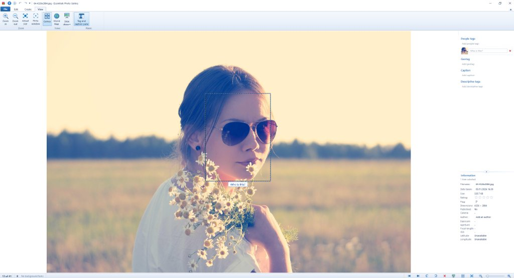
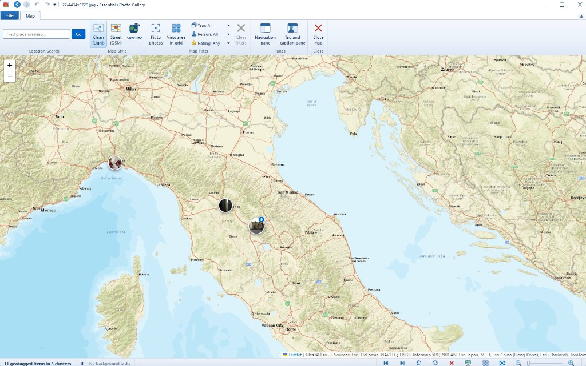
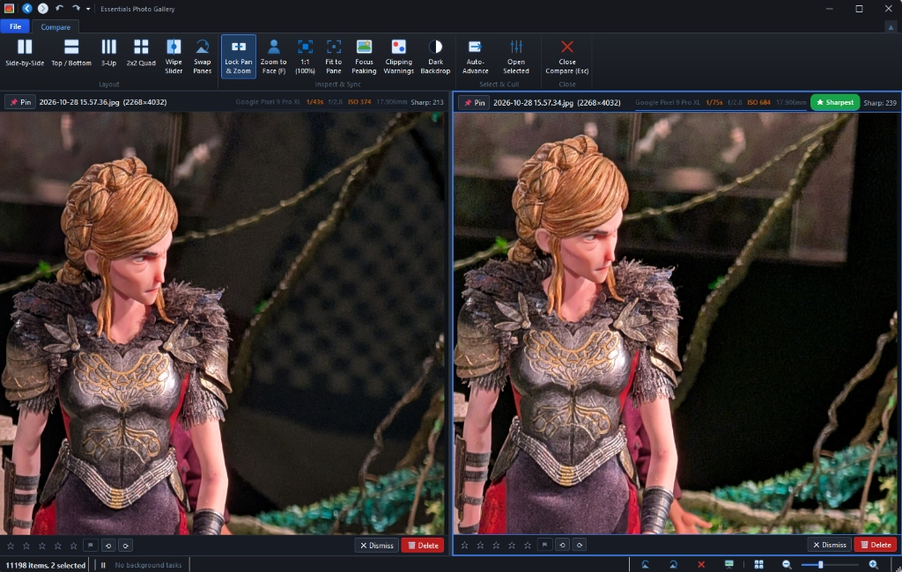
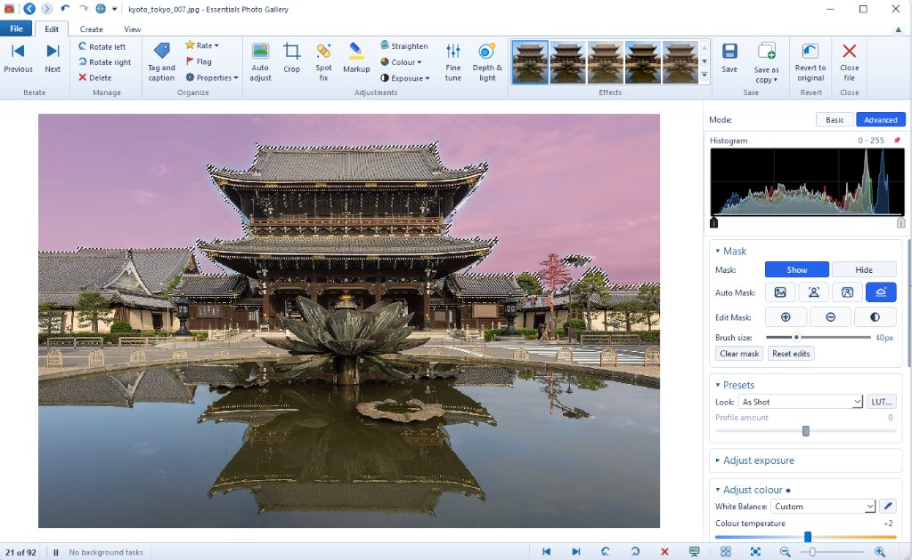
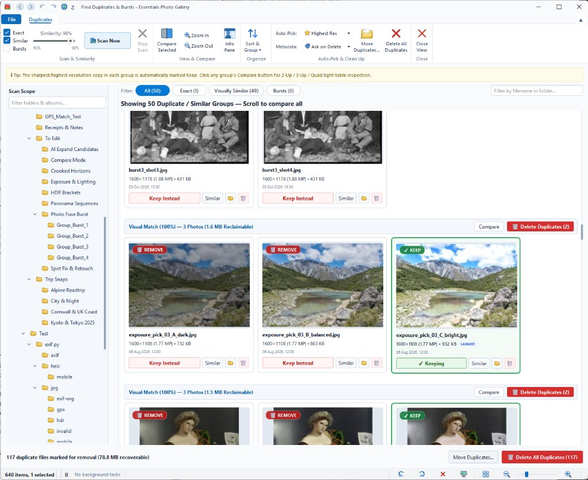

# Essentials Photo Gallery

[](https://github.com/docsucram/Essentials-Photo-Gallery/releases/latest)
[](https://github.com/docsucram/Essentials-Photo-Gallery/releases)
[](https://github.com/docsucram/Essentials-Photo-Gallery/stargazers)
[-0078D6.svg)](https://github.com/docsucram/Essentials-Photo-Gallery/releases/latest)
[](LICENSE)

**Essentials Photo Gallery** is a modern, 64-bit, **100% local & privacy-first** successor to Microsoft's **Windows Live Photo Gallery (WLPG)**.

Microsoft discontinued Windows Essentials in 2017, and for anyone with a large local folder collection of family photos, nothing since has matched how fast, intuitive, and practical WLPG was for browsing, organising, tagging, and quick edits. This project brings that exact workflow back on Windows 10 and 11—engineered for **500,000+ photo libraries** (`<10 ms` queries, `60 FPS` scrolling), modern camera RAW & next-gen codecs, local AI face recognition & OCR, and non-destructive 32-bit editing.

> [!IMPORTANT]
> **Project Status — In Active Development**
> File write-back is **turned off by default** (catalog-only Safe Mode) so tag, rating, and face changes stay strictly in the local database until you explicitly enable write-back. Original files are never altered without an automatic backup in `.OriginalFiles/`. As always, please keep backups of important photos.



| World Map Clustering & Geotagging | Multi-Photo Compare Light Table |
| :---: | :---: |
|  |  |

| Fine Tune Advanced & Regional Sky Masks | Revamped Duplicates & Find Similar |
| :---: | :---: |
|  |  |

---

## Download

Standalone 64-bit Windows installers (`EssentialsPhotoGallery_Setup_x64.exe`) are available on the **[Releases](https://github.com/docsucram/Essentials-Photo-Gallery/releases/latest)** page—no Python setup needed. See [RELEASES.md](RELEASES.md) for version history and release highlights.

*Note: Because this is a hobby open-source project without a paid code-signing certificate, Windows SmartScreen will likely show an "Unknown publisher" warning the first time you run the installer (**More info** -> **Run anyway**).*

---

## Highlights & Features

- **Classic WLPG Ribbon Look & Feel (with Modern Themes, 4 Layouts & Integrated QAT)**
  Recreates the authentic ribbon layout (*Home*, *Edit*, *Find*, *Create*, *View*) plus contextual tabs (*Edit* in Single Image View, *Map* in World Map View, *Compare*, *Duplicates*), integrated title bar with Quick Access Toolbar (QAT), optional left navigation sections (*Albums*, *Folders*, *Date Taken*, *Places*, *Tags*, *People*, *Ratings*, plus optional *Cameras* and AI *Subjects*), and right-hand tag/information pane. Supports three themes (**Classic Aero (Light)**, **Microsoft Fluent (Windows 11)**, and **Dark Studio**), four gallery layout modes (**Grid**, uniform **Tiles**, row-justified **Mosaic**, and portrait-priority **Masonry**), customizable thumbnail **Badges** (Flags, Favourites, Photo groups, plus optional monochrome Geotagged / Descriptive tagged / People tagged indicators), a searchable `F1` Keyboard Shortcuts modal, and custom `Alt+1..9` Quick-Tag hotkeys assignable directly inside **Manage Tags**.

- **Built for Large Libraries (64-Bit Architecture)**
  WLPG was a 32-bit app that would frequently hit out-of-memory errors on large collections or high-megapixel cameras. Essentials Photo Gallery is native 64-bit with virtualised grid scrolling and separate SQLite catalog and thumbnail databases, designed to stay snappy even with **500,000+ photos and videos**.

- **Next-Generation Image Formats, RAW Fast-Path & USB Import**
  Alongside JPEG, PNG, BMP, TIFF, WebP, animated GIFs, and video playback, includes native support for **HEIC / HEIF / HIF**, **AVIF**, **JPEG XL (`.jxl`)**, and proprietary camera **RAW** formats (with embedded JPEG fast-path for instant browsing before full 16-bit demosaicing), Display P3 ICC-to-sRGB colour management, and native Windows **MTP/PTP** camera & smartphone import.

- **Folder Manager, Private Mode & Offline Text-in-Photo OCR**
  Control per-folder scanning (*Scan Always*, *Scan Once*, *Exclude*), opt in to offline **Text-in-Photo OCR** (`Tesseract` / `RapidOCR` / `Windows OCR` with SQLite `FTS5` search and copyable OCR text), and protect sensitive folders with **Private Mode** (PIN lock & idle auto-lock).

- **Multi-Photo Compare Mode, Static Albums & 18-Dimension Boolean Smart Albums**
  Organise photos manually into curated **My Albums** (non-destructive links; removing an item leaves original files untouched), or build live **Smart Albums** using multi-condition **ALL (AND)** / **ANY (OR)** rule builders across People, Tags, Places, Time of Day, Date / On This Day, Camera Make/Model, Rating, Flag, File Type, Orientation, Megapixels, Size, Folder, Caption/Filename, and AI **Subject / Semantic Search**—plus one-click *Save Current Filter as Smart Album...*.

- **WLPG Hierarchical Tagging**
  Full support for nested descriptive tags (`Place/England/London`, `Subject/Occasions/...`), drag-and-drop tag tree management, star ratings, flags, captions, and fast multi-tag filtering—compatible with existing WLPG XMP/EXIF tags.

- **Updated Facial Recognition & People View**
  Replaces WLPG's ageing face detector with local **SCRFD + ArcFace (ONNX)** models for faster, more accurate face detection and suggestions. Includes a dedicated People view, expandable Quick Find People dropdown with corner resizing, face crop view, and batch confirmation tools—all running 100% locally offline.

- **Interactive World Map & Hierarchical Places Tree**
  Full interactive Leaflet world map with a dedicated **Map** ribbon tab (Location Search, Clean/Street/Satellite styles, live Year/Person/Rating map filters synced to the Search Scope bar, drag-to-zoom, and *View area in grid*), persistent disk tile caching, and offline vector canvas fallback. Backed by SQLite R*Tree (`media_rtree`), an offline gazetteer (3,500+ world cities & UK settlements), cached Nominatim reverse geocoding, and a collapsible **Places** hierarchy (`Country -> State / County -> City / Town`).

- **Updated Creation, Editing & Printing Tools**
  Brings back WLPG's multi-photo creation workflows and quick editors without external plugins:
  - **Photo Collage** (grid, masonry, scattered Polaroid, and *Then & Now* layouts)
  - **Photo Fuse** (combine the best smiles/expressions from a burst into one shot)
  - **Panoramic Stitching** (automatic stitcher inspired by Microsoft ICE)
  - **Portrait Depth Blur, Relighting & Colour Pop** alongside Crop/Uncrop, Straighten, Spot Fix (Retouch & Red Eye), Exposure, Colour, Look Profiles & `.cube` 3D LUTs, Video Frame Capture (*Save still frame as photo*), and Vector Markup & Privacy Redaction
  - **Contact Sheet & Photo Printing**

- **Duplicate & Burst Photo Finder, Progressive Find Similar & Optional `MobileCLIP-S1` Semantic Search**
  Extracts perceptual signatures (`pHash`, `dHash`, `Laplacian` sharpness, and `LAB Haar`) directly during thumbnail generation into `thumbnails.db`, powers undoable stack-aware Auto-Stacking for RAW+JPEG pairs and burst sequences, and finds exact duplicates or visually similar photos (non-blocking, NumPy-vectorized, and automatically blended with local AI semantics when installed) with safe Recycle Bin cleanup. Optionally install the `MobileCLIP-S1` ONNX add-on in **File → Options → Add-ons** for offline natural-language photo search (fused with FTS5) and **Subjects** filtering.

---

## Supported Formats

| Category | Formats |
| :--- | :--- |
| **Standard & Animated Images** | `JPG`/`JPEG`, `PNG`, `BMP`, `TIFF`/`TIF`, `WebP` (static & animated), `GIF` (animated), `ICO` |
| **Next-Gen & Wide-Gamut** | `HEIC`, `HEIF`, `HIF`, `AVIF`, `JPEG XL (.jxl)` — with LittleCMS2 Display P3 / Adobe RGB → sRGB colour management |
| **Camera RAW (Non-Destructive)** | `CR2`, `CR3`, `NEF`, `ARW`, `RAF`, `DNG`, `ORF`, `RW2`, `PEF`, `SRW` (+ Windows Imaging Component fallback) |
| **Videos** | `MP4`, `MOV`, `M4V`, `MKV`, `AVI`, `WMV`, `FLV`, `WebM`, `3GP`, `TS`, `MTS`, `M2TS` |

---

## Metadata, Non-Destructive Safety & Data Ownership

Essentials Photo Gallery is **100% folder-first and local**: your photos stay in your existing folders with no cloud account, no subscription, and no telemetry.

- **Catalog-Only Safe Mode (Default):** Ratings, flags, descriptive tags, captions, people tags, albums, smart albums, OCR text, and face embeddings live strictly in `%LOCALAPPDATA%\PhotoGallery\db\catalog.db` (and WebP thumbnails in `thumbnails.db`) until you explicitly enable **Write to files** in **File → Options**.
- **Surgical XMP Write-Back:** When write-back is enabled, metadata writes preserve unrelated third-party XMP namespaces (such as Adobe Lightroom / Camera Raw `crs:*` develop settings, darktable edit history, and copyright fields), preserve file modification timestamps (`mtime`), and always write `.xmp` sidecars for camera RAW files rather than touching RAW containers.
- **OneDrive Files On-Demand Safe:** Online-only cloud placeholders (`OFFLINE` / `RECALL_ON_OPEN` / `RECALL_ON_DATA_ACCESS`) are never opened by background scanners, thumbnail workers, face detection, OCR, or duplicate hashing—so browsing never triggers unintended gigabyte cloud downloads.
- **Automatic `.OriginalFiles/` Backups:** Before saving destructive image edits, Essentials Photo Gallery stashes an untouched original in `<folder>/.OriginalFiles/` so you can revert to original at any time.

---

## Uninstall & Clean Up

Uninstalling Essentials Photo Gallery (or removing its database) **never deletes your photos or videos**.

1. Open **Windows Settings → Apps → Installed apps**, find **Essentials Photo Gallery**, and choose **Uninstall**.
2. *(Optional)* To also remove the local catalog database, thumbnail cache, logs, and optional downloaded AI models:
   ```powershell
   Remove-Item -Recurse -Force -ErrorAction SilentlyContinue "$env:LOCALAPPDATA\PhotoGallery"
   ```

---

## Running from Source

Requires **Python 3.11–3.13 (64-bit)** on Windows 10 or 11.

```powershell
# Clone the repo
git clone https://github.com/docsucram/Essentials-Photo-Gallery.git
cd Essentials-Photo-Gallery

# Set up a virtual environment
python -m venv venv
venv\Scripts\activate

# Install dependencies and launch
pip install -r requirements.txt
python main.py
```

### Building the `.exe` & Installer

If you want to build a standalone executable or installer locally (installer requires [Inno Setup 6](https://jrsoftware.org/isinfo.php)):

```cmd
1_build_exe.bat         :: Builds standalone 64-bit app via PyInstaller
2_test_exe.bat          :: Runs the compiled build
3_build_installer.bat   :: Packages EssentialsPhotoGallery_Setup_x64.exe
```

---

## License

Released under the [MIT License](LICENSE).
