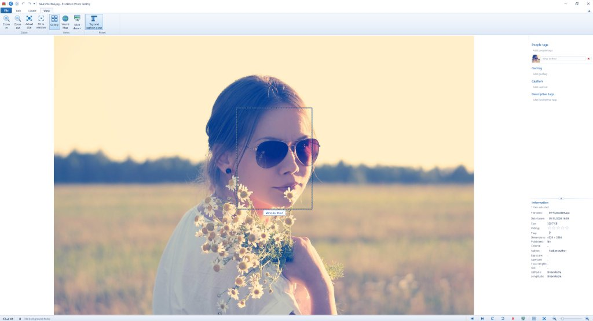

# Essentials Photo Gallery

[](https://github.com/docsucram/Essentials-Photo-Gallery/releases/latest)
[-0078D6.svg)](https://github.com/docsucram/Essentials-Photo-Gallery/releases/latest)
[](LICENSE)

**Essentials Photo Gallery** is a modern, 64-bit update to Microsoft's long-abandoned **Windows Live Photo Gallery (WLPG)**.

Microsoft discontinued Windows Essentials back in 2017, and for anyone with a big local folder collection of family photos, nothing since has quite matched how fast, intuitive, and practical WLPG was for browsing, organising, tagging, and doing quick edits. This project brings that exact feel and workflow back on Windows 10 and 11—fixing WLPG's old limitations while adding modern tools for large local libraries.

> [!IMPORTANT]
> **Project Status — In Active Development**
> This project is still actively being developed and tested. File write-back is **turned off by default**, and if you are trying it out on an existing photo collection, **it is strongly recommended to leave file write-back turned off** so tag and metadata changes stay in the local database rather than modifying your original image files. As always, please keep backups of important photos.



---

## Download

Standalone 64-bit Windows installers (`EssentialsPhotoGallery_Setup_x64.exe`) are available on the **[Releases](https://github.com/docsucram/Essentials-Photo-Gallery/releases/latest)** page—no Python setup needed. See [RELEASES.md](RELEASES.md) for version history and release highlights.

*Note: Because this is a hobby open-source project without a paid code-signing certificate, Windows SmartScreen will likely show an "Unknown publisher" warning the first time you run the installer (**More info** -> **Run anyway**).*

---

## Highlights & Features

- **Classic WLPG Ribbon Look & Feel (with Modern Themes & Integrated QAT)**
  Recreates the authentic ribbon layout (*Home*, *Edit*, *Find*, *Create*, *View*) plus contextual tabs (*Edit* in Single Image View, *Map* in World Map View), integrated title bar with Quick Access Toolbar (QAT), left navigation tree, and right-hand tag/information pane. Supports three themes: **Classic Aero (Light)**, modern **Microsoft Fluent (Windows 11)** with vector icons and dynamic tab indicator, and **Dark Studio**.

- **Built for Large Libraries (64-Bit Architecture)**
  WLPG was a 32-bit app that would frequently hit out-of-memory errors on large collections or high-megapixel cameras. Essentials Photo Gallery is native 64-bit with virtualised grid scrolling and separate SQLite catalog and thumbnail databases, designed to stay snappy even with **500,000+ photos and videos**.

- **Next-Generation Image Formats & Camera RAW**
  Alongside JPEG, PNG, BMP, TIFF, WebP, animated GIFs, and video playback, includes native support for **HEIC / HEIF / HIF**, **AVIF**, **JPEG XL (`.jxl`)**, and proprietary camera **RAW** formats—complete with automatic Display P3 ICC-to-sRGB colour management and sidecar-safe metadata handling.

- **Static Albums & 17-Dimension Boolean Smart Albums**
  Organise photos manually into curated **My Albums** (non-destructive links; removing an item leaves original files untouched), or build live **Smart Albums** using multi-condition **ALL (AND)** / **ANY (OR)** rule builders across People, Tags, Places, Time of Day, Date / On This Day, Camera Make/Model, Rating, Flag, File Type, Orientation, Megapixels, Size, Folder, and Caption/Filename—plus one-click *Save Current Filter as Smart Album...*.

- **WLPG Hierarchical Tagging**
  Full support for nested descriptive tags (`Place/England/London`, `Subject/Occasions/...`), drag-and-drop tag tree management, star ratings, flags, captions, and fast multi-tag filtering—compatible with existing WLPG XMP/EXIF tags.

- **Updated Facial Recognition & People View**
  Replaces WLPG's ageing face detector with local **SCRFD + ArcFace (ONNX)** models for faster, more accurate face detection and suggestions. Includes a dedicated People view, expandable Quick Find People dropdown with corner resizing, face crop view, and batch confirmation tools—all running 100% locally offline.

- **Interactive World Map & Hierarchical Places Tree**
  Full interactive Leaflet world map with a dedicated **Map** ribbon tab (Location Search, Clean/Street/Satellite styles, live Year/Person/Rating map filters synced to the Search Scope bar, drag-to-zoom, and *View area in grid*), persistent disk tile caching, and offline vector canvas fallback. Backed by SQLite R*Tree (`media_rtree`), an offline gazetteer (3,500+ world cities & UK settlements), cached Nominatim reverse geocoding, and a collapsible **Places** hierarchy (`Country -> State / County -> City / Town`).

- **Updated Creation, Editing & Printing Tools**
  Brings back WLPG's multi-photo creation workflows and quick editors without external plugins:
  - **Photo Collage** (grid, masonry, scattered Polaroid, and *Then & Now* layouts)
  - **Photo Fuse** (combine the best smiles/expressions from a burst into one shot)
  - **Panoramic Stitching** (automatic stitcher inspired by Microsoft ICE)
  - **Portrait Depth Blur, Relighting & Colour Pop** alongside Crop/Uncrop, Straighten, Spot Fix (Retouch & Red Eye), Exposure, Colour, Effects, and Vector Markup & Privacy Redaction
  - **Contact Sheet & Photo Printing**

- **Duplicate & Burst Photo Finder**
  Finds exact file duplicates, resized/re-saved copies (via perceptual hashing), and rapid burst sequences, with side-by-side sharpness comparison to help clean up clutter safely via the Recycle Bin.

---

## Running from Source

Requires **Python 3.11–3.13 (64-bit)** on Windows 10 or 11.

```powershell
# Clone the repo
git clone https://github.com/docsucram/Essentials-Photo-Gallery.git
cd Essentials-Photo-Gallery

# Set up a virtual environment
python -m venv venv
venv\Scripts\activate

# Install dependencies and launch
pip install -r requirements.txt
python main.py
```

### Building the `.exe` & Installer

If you want to build a standalone executable or installer locally (installer requires [Inno Setup 6](https://jrsoftware.org/isinfo.php)):

```cmd
1_build_exe.bat         :: Builds standalone 64-bit app via PyInstaller
2_test_exe.bat          :: Runs the compiled build
3_build_installer.bat   :: Packages EssentialsPhotoGallery_Setup_x64.exe
```

---

## License

Released under the [MIT License](LICENSE).
