# Essentials Photo Gallery — Releases

Release history matching the published GitHub Releases (`EssentialsPhotoGallery_Setup_x64.exe`).

---

## Essentials Photo Gallery v0.19.0

**Essentials Photo Gallery 0.19.0** introduces a redesigned contextual **Markup Studio**, a dedicated contextual **Crop & Perspective** Ribbon tab, configurable **Auto Adjust**, **`Shift+Drag` Line Healing** in Spot Fix, **relocatable databases & cache** with integrity verification, **resumable SHA-256 add-on downloads**, and **automatic startup update checks with inline release notes**.

### Highlights

- **Contextual Crop Ribbon, Live Keystone Perspective & Configurable Auto Adjust:**
  - Selecting **Crop** in Single Image View opens a dedicated 5-group contextual **Crop** tab (`Aspect Ratio` with **Swap Aspect**, `Orientation` with **Flip horizontal / Flip vertical** and **3×3 / 4×4 / Fine 9×9 Grid**, `Straighten & Perspective` sliders + **Line / Auto ▾ / Reset**, **AI Expand** fill, and crisp green-tick **Apply crop** / **Cancel crop**), automatically returning to `Edit` on apply or cancel.
  - **Vertical & Horizontal Perspective Sliders (`-100..+100`):** Correct tilting buildings and keystoned horizons with live GPU proxy previews, analytical inscribed zero-black-wedge auto-crop, and confidence-gated **Auto → Perspective**.
  - **Configurable `Edit → Auto adjust ▾` Split Menu:** Toggle any of 7 independent adjustment passes (**Exposure & contrast**, **Colour & white balance**, **Detail & crispness**, **Reduce noise (low light)**, **Remove haze**, **Straighten**, **Perspective**) with smart defaults and noise-aware sharpening.
- **Dedicated Contextual Markup Studio Ribbon (`Edit | Create | View | Markup`) & Text UX:**
  - Selecting **Markup** opens a dedicated contextual **Markup** tab with 9 WLPG category buttons (**Select**, **Pen**, **Text**, **Shapes ▾**, **Line ▾**, **Obscure ▾**, **Stickers ▾**, **Magnify**, **Stamp ▾**), visual MS Paint-style **Shapes** & **Stickers** galleries, a compact Canva/Fluent-style `[ − | pt | + ]` **Text Size** stepper (`12–440 pt`), a wider unclipped **Text Style** selector (`Pill`, `Outline`, `Shadow`, `Plain`), resolution-aware stroke sizing, **Select (`V`)** session reselection, 120 FPS live rotation, expanded 16-colour + rainbow wheel palette, and EXIF/GPS/Watermark stamps.
  - **Drag-Border Before Commit, Double-Click In-Place Text Edit & Live Effects:** Drag the dashed blue border of an active inline Text box to reposition it before committing and click back inside to keep typing until pressing `Enter` or clicking away; double-click existing text to edit it in place with a clean single-step Undo/Redo stack; **Outline**, **Shadow**, and **Left / Center / Right** alignment apply immediately from the first keystroke; pressing `Delete` in Markup mode only removes active markup (never the photo), and markup renders immediately even on cropped or Fine-Tuned photos.

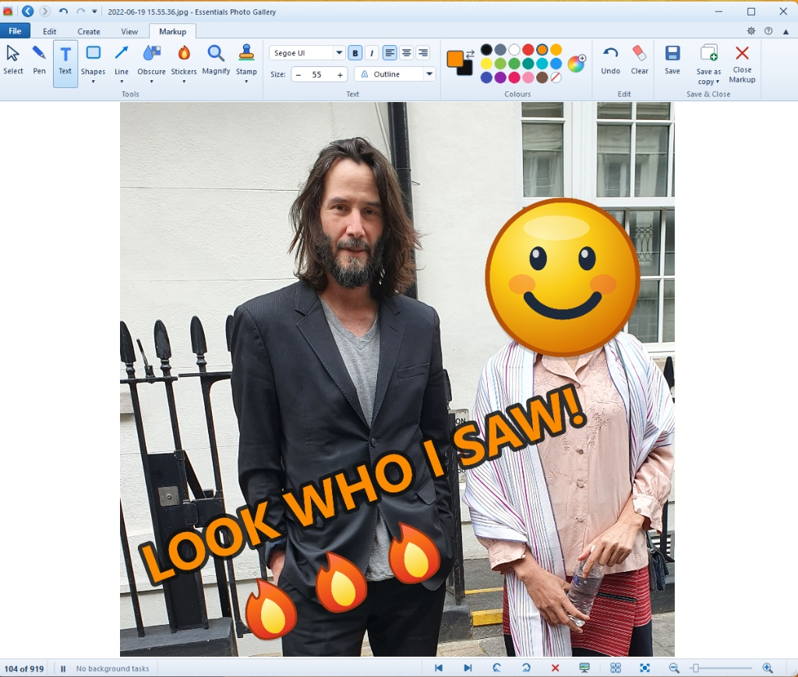
- **Spot Fix Line Healing, Edit Ribbon States & Unified Keyboard Workflow:**
  - **Straight Line Mode (`Shift+Drag`):** Heal telephone wires, film scratches, and power lines in Spot Fix with a live brush-width + dashed center-guide preview in one undoable stroke.
  - **Active Side-Pane Highlighting & Mask Cleanup:** **Fine tune** and **Depth & Light** remain highlighted on the **Edit** ribbon while open and automatically clear any active mask overlays or eyedropper modes when dismissed; closing the app with uncommitted edits or active markup prompts with **Save / Save as copy / Discard / Cancel**.
  - **Unified Hold-to-Compare (`B`) & Lightroom Culling (`Z` / `X`):** Press and hold **`B`** (*Before*, works identically on ANSI and UK ISO keyboards) in **Spot Fix**, **Fine Tune**, or **Depth & Light** to compare against the original photo; press **`Z` / `Shift+Z`** (Pick) and **`X` / `Shift+X`** (Reject) to cull and auto-advance.
- **Relocatable Database & Cache, Integrity Checks & Resilient Downloads:**
  - **Move Database & Thumbnail Cache (`Options → Database`):** Relocate `catalog.db`, `thumbnails.db`, and optional AI vectors to another drive or folder with background worker draining, byte-verified migration, offline-drive startup recovery prompts, and a redesigned 3-card **Database** tab with one-click **Check Integrity** (`PRAGMA quick_check(1)`).
  - **Resumable Add-on Downloads & Content-Sniffed Image Fallback:** Optional AI add-ons resume interrupted HTTP transfers from `.part` files and verify `X-Linked-Etag` SHA-256 digests, while misnamed PNG/WebP images (e.g. from messaging apps) decode cleanly by inspecting magic bytes.
- **Auto-Update Checks, Inline Release Notes, Cleaner Defaults & Options Polish:**
  - Quietly checks GitHub Releases on startup (**Daily**, **Weekly [default]**, or **Monthly** in **Options → General**), renders clean inline release notes in **Update Available** and **Help → About**, turns **Home → Photo stacks** into a master toggle remembering **Bursts** / **RAW + JPEG** preferences, refines first-install defaults (**Auto-stack RAW + JPEG** on, **JPEG Quality 90%**, clean default **Navigation Pane** sections, simplified **Subjects** label), and rewrites **Options** tooltips to lead with plain English plus full Dark Studio contrast.
- **Video Handling, Immersive `F4` & Filmstrip Smoothness:**
  - Suppresses Markup tools in **Immersive (`F4`)**, places themed **Exit Immersive (`F4`)** in the title bar, adds Play badges and video frame capture in Spacebar **Quick Preview**, adds clear video-unavailable cards in Fine Tune / Depth & Light / Colour Pop / Compare, and eliminates filmstrip minimize flicker.

Full Technical Changelog

- **Contextual Crop & Perspective Pipeline (`src/imaging/opencv_engine.py`, `src/ui/crop_tool.py`, `src/ui/ribbon_toolbar.py`, `src/ui/media_viewer.py`, `src/ui/main_window.py`):**
  - Added `perspective_v`, `perspective_h`, `flip_h`, and `flip_v` to `PhotoAdjustmentRecipe` alongside `build_perspective_homography()`, `compute_inscribed_rect_for_homography()`, `apply_geometry_transform()`, and `estimate_auto_perspective()`.
  - Built 5-group contextual `tab_crop` with Dark Studio theme support, `Fine Grid (9×9)`, live proxy perspective preview anchored at `(0, 0)`, strict fixed-aspect-ratio preservation when dragging outside image bounds, and single-step undo across Crop + Flip + Straighten + Perspective.
  - Added `DEFAULT_AUTO_ADJUST_OPTIONS` and `_make_split_auto_adjust_button()` persisting 7 toggleable `Auto adjust` passes to `QSettings` for both Single Viewer and Batch Auto Adjust.
- **Contextual Markup Ribbon, WYSIWYG Text, Spot Fix & Workflow Polish (`src/ui/ribbon_toolbar.py`, `src/ui/markup_overlay.py`, `src/ui/media_viewer.py`, `src/imaging/opencv_engine.py`, `src/ui/right_tag_dock.py`, `src/ui/shortcuts_dialog.py`, `src/ui/grid_view.py`, `src/ui/compare_view.py`, `src/ui/quick_preview_dialog.py`):**
  - Added `_AdaptiveStackedWidget`, `_make_mk_split_tool_button()`, compact 3-digit `Size` stepper + wider `Text Style` dropdown, border hit-testing & repositioning (`_hit_test_inline_text_border`, `_move_inline_text_box_to`) before commit, direct `QPainterPath`/shadow rendering inside `_InlineTextEdit.paintEvent()`, double-click in-place text editing (`edit_active_markup_text()`) with clean deep-cloned Markup undo/redo snapshots, immediate multi-line inline & committed text alignment, Markup `Delete`-key photo guard, `invalidate_stage_cache()` so Markup renders immediately over cropped/adjusted photos, resolution-aware stroke defaults (`16px` / `short_edge / 120`), `flatten_markup_element_roi()`, `PixelArrayUndoCommand.from_roi_patch()`, `_start_retouch(..., straight_line=True)` for `Shift+Drag` line healing, `set_edit_pane_mode` / `clear_depth_light_session()` active-pane sync & mask cleanup, global `Key_B` Hold-to-Compare, Lightroom-aligned `Key_Z` (`Pick`) / `Key_X` (`Reject`) shortcuts, and `MainWindow.closeEvent()` unsaved-edits guard.
- **Storage Reliability, Resumable Downloads & Format Sniffing (`src/utils/downloader.py`, `src/db/connection.py`, `src/utils/paths.py`, `src/imaging/image_loader.py`, `src/workers/scanner_thumb_worker.py`, `main.py`):**
  - Extracted `download_file_resumable()` (`Range` resume, `Content-Length` check, `X-Linked-Etag` SHA-256 verification, HTML guard) for LaMa, u2netp, MobileCLIP-S1, and RapidOCR add-ons.
  - Added `quick_check_db()`, `checkpoint_and_close_all()`, `migrate_database_directory()`, custom DB path helpers + offline-volume recovery dialog on startup, and `sniff_image_format()` + `QImageReader.setDecideFormatFromContent(True)`.
- **Auto-Updates, Offline Release Notes, Defaults & Options Redesign (`src/version.py`, `src/ui/dialogs.py`, `src/ui/options_dialog.py`, `src/ui/left_nav_dock.py`, `photogallery.spec`):**
  - Added `sanitize_release_notes_markdown()`, `load_local_release_notes()`, configurable daily/weekly/monthly `should_run_auto_update_check()`, `UpdateAvailableDialog` + expandable `AboutDialog` release notes, bundled `RELEASES.md` in `photogallery.spec`, updated first-install defaults (`jpeg_quality=90`, `auto_group_raw_jpeg=True`, `retention_days=180`, clean `LeftNavDock` initial expand/visibility state, `"Show Subjects"` label), redesigned **Options → Database** & **General** cards, added 2×2 maintenance grid + Dark Mode styling to `FaceRecognitionOptionsTab`, and rewrote Options tooltips to lead with plain English.
- **Video Polish & Non-Flickering Filmstrip (`src/ui/right_tag_dock.py`, `src/ui/quick_preview_dialog.py`, `src/ui/compare_view.py`, `src/ui/bottom_filmstrip_dock.py`):**
  - Added `VideoUnavailablePage` (`set_video_mode`), video thumbnails + Play badges in `QuickPreviewDialog`, video guards in Compare / Colour Pop, and froze `QListView` relayout during `BottomFilmstripDock.animate_visible()`.

---

## Essentials Photo Gallery v0.18.0

**Essentials Photo Gallery 0.18.0** delivers major **large-library performance & responsiveness upgrades**—cutting cold startup from **~14.2 s → ~3.2 s**, making navigation pane refreshes up to **6×–22× faster** at 500,000 photos, **Batch People Tagging** up to **10× faster**, and making **Find Similar**, **People Directory**, **AI Straighten / Expand**, **Retouch**, and **Visual Signature Backfill** completely non-blocking—alongside **new monochrome tag badges**, **Photo stacks** filtering & tooltips, **Semantic Smart Albums**, and **Auto Exposure / Auto Color / Fine Tune** polish.

### Highlights

- **Much Faster Launch, Navigation Pane & Zero-Freeze Editing:**
  - Cut cold startup on a 92k-photo library from **~14.2 s → ~3.2 s**, and made Navigation pane refreshes **6×–7× faster** at 500,000 photos with scoped incremental refreshes that update only the affected sections.
  - **Batch People Tagging** opens up to **10× faster** (~28 ms at 500k photos / 333k faces), **People Directory** loads asynchronously without stalling the UI, and **AI Straighten / Expand** plus large **Retouch / Spot Heal** strokes run off the GUI thread.
- **Smarter, Non-Blocking Find Similar, Faster Duplicate Scans & Semantic Smart Albums:**
  - **Find Similar** (right-click any photo, right below **Scan ▸**) opens **immediately** with already-cached matches (no blocking modal dialog), streams progressive matches via a sleek inline Scope Bar progress bar + **Stop** button, scores in vectorized NumPy (`~200×` faster), and blends local **MobileCLIP-S1** semantic similarity with visual similarity (falling back cleanly to pure visual signatures whenever MobileCLIP-S1 is not installed).
  - A gentle, very-low-priority **Visual Signature Backfill** worker quietly indexes `media_signatures` in the background from already-cached thumbnails in `thumbnails.db` (**zero** disk or OneDrive reads, respects **Pause Background Tasks**) so **Find Similar** is instant.
  - **Find Duplicates** reuses cached thumbnail-time visual signatures & sharpness, resolves folder paths across all scan scopes, and uses sharpness as a tie-breaker in Auto-Pick.
  - **Smart Albums** now support **Subject / Semantic Search (AI)** rules matching any of the 12 built-in Subjects or natural-language queries (e.g. *"golden retriever on beach"*).
- **Photo Stacks, Monochrome Tag Badges & Gallery Polish:**
  - Renamed *Photo grouping* to **Photo stacks**, added a **View stacks only** filter in **Home → Photo stacks ▾** (with a removable Scope Bar chip), upgraded stack hover tooltips to list the first 5 filenames (`+ (and N more)`), and upgraded **Stack-Aware Delete, Move & Rename** for RAW+JPEG pairs and bursts.
  - Added three default-off monochrome vector badges in **View → Badges ▾** (**Geotagged**, **Descriptive tagged**, **People tagged**, zero query overhead when off) stacking cleanly in the **bottom-left** corner alongside any **Photo stack** or **Motion photo** pill, and made the **Motion photos** badge togglable (default on).
  - Added translucent top-right **Flag** squircles in Mosaic/Tiles/Masonry, widened and inset the gallery scrollbar so it stays easy to grab when the right pane is closed, made **Favourites** always on, tightened **Photo stacks** and **Descriptive tag** ribbon widths, clarified **Geotag ▾** menu labels, and added **Video Frame Capture** ("Save still frame as photo") in Single Media Viewer.
- **Upgraded Auto Exposure / Auto Color, Fine Tune & Map View Polish:**
  - Upgraded **Auto Exposure** (key-aware and highlight-safe) and **Auto Color** (near-neutral CIE Lab white balance + adaptive saturation), aligned the 9-tile Exposure & Color preset grids to classic WLPG ordering with hover tooltips, restyled Fine Tune dropdowns with crisp SVG chevrons, redesigned the **WB Eyedropper** and **Line Straighten** icons, added **Reset to default** icons across the app, and kept the **Favourite / Flag HUD** visible when Fine Tune is open.
  - **World Map View** now automatically generates thumbnails for all visible uncached blue cluster circles in parallel while browsing, and clicking a cluster filters directly without a throwaway full-library query.

Full Technical Changelog

- **Duplicate Finder `media_signatures` Reuse & Sharpness Tie-Breaker (`src/core/duplicate_finder.py`):**
  - `_enrich_burst_face_sharpness()` skips decoding burst thumbnails/files when a photo has no detected faces and already carries cached `laplacian_sharpness > 0.0` from `media_signatures`.
  - `auto_recommend_rules("highest_resolution")` now includes cached `sharpness` as a tie-breaker after pixel area and file size.
- **Semantic-Blended `Find Similar` (`src/core/duplicate_finder.py`, `src/ui/main_window.py`):**
  - `DuplicateDetectionEngine.find_similar_to_photo()` blends MobileCLIP-S1 cosine similarity (`0.45` weight) with visual color/pHash/dHash similarity (`0.55` weight) whenever the optional Semantic AI add-on is installed and the anchor photo is indexed.
- **Smart Albums Semantic Subject / Search Filter (`src/ui/smart_album_dialog.py`, `src/db/repository.py`, `src/ui/main_window.py`):**
  - Added `"semantic_subject"` (`"Subject / Semantic Search (AI)"`, `matches` / `not_matches`) to `SMART_FIELD_SPECS` with built-in Subject preset autocomplete and free-text query support, compiled via `set_smart_album_semantic_provider()` inside `compile_smart_album_where()`.
- **Update Available Dialog Sizing (`src/ui/dialogs.py`):**
  - Fixed clipped button labels (`Download & Install` / `Open Release Page`) in the Update Available dialog on Windows scaling.
- **UI Polish — Mosaic Flag Badges, Info Pane & Ribbon Menus (`src/ui/grid_view.py`, `src/ui/right_tag_dock.py`, `src/ui/ribbon_toolbar.py`):**
  - Added translucent top-right **Flag** (Pick/Reject) squircle badges matching Favourites/Ratings across **Mosaic**, **Tiles**, and **Masonry** layouts.
  - Aligned editable fields (`Filename`, `Date taken`, `Author`) and the `Flag` icon flush with static labels in the **Information** pane, upgraded **Folder** to display compact middle-elided paths (e.g. `D:/Users/M...Photos/September trip`), moved GPS **Coordinates** into the **Geotag** hover tooltip with right-click **Copy coordinates**, and kept mouse-selectable `Latitude`/`Longitude` in Information.
  - Tightened Ribbon and context menu icon-to-text padding (`8px`), lowered large Find Ribbon dropdown arrows, fixed `Find → Flagged` (`Picked` / `Rejected` / `Not flagged`) filtering, fixed View Ribbon responsive overlap, widened Home split buttons (`Geotag`/`Rate`/`Flag`), audited all `make_wlpg_icon()` calls (zero fallback icons remaining), and retained fade-out snapshot overlays so smooth 140 ms menu fade-outs render reliably.
- **New Default-Off Monochrome Tag Badges, Motion Badge Toggle & Always-On Favourites (`src/db/repository.py`, `src/ui/grid_view.py`, `src/ui/ribbon_toolbar.py`, `src/ui/main_window.py`, `src/ui/dialogs.py`):**
  - Added **Geotagged**, **Descriptive tagged**, and **People tagged** (confirmed `state = 1`) default-off badges to **View → Badges**, annotated lazily in `CatalogRepository.annotate_tag_badges()` only when enabled and drawn as crisp monochrome vector outlines in the **bottom-left** corner after any Stack/Motion pill.
  - Made the existing **Motion photos** badge togglable in **View → Badges ▾** (default on, persisted as `badge_show_motion`).
  - Removed the redundant *Enable Favourites* Options checkbox and cleaned up conditional `favourites_enabled` gating across 9 UI modules.
  - Widened `QScrollBar:vertical` across all 3 QSS themes (`5px → 10px` with `2px` right inset) and tightened frameless right-edge resize hit-testing (`8px → 4px` in `src/ui/win32_frame.py`) so the gallery scrollbar is never clipped when the right pane is closed.
- **Photo Stacks Filter, Tooltips & Ribbon Polish (`src/ui/ribbon_toolbar.py`, `src/ui/grid_view.py`, `src/ui/search_scope_bar.py`, `src/ui/main_window.py`):**
  - Renamed *Photo grouping* to **Photo stacks** across ribbon, menus, and tooltips; upgraded collapsed stack hover tooltips to list the first 5 filenames (`+ (and N more)`).
  - Added **View stacks only** in **Home → Photo stacks ▾** (`set_stacks_only_filter`) with a removable **Photo stacks** chip in `SearchScopeBar`.
  - Tightened **Photo stacks** (`74px → 58px`) and **Descriptive tag** (`80px → 68px`) ribbon button widths, and simplified **Geotag ▾** menu phrasing (`Add or Edit Location...`, `Copy GPS from Phone Photos or GPX...`).
- **Async Retouch, Async People Directory & Low-Priority Signature Backfill (`src/ui/media_viewer.py`, `src/ui/people_directory_view.py`, `src/workers/signature_backfill_worker.py`, `src/ui/main_window.py`):**
  - Offloaded large **Retouch / Spot Heal** strokes (`ROI > 160,000 px`) in `SingleMediaViewer._finish_retouch()` to a dedicated 1-thread `QThreadPool` with `(media_id, generation)` cancellation guards, and kept the **Favourite / Flag HUD** visible when **Fine Tune** is open during Quick Effects hover previews.
  - Made `PeopleDirectoryView.refresh_directory()` query `get_named_people_directory_data()` asynchronously on a background `QRunnable` with generation guards to eliminate the initial ~2 s People view stall.
  - Added `SignatureBackfillWorker` (`src/workers/signature_backfill_worker.py`), starting 10 s after startup reconciliation to backfill `media_signatures` exclusively from already-cached `thumbnails.db` WebP blobs (`0` disk/OneDrive reads, `60 ms` yield per 50-item chunk, pauses with **Pause Background Tasks**, exits permanently once caught up).
- **Non-Blocking Progressive `Find Similar` & Freeze-Log Elimination (`src/core/duplicate_finder.py`, `src/ui/search_scope_bar.py`, `src/ui/main_window.py`, `src/ui/left_nav_dock.py`, `src/ui/map_view.py`):**
  - Replaced the blocking `QProgressDialog` with instant cached similarity results + streaming `partial_cb` indexing via a sleek 6 px pill progress bar + **Stop** button inside `SearchScopeBar`, and vectorized `_score_batch()` in NumPy (`~200×` faster, releasing the GIL; 10k photos scored in `~51 ms`).
  - Staggered `_on_startup_reconciliation_completed()` scoped nav refreshes (skipping non-folder sections when only folder metadata changed), suppressed the throwaway full-library query on Map cluster click (`clear_all_filters(emit_signal=False)`), skipped refreshing `bottom_dock` filmstrip while hidden in Gallery Grid, fixed Duplicate Finder `folder_id → folder_path` resolution, and coalesced Map View `gallerythumb://` cache misses (`cancel_others=False`) so all visible blue clusters generate thumbnails in parallel.
- **Edit Presets, Auto Adjust & Fine Tune Polish (`src/imaging/opencv_engine.py`, `src/ui/ribbon_toolbar.py`, `src/ui/right_tag_dock.py`, `src/ui/media_viewer.py`, `src/ui/dialogs.py`, `src/ui/folder_manager_dialog.py`):**
  - Upgraded `analyze_auto_adjust()` with key-aware / highlight-safe Auto Exposure, near-neutral CIE Lab midtone white balance (with damped Gray-World fallback), and adaptive saturation.
  - Aligned Exposure (`Brighter` top → `Darker` bottom) and Color (`High/magenta tint` top → `Low/green tint` bottom) 3×3 preset grids to classic WLPG ordering with descriptive hover tooltips on all 9 tiles and Auto buttons.
  - Styled Fine Tune combo boxes (`Look`, `White Balance`, `Tone Curve`) with `arrow_dropdown_mini.svg` chevrons, kept `btn_mask_fill` neutral when checked (red dot toggle only), redesigned the WB **Eyedropper** and **Horizon Line-Straighten** (`"line_straighten"`) icons, and added `"restore"` icons to **Reset to default** buttons across the app.
- **Quick-Tag Shortcuts & Navigation Pane Context Menus (`src/ui/tag_hierarchy_dialog.py`, `src/ui/shortcuts_dialog.py`, `src/ui/left_nav_dock.py`, `src/ui/right_tag_dock.py`):**
  - Fixed `Qt.UserRole` vs `_NODE_TYPE_ROLE` collision in **Manage Tags** (`TagHierarchyDialog`), upgraded it to a 2-column tree with right-aligned `Alt+1..9` badges, an inline active-shortcuts header summary, and right-click **Assign keyboard shortcut ▸ / Clear shortcut / Delete tag**, alongside shortcut menus in Left Nav & Right Tag Pane.
  - Added **Expand all** / **Collapse all** to Navigation Pane root context menus (**Albums**, **Date taken**, **Descriptive tags**, **Places**) and **Collapse** / **Expand** to **Folders**, **People**, **Ratings**, **Cameras**, and **Subjects**.
- **Faster App Launch & Unified Image Context Menu (`src/db/connection.py`, `src/ui/main_window.py`, `src/ui/left_nav_dock.py`, `src/ui/grid_view.py`, `src/ui/media_viewer.py`, `src/ui/compare_view.py`, `src/ui/ribbon_toolbar.py`):**
  - Guarded the legacy `confirmed_count` people migration in `DualDatabaseEngine._migrate_catalog_schema()` with `schema_flags` (`migrate_confirmed_people_v1`), cutting database startup from **~9.5 s → ~32 ms** on a 92k-photo / 504 MB catalog (`~14.2 s → ~4.0 s` total launch).
  - Eliminated duplicate startup `apply_theme()` (~500 ms), deduplicated `RightTagDock` / `RibbonToolbar` theme & hidden responsive layout passes, cached `icon_provider` directory lookups, added covering partial indexes for `get_people_list()` (`300 ms → 109 ms`) and `get_tag_tree()` (`147 ms → 62 ms`), lazily initialized `QMediaPlayer` / FFmpeg until first video/motion photo playback, skipped `query_camera_counts()` when hidden, and deferred `deduplicate_media_people()` to 2.2 s post-launch — bringing total cold launch on a 92k-photo / 504 MB catalog down from **`~14.2 s` → `~3.2 s`**.
  - Unified the photo right-click context menu across **Thumbnail Grid** and **Single Image View** with clean **Flag ▸** (*Mark as Favourite*, *Pick*, *Reject*, *Unflag*), **Edit ▸** (*Rotate left/right*, *Copy subject to clipboard*, *Remove background*), and **Scan ▸** (*Find Similar Photos*, *Rescan for faces*, *Scan for text (OCR)*) submenus.
  - Moved **AF Focus Points** out of the image right-click menu onto the **Compare** Ribbon tab (**Inspect & Sync**).
- **Video Frame Capture (`src/imaging/video_frame_capture.py`, `src/ui/media_viewer.py`):**
  - Added **"Save still frame as photo"** to the video right-click context menu in Single Media Viewer—extracting the current full-resolution frame as a collision-safe JPEG in the same folder with offset EXIF capture date + GPS coordinates and immediate catalog indexing.
- **Stack-Aware Delete, Move, Rename & Improved Stack Tooltips (`src/ui/main_window.py`, `src/ui/grid_view.py`):**
  - Upgraded collapsed-stack **Delete** prompts with explicit choices (**Delete Both (RAW + JPEG)** / **Delete JPEG Only** / **Delete RAW Only** / **Cancel** for RAW+JPEG pairs; **Delete All N Photos** / **Delete Top Photo Only** / **Cancel** for Burst groups).
  - Made drag-and-drop **Move** stack-aware so dragging a collapsed RAW+JPEG pair or photo group prompts to move the full stack together instead of stranding hidden members.
  - Upgraded single-file **Rename** (`F2` & Info pane) to automatically rename `.xmp` sidecars / `.OriginalFiles` backups and keep collapsed RAW+JPEG pair stems in sync.
  - Improved hover tooltip text over stacks to clearly show RAW + JPEG pair / photo group counts and click-to-expand/collapse hints.

- **Covering Partial Indexes for Navigation SQL (`src/db/connection.py`, `src/db/repository.py`):**
  - Added `idx_media_rating_active`, `idx_media_date_active`, and `idx_media_places_active` (partial indexes on `is_missing = 0`).
  - Added `_get_hidden_folder_ids()` and removed unconditional `JOIN folders` + `COALESCE(m.is_missing, 0) = 0` from `get_rating_counts()`, `get_date_tree_counts()`, and `get_places_hierarchy()` so SQLite executes pure index-only covering scans (`get_rating_counts`: `539.6 ms → 24.6 ms`; `get_places_hierarchy`: `616.8 ms → 55.7 ms` at 500k).
- **Zero-Sort Partial Indexes for Batch People Tagging (`src/db/connection.py`, `src/db/repository.py`):**
  - Added leading-`state` partial indexes `idx_media_people_pending_named`, `idx_media_people_pending_unnamed`, and `idx_media_people_pending_person`, and split `get_pending_face_suggestions(include_unnamed=True)` into two index-ordered `LIMIT` queries, eliminating `USE TEMP B-TREE FOR ORDER BY` (`275.6 ms → 27.8 ms` at 500k).
- **Async AI Straighten / Expand & Vectorized Semantic Matrix Load (`src/ui/media_viewer.py`, `src/core/semantic_engine.py`, `src/ui/main_window.py`):**
  - Offloaded `straighten_with_ai_fill` and `expand_canvas_with_ai_fill` in `SingleMediaViewer.apply_crop()` to a 1-thread `QThreadPool` with generation/media-ID cancellation guards.
  - Vectorized `SemanticVectorRepository.load_matrix()` (`b"".join` + single `np.frombuffer` + in-place L2 normalization, cutting 100k cold load from `676.0 ms → 403.2 ms` and saving ~205 MB peak RAM) and added `_prewarm_semantic_matrix_async()` 2.5 s after startup.

---

## Essentials Photo Gallery v0.17.0

**Essentials Photo Gallery 0.17.0** introduces **brand-new Gallery Views** (**Tiles** and portrait-priority **Masonry** alongside **Grid** and **Mosaic**), a **new way to discover photos through local AI Subjects & Semantic Search**, **hardened Auto-Stacking / Photo Grouping**, **multi-selection across the Navigation Pane**, major **Batch People Tagging** and **Create Studio** upgrades, and sweeping **freeze-elimination & stability improvements**.

### New Gallery Views (`Grid`, `Mosaic`, `Tiles` & `Masonry`)

- **Four Ways to Browse Your Library:** Alongside classic **Grid** and landscape **Mosaic**, you can now switch to **Tiles** (clean, edge-to-edge square tiles) or **Masonry** (a waterfall layout that gives portrait photos room to breathe). Click the new **View mosaic ▾** button on the **View** ribbon to cycle layouts or pick one directly.
- **Stay Right Where You Were:** Switching between Grid, Mosaic, Tiles, and Masonry—or resizing the window—keeps your selected photos selected and keeps the view anchored on the same photo instead of jumping back to the top.
- **Cleaner Badges & Controls:** Unified rating/favourite badges, filmstrip borders on video tiles, a crisp Motion Photo icon, and a **Badges ▾** menu on the **View** ribbon to toggle all overlays at once or pick Flags, Favourites, and Photo groups individually.

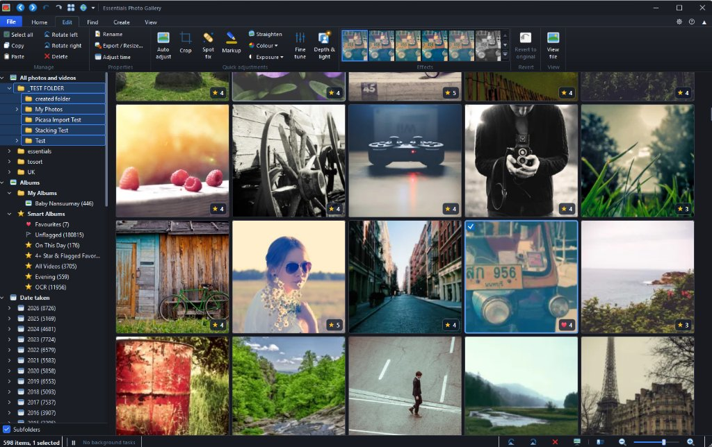

### New Way to Find Photos: AI Subjects & Local Semantic Search

- **Browse by Visual Subject:** Turn on **Subjects** in **File → Options → General** to filter your library across 12 built-in visual categories—**Family**, **Kids**, **Pets**, **Portraits**, **Food**, **Sports**, **Landscape**, **Night**, **Architecture**, **Beach & Coast**, **Nature & Flowers**, and **Documents & Notes**—with live photo counts and multi-select support.
- **Private, 100% Local Search:** Powered by the optional **MobileCLIP-S1** add-on (**File → Options → Add-ons**), which runs completely offline on your PC using your existing thumbnail cache. Natural-language searches in the Search Box blend automatically with your keywords, tags, and OCR text.

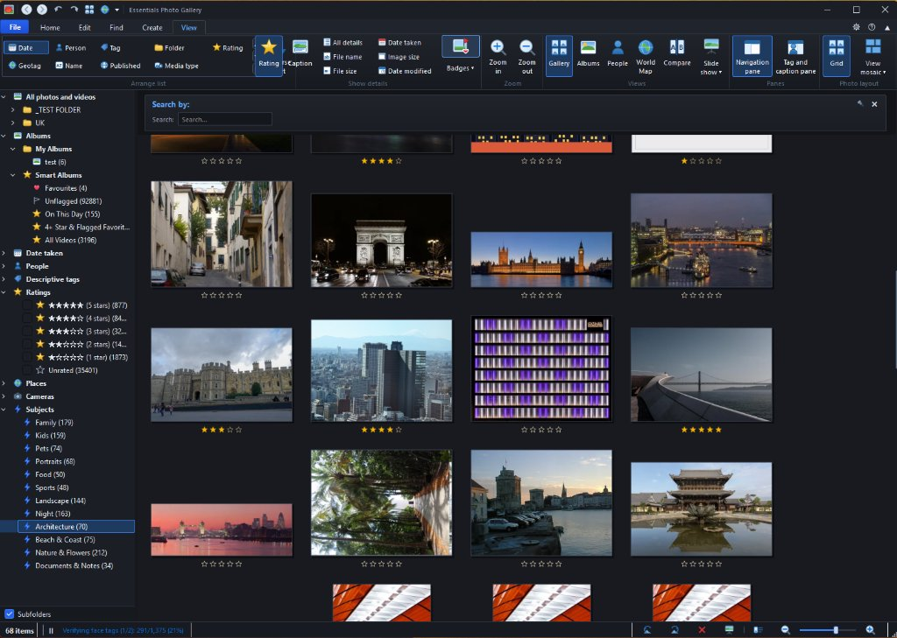

### Photo Grouping, Multi-Select Navigation & Picasa Polish

- **Automatic Photo Grouping (Bursts & RAW+JPEG):** Use the new **Photo grouping ▾** button on the **Home** ribbon to automatically group rapid bursts and RAW+JPEG pairs, pick the sharpest cover shot, expand or collapse groups with **`S`**, or press **`C`** on a collapsed group to compare every shot side by side.
- **Multi-Select Across the Navigation Pane:** Ctrl/Shift-select multiple **Folders**, **Places**, **Cameras**, **Tags**, **Dates**, or **Subjects** at once. When **Subfolders** is enabled, child folders and nested date/tag/place branches highlight together just like classic WLPG. Also adds an optional **Cameras** section (`A–Z`).
- **Cleaner Filters & Picasa Folder Manager:** Simplified **Flagged** (`Picked`) and **Media type** (`Photos`, `RAW`, `Motion photos`, `Video`) filters, clearer Picasa import prompts with an **Include subfolders** checkbox, and a new **View Picasa Folders...** window in **Options → Import** showing which folders have been imported with one-click Import and Open Folder actions.

### Create Studio, Editor & Batch People Tagging

- **Create Collage & Editor Polish:** Create Collage now defaults to **Grid** with gap-free fill, an animated drag-and-drop photo strip, **Polaroid Border Captions** (Caption, Date, File Name, Tagged People), and smooth **Canvas Rotation** (`-45°` to `+45°`). Fixed **Colour Pop** Quick Styles, **Depth & Light** Reset (now also resets **Remove Background**), **Spot Fix** Object Eraser accuracy & circle cursor, and **Fine Tune** Straighten framing.
- **Batch People Tagging Improvements:** Right-click any person's name or avatar to jump straight to their photos, keep your person filter when opening and closing a photo, avoid losing lower-confidence suggestions on partial confirm/reject, restore the Navigation pane on Back, and eliminate idle screen flicker.
- **Keyboard Shortcuts (`F1`) & Quick-Tag Hotkeys (`Alt+1..9`):** Press **`F1`** (or click **`?`** next to Settings) for a searchable keyboard shortcuts guide, configure `Alt+1..9` Quick-Tag hotkeys, click the **Folder** link in the Information pane to open it in Explorer, and enjoy cleaner motion-photo playback without the filmstrip tab overlapping the Play button.

### Smoother & More Reliable

- **Major Freeze & Crash Fixes:** Eliminated main-thread UI freezes across background folder watching, People view, Batch People Tagging, AI Object Eraser, Save as Copy, and post-launch Map pre-warming, plus added a capped 512 KB freeze log (`logs/freeze_traces.log`) and native crash log (`logs/crash.log`).

Full Technical Changelog

- **Visual Signatures & Auto-Stacking (`src/workers/thumbnail_worker.py`, `src/db/repository.py`, `src/ui/grid_view.py`, `src/ui/main_window.py`):**
  - `ThumbnailDecodeWorker` computes `phash64`, `dhash64`, `laplacian_sharpness`, and `lab_haar` in memory during thumbnail decode and writes them to `thumbnails.db` (`media_signatures`).
  - Hardened `auto_stack_raw_jpeg_pairs()` and `auto_stack_bursts()` with `30.0s` burst windows, `dhash64` anchor Hamming distance checks, single-step `Ctrl+Z` undo/redo (`_StackMutationUndoCommand`), `reconcile_stack_after_delete()` head promotion, and fixed `_annotate_media_records()` collapsed stack counts in folders with `<= 500` items.
- **4-Mode Photo Layout Engine (`src/ui/grid_model.py`, `src/ui/grid_view.py`, `src/ui/ribbon_toolbar.py`):**
  - Added `"tiles"` and `"masonry"` layouts alongside `"wlpg_grid"` and `"mosaic"`, `View mosaic ▾` split button, `Badges ▾` split button, viewport anchor preservation across resize/layout/details changes, selection preservation across `set_layout_mode()`, and fixed grouped Mosaic/Masonry blank scroll and double filmstrip perforations.
- **Local Semantic Search & AI Subjects (`src/core/semantic_engine.py`, `src/workers/semantic_worker.py`, `src/ui/left_nav_dock.py`):**
  - Added `SemanticEngine` (pure-Python CLIP BPE `tokenizer.json`, MobileCLIP-S1 FP16 ONNX), `SemanticVectorRepository` (`semantic_vectors.db`), `SemanticIndexWorker`, HTTP `Range` resumable download in **Options → Add-ons**, `fuse_semantic_and_fts_scores()` RRF search, and dedicated-pool `_SubjectsCountWorker`.
- **Navigation, Filters & Picasa (`src/ui/left_nav_dock.py`, `src/ui/picasa_import_dialog.py`, `src/core/picasa_importer.py`, `src/ui/dialogs.py`):**
  - Added multi-selection across Folders, Places, Cameras, Tags, Dates, and Subjects; subtree selection highlighting; optional Cameras nav section; automatic `Country → State → City` Places backfill; `include_subfolders` in `scan_picasa_tree()` and `PicasaImportDialog`; and `PicasaFoldersDialog` with persisted import status.
- **Editor, Create Studio & Batch People (`src/ui/media_viewer.py`, `src/imaging/creative_effects.py`, `src/ui/create_studio/`, `src/ui/batch_people_view.py`):**
  - Fixed Colour Pop Quick Styles HSV hue masking, Depth & Light `reset_depth_light()` resetting `_pre_cutout_rgb`/`master_alpha`, LaMa mask downsampling (`cv2.INTER_AREA` + dilation), async Object Eraser worker, cached Spot Fix hover circle cursor, Create Collage overhaul, and Batch People Tagging context menus / filter persistence / rematch floor (`0.42`) / idle signature guard.
- **Diagnostics, Stability & Benchmarks (`src/utils/freeze_watchdog.py`, `docs/BENCHMARKS.md`):**
  - Added `MainThreadFreezeWatchdog` (`logs/freeze_traces.log`, 512 KB in-place cap), `faulthandler` native crash logging, fixed cross-thread `QRunnable` signal crashes and `_on_dock_person_confirm_requested` `NameError`, and added v0.17.0 pre-release benchmarks to `docs/BENCHMARKS.md`.

---

## Essentials Photo Gallery v0.16.0

**Essentials Photo Gallery 0.16.0** delivers major **speed & responsiveness improvements** across World Map View and the thumbnail grid, a **borderless fullscreen Quick Preview (`Space`)**, a **redesigned draggable Filmstrip**, an **overhauled Export / Resize** workflow, **Favourites & Tri-State Culling Flags**, and an **auto-detecting Google Picasa importer**.

### Much Faster Map View, Grid & RAW Browsing

- **Instant Offline World Map:** World Map View and Adjust Location now open immediately offline with smooth Web Worker pin clustering, zero lag when panning or zooming, and a new **Current View / Entire Library** toggle.
- **Faster Thumbnails & RAW Previews:** Cached thumbnails load in fast batches without getting stuck behind slow RAW or video decodes, and camera RAW files extract embedded previews directly for instant grid browsing.
- **Sharper HiDPI & Panorama Thumbnails:** Higher-resolution thumbnail caching with dedicated support for wide panoramas, plus a one-click **Rebuild Thumbnail Cache** option in **Options → Database**.

### Quick Preview & Draggable Filmstrip

- **Fullscreen Quick Preview (`Space`):** Press **`Space`** in the gallery for an instant borderless full-screen preview with floating filename, star rating, and Pick/Reject/Favourite controls. Use **`←`/`→`** to browse, **`0–5`** to rate, **`P`/`X`/`U`** to flag, **`F`** to favourite, or hold **`Shift`** to rate/flag and auto-advance.

- **Draggable Filmstrip & Pull-Tab:** A sleek, headerless filmstrip in Single Image View with a flush bottom-left show/hide tab. Drag its top edge taller (up to `148px`) to scale thumbnails smoothly—your preferred height is remembered across restarts.

### Upgraded Export / Resize & Culling Tools

- **Overhauled Export / Resize Dialog:** Defaults cleanly to **Original size**, with an expandable section for **Fit within**, **Exact W × H**, **Percentage**, and custom saved presets, plus flexible filename templates with a live preview.

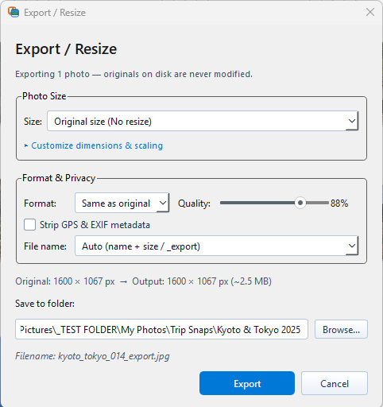

- **Zoom Minimap, Batch Rename (`F2`) & Camera AF Overlay (`A`):** Pan zoomed-in photos effortlessly with a corner minimap, rename selections using templates (`{name}`, `{date}`, `{seq}`, `{camera}`) with automatic sidecar syncing, and press **`A`** to view camera autofocus points for Nikon, Canon, Sony, and Fujifilm shots.

### Favourites, Tri-State Flags & Google Picasa Import

- **Separate Favourites & Culling Flags:** Keep permanent **Favourites** (`F`) separate from **Pick / Neutral / Reject** culling flags (`P`/`X`/`U`), backed by live-counted **Smart Albums** in the Navigation pane.
- **Auto-Detecting Google Picasa Importer:** Automatically spots `.picasa.ini` and `contacts.xml` files when scanning folders to bring in Picasa stars, captions, tags, face regions, and albums non-destructively.
- **Welcome Screen & Auto-Closing Updater:** A clean 3-card Welcome screen for empty libraries, Dark Theme fixes, and an update installer that closes the app cleanly when upgrading.

Full Technical Changelog

- **World Map Overhaul (`src/ui/map_view.py`, `resources/leaflet/`):** Bundled Leaflet `1.9.4` + Web Worker clustering (`map_clusters_worker.js`), `QWebEngineUrlSchemeHandler` (`gallerythumb://leaflet/...` & `gallerythumb://media/<id>`), `query_map_overview_cells()`, lazy cluster member lookup, incremental marker diffing, `media_rtree`-backed bounds, `_map_data_dirty` caching, scope toggle, and 3s post-launch idle pre-warm.
- **Thumbnail & RAW Pipeline (`src/workers/thumb_scheduler.py`, `src/db/repository.py`, `src/imaging/image_loader.py`):** Split `BatchThumbCacheWorker` (`thumb_cache_pool`) from disk decodes (`thumbnail_pool`, 12 in-flight viewport-center window), added `ThumbnailWriteCoalescer`, off-thread `BatchFaceCropWorker` prefetching, `extract_tiff_embedded_jpeg()` Tier-0 RAW fast-path, `ScanCrashTrace` (`active_scan_trace.json`), and raised `THUMB_MAX_DIM` from `256` → `384` (up to `768px` long edge for panoramas, WebP quality `85`).
- **Culling, Filmstrip & Export (`src/ui/quick_preview.py`, `src/ui/bottom_filmstrip_dock.py`, `src/ui/export_dialog.py`, `src/ui/batch_rename_dialog.py`):** Added borderless `Space` Quick Preview, `Shift`-to-advance culling, resizable `BottomFilmstripDock` with welded pull-tab, Zoom Minimap, `F2` two-phase atomic Batch Rename with `.xmp`/`.OriginalFiles` sync, and MakerNote AF point overlay (`A`).
- **Favourites, Flags & Picasa (`src/core/picasa_importer.py`, `src/ui/picasa_import_dialog.py`, `src/ui/welcome_overlay.py`):** Added `is_favourite` and `is_rejected` columns, permanent built-in Smart Albums, `.picasa.ini` / `contacts.xml` importer, `WelcomeEmptyOverlay`, and auto-closing updater in `AboutDialog`.

---

## Essentials Photo Gallery v0.15.0

**Essentials Photo Gallery 0.15.0** introduces a **revamped Create Studio with integrated full-window workspaces**, **Depth & Light 2.0 (3D Relight)** with interactive virtual lights, a **unified Crop & Straighten bar**, an upgraded **Resize & Export** dialog, and important **safety & reliability upgrades** for OneDrive libraries and third-party XMP sidecars.

### Revamped Create Studio (Full-Window Workspaces)

- **Integrated Studio Experience:** **Collage**, **Photo Fuse**, **Panorama**, **Colour Pop**, and **3D Cinematic** now open as full-window workspaces with their own contextual Ribbon tab, right-hand inspector, zoomable live canvas, and bottom photo strip—returning you right back to your previous view when closed.
- **Collage, Photo Fuse, Panorama, Colour Pop & 3D Cinematic:**
  - **Collage:** Blended, Grid, Polaroid, and Then & Now layouts with social/print aspect presets, background colours, per-photo pan/zoom, and drag-and-drop reordering.
  - **Photo Fuse:** Full-canvas group expression swapping with **Compare Original**.
  - **Panorama:** Interactive stitching with optional **AI Fill Gaps** for uneven borders.
  - **Colour Pop:** Quick Style colour swatches (**Red**, **Blue**, **Green**, **Warm**, **Cool**) and edge-snapping selection brushes.
  - **3D Cinematic:** 2.5D depth-parallax motion presets with MP4 export.
- **Collapsible Bottom Filmstrip:** Toggle a sleek bottom filmstrip in Single Image View to jump between photos quickly.

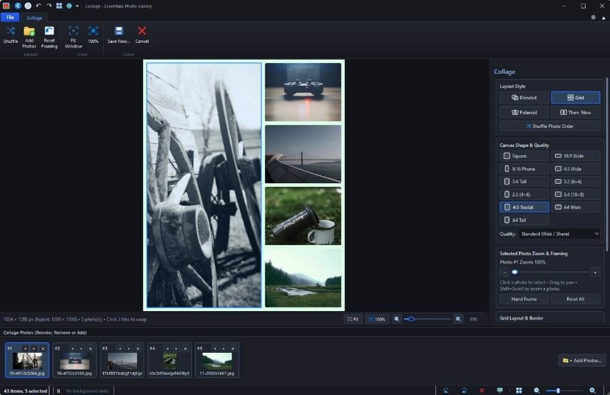

### Depth & Light 2.0: 3D Relight Studio

- **Interactive 3D Virtual Lights:** Add up to 3 independent **Point**, **Spot**, or **Rim** lights directly on your photo with draggable light orbs and aim handles, adjusting temperature (`1800K–10000K`), intensity, softness, distance, spot cone, gloss, and gobo shadows.
- **One-Click Relight Looks:** Six visual lighting sphere presets (**Warm Streetlamp**, **Golden Rim**, **Rembrandt**, **Dual Neon**, **Moonlit**, **Window Gobo**) style your lighting in a single click.

### Unified Crop & Straighten + Resize & Export

- **Draw-a-Line Straighten & Cleaner Aspect Ratios:** Draw a horizon line directly on the photo, fine-tune with the `-15°..+15°` slider (double-click to reset), or click **Auto**. Use **↻ Flip (`X`)** instead of duplicate portrait/landscape presets, cycle composition grids (`G`), and preview **AI Expand** fill zones before applying.
- **Flexible Resize & Export:** Export from Gallery or Single Image View using **Fit within**, **Exact W × H**, or **Percentage**, with custom presets, live file-size estimates, `JPEG`/`WebP`/`PNG` quality controls, and an option to **Strip GPS & EXIF metadata**.

### Safety, Reliability & Everyday Polish

- **OneDrive Files On-Demand Protection:** Background scanners, thumbnailers, OCR, and face detection automatically skip cloud-only OneDrive placeholders so your library stays indexed without triggering unwanted gigabyte downloads.
- **Third-Party XMP Preservation:** When optional file write-back is enabled, edits made in Adobe Lightroom, Camera Raw, or darktable are preserved intact rather than overwritten.
- **Streamlined Context Menus & On-Demand OCR:** Cleaner WLPG-style right-click menus with an **AI & Scan ▸** submenu (including on-demand **Scan for text (OCR)** on any photo).

Full Technical Changelog

- **Create Studio & Filmstrip (`src/ui/create_studio/`, `src/ui/bottom_filmstrip_dock.py`):** Migrated Collage, Photo Fuse, Panorama, Colour Pop, and 3D Cinematic from modal dialogs to integrated main-window workspaces with contextual Ribbon tabs and `BottomFilmstripDock`.
- **Depth & Light 2.0 (`src/imaging/creative_effects.py`, `src/ui/right_tag_dock.py`):** Added joint-guided depth refinement, multi-scale Scharr + hemispherical subject normals (`DepthAndMatteEngine.get_refined_depth_and_normals()`), optional ONNX normal-map model support (`dsine.onnx` / `normal_bae.onnx`), linear-light ambient dimming, up to 3 virtual 3D lights, and 6 sphere presets.
- **Crop, Export & Theme Architecture (`src/ui/crop_tool.py`, `src/ui/export_dialog.py`, `src/ui/theme_tokens.py`):** Unified Crop & Straighten bar, `ThemeTokens` + semantic `uiRole` properties across Aero/Fluent/Dark Studio, and automated headless contrast auditing (`tests/test_theme_contrast_audit.py`).
- **Safety & Worker Hardening (`src/workers/`, `src/metadata/xmp_writer.py`, `src/ui/main_window.py`):** Added Windows `st_file_attributes` (`OFFLINE | RECALL_ON_OPEN | RECALL_ON_DATA_ACCESS`) OneDrive guards across all background workers, surgical `merge_wlpg_xmp_packet()` third-party namespace preservation (`crs:*`, `darktable:*`, `dc:rights`, `photoshop:Headline`), fixed `perform_fresh_start_reset()` worker shutdown, and routed `WorldMapView` cluster thumbnails through `thumbnail_pool`.

---

## Essentials Photo Gallery v0.14.0

**Essentials Photo Gallery 0.14.0** takes a big step forward in both editing power and library cleanup—introducing **Advanced Fine Tune** with **Automatic Regional Masks**, a **revamped Duplicates Finder** paired with **Find Similar Photos**, and **Companion Phone GPS Matching** for automatic geotagging.

### Fine Tune Advanced Mode & Automatic Regional Masks

- **Advanced Fine Tune:** Switch Fine Tune from **Basic** to **Advanced** whenever you want deeper control—unlocking a live RGB histogram, **Smart Enhance**, **Whites** & **Blacks**, **Structure**, **Tone Curve** (`RGB` + individual colour channels), **White Balance Eyedropper**, **8-Band Color Mixer (HSL)**, **Orton Glow / Golden Hour**, and **Film Grain**.

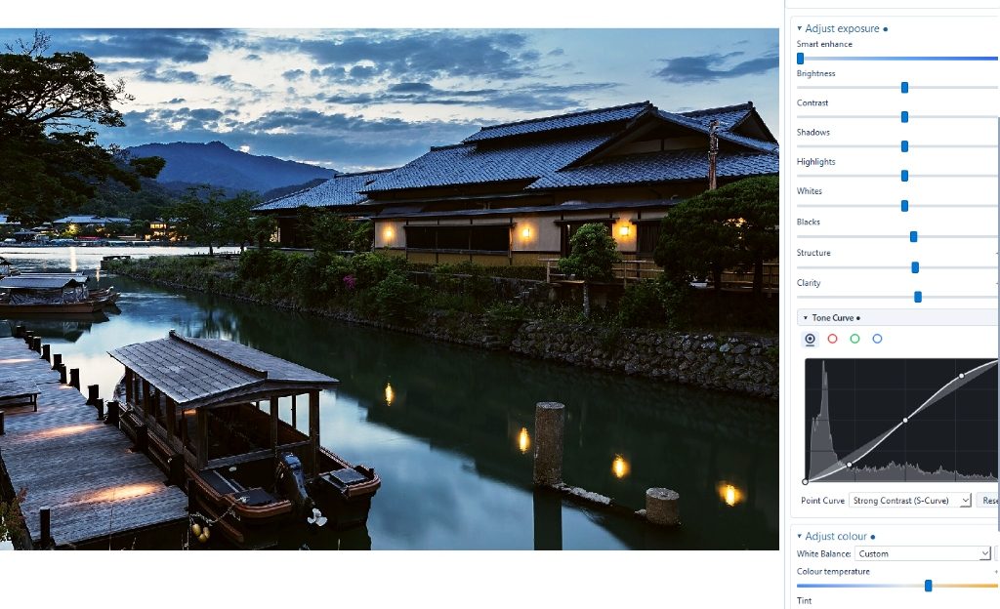

- **Automatic Regional Masks (`Whole | Subject | Background | Sky`):** Automatically isolate and adjust the **Subject**, **Background**, or **Sky**, refine edges with the **Add (+) / Subtract (-)** brush, and see a live histogram for just that region.

### Revamped Duplicates Finder & New Find Similar Photos

- **Revamped Duplicates & Bursts Workspace:** A dedicated **Duplicates** Ribbon tab with **Compare Selected**, **Info Pane**, **Auto-Pick** rules, **Metadata Merge** on delete, **Move Duplicates...**, and customizable card details.

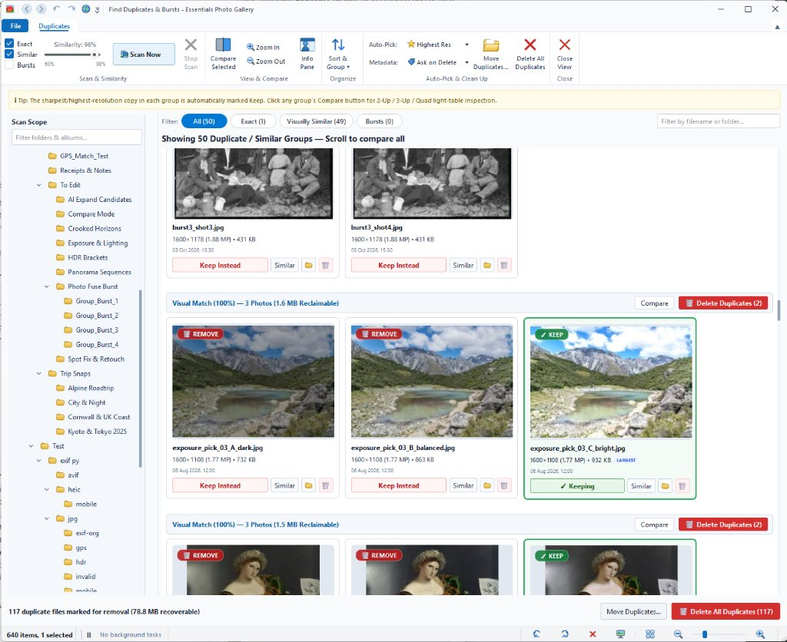

- **New Find Similar Photos:** Right-click any photo and choose **Find Similar** to find visually matching shots across your library, with a live similarity slider (`70%–98%`) in the Search bar.

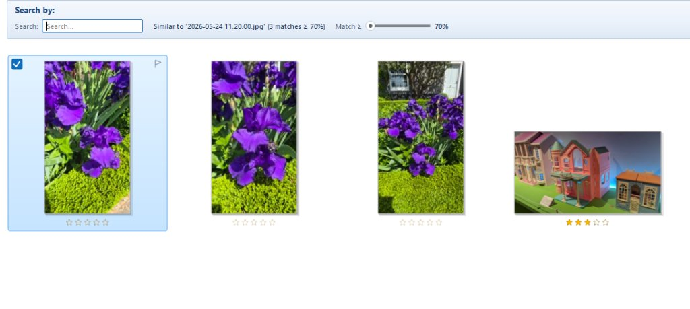

### Auto-Geotagging from Phone Photos or GPX Tracks

- **Match Locations from Timed Photos (`Home → Geotag ▾`):** Copy GPS locations from your phone's geotagged photos (or a `.gpx` track) onto camera photos taken around the same time, with side-by-side previews, optional camera clock sync, and one-step Undo (`Ctrl+Z`).

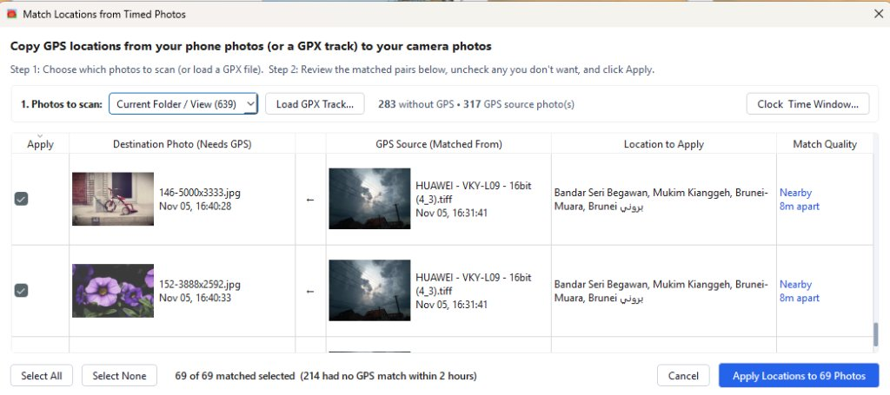

### Other Notable Improvements

- **Fresh Start Reset & Faster Library Management:** Added **Fresh Start (Reset Catalog & Thumbnails)** in **Options → Database**, faster Face Recognition startup, snappier **Folder Manager** opening and toggling, and smoother large-folder indexing.
- **Everyday Polish & Fixes:** Click anywhere on the video seek bar to jump straight to that timestamp, keep the title bar visible in **Immersive Mode (`F4`)**, true A–Z folder sorting, and fixes for Object Eraser, the 99% LaMa download hang, and Private Folder persistence.

Full Technical Changelog

- **Fine Tune Advanced & Regional Masking (`src/ui/right_tag_dock.py`, `src/imaging/opencv_engine.py`, `src/imaging/creative_effects.py`):** Added Basic/Advanced Fine Tune toggle, live RGB histogram, `Smart Enhance`, `Whites`/`Blacks`, `Structure`, `Tone Curve` (`RGB`/`R`/`G`/`B` + S-Curve), WB Eyedropper, 8-band HSL mixer, Sharpen Masking, Color Noise, Vignette Feather, Orton Glow, Film Grain, and `DepthAndMatteEngine` automatic Subject/Background/Sky masks with paint/erase brush and region-masked histogram.
- **Duplicates & Visual Similarity (`src/ui/duplicates_workspace.py`, `src/core/duplicate_engine.py`):** Redesigned Duplicates workspace with contextual Ribbon tab, Auto-Pick, metadata merge on delete, and Find Similar Photos (spatial + position-invariant LAB color palette and perceptual hash matching with live `70%–98%` Scope Bar slider).
- **GPS Matching (`src/ui/gps_match_dialog.py`):** Added timestamp-based companion phone GPS matching and `.gpx` track interpolation with 2-photo camera clock offset calibration and `Ctrl+Z` undo.
- **Performance & Fixes (`src/core/face_engine.py`, `src/ui/folder_manager_dialog.py`, `src/ui/main_window.py`):** Session-cached `FaceEngine` with `allowed_modules=["detection", "recognition"]`, lowered `FaceDetectionWorker` priority, grouped `media_count` queries in Folder Manager, Fresh Start Reset, and fixes for LaMa download hang, Private Folders unhide persistence, and Places expansion persistence.

---

## Essentials Photo Gallery v0.13.0

Welcome to **Essentials Photo Gallery 0.13.0**! This release upgrades the core imaging and UI engine for faster everyday browsing, introduces a **Folder Manager & Private Folders** system, adds opt-in **Offline Text-in-Photo Search (OCR)**, and polishes **AI Inpainting** across **Crop AI Expand** and **Object Eraser**.

### Core Stack Upgrade, Faster RAWs & Cleaner Highlights

Under the hood, **0.13.0** moves to a newer runtime (**OpenCV 5.0**, **Qt 6.12**, **NumPy 2.5**, and **Pillow 13**) with noticeable speed and image-quality gains:

- **Instant RAW Browsing & Thumbnails:** Opening folders of camera RAW files (`.CR2`, `.CR3`, `.NEF`, `.ARW`, `.RAF`, `.DNG`) now extracts the camera's embedded JPEG preview for immediate thumbnails and Single Image View opening, only running full 16-bit demosaicing in the background when you actively edit sliders.
- **Natural Highlight Roll-Off in Fine Tune & Auto-Adjust:** Pushing **Exposure**, **Highlights**, or **Auto-Adjust** no longer clips bright skies or skin highlights into harsh yellow or magenta—extreme highlights now desaturate smoothly toward natural white.

### Inpainting: Crop AI Expand & Object Eraser

- **Cleaner Crop AI Expand & Straighten:** Expanding a photo's canvas or straightening crooked horizons now blends seamlessly into the edges and corners without leaving dark seam lines or edge artifacts.
- **Contextual AI Object Eraser:** Painting over unwanted objects in **Spot Fix → Object Eraser** (or using **Crop AI Expand**) now offers a one-time contextual prompt to download the optional **LaMa Neural Inpainting** add-on (~208 MB), while keeping built-in basic inpainting ready out of the box.

### Offline Text-in-Photo Search (OCR)

Find receipts, street signs, documents, and screenshots by the words inside them—completely offline:

- **Opt-In Per Folder:** Text recognition is off by default; enable it on any folder from **Folder Manager** (or run an on-demand **Scan Folder for Text Now**). If no OCR engine is installed yet, you'll be prompted to download **RapidOCR (~15 MB)** in one click, or point to an existing **Tesseract** or **Windows Native OCR** setup in **Options → Add-ons**.
- **Search & Copy:** Extracted text is indexed in the local database for instant search and Smart Albums, and appears selectable/copyable right in the **Information** pane.

### Folder Manager & Private Folders

- **Folder Manager:** Open **Folder Manager** to add or remove catalog folders, filter the folder tree, switch folders between **Scan Always**, **Scan Once**, and **Exclude from catalog**, toggle Face Recognition and Text (OCR) per folder, and cascade settings to subfolders.
- **Private Folders & Flexible Unlock:** Mark sensitive folders as **Private** to hide their photos, people, tags, and places until unlocked from the **File** menu (hidden automatically when no private folders are in use). Protect unlocking with a **PIN / Passcode**, **Windows Login / Windows Hello**, or 1-click unlock, with optional idle auto-lock.

### Other Notable Improvements

- **USB Smartphone & Camera Import:** Native Windows **MTP/PTP** import with thumbnail previews, duplicate detection, and streamed transfers for iPhones, Android phones, and cameras.
- **Auto Collage Polish:** Reorder photos manually in all collage styles (including **Blended Collage**), drag cropped photos with the **Hand** tool to adjust framing, drag **Polaroids** freely across the canvas, and get count-aware Grid layouts (e.g. `3x1` / `1x3` for 3 photos).
- **Add-ons & In-App Update Check:** Renamed **Options → Add-ons** with clearer status for LaMa and OCR, plus a **Check for Updates...** button in **About**.

Full Technical Changelog

- **Folder Manager, Private Mode, Missing Folder Recovery & Windows Rename Fix (`src/ui/folder_manager_dialog.py`, `src/ui/left_nav_dock.py`, `src/workers/folder_watcher.py`, `src/db/repository.py`, `src/ui/main_window.py`):**
  - Added `FolderManagerDialog` with `monitor_mode` (`always` / `once` / `excluded`), `scan_faces`, `scan_ocr` (default `0`), `is_private`, folder search/expand/collapse, and add/remove folder actions; PBKDF2 PIN hashing, Windows Login / Windows Hello (`UserConsentVerifier`) unlock mode, idle auto-lock, and conditional File menu Unlock visibility (`repo.has_private_folders()`).
  - Added guided *Locate* / *Remove* prompt when a library root folder is missing on startup, fixed `FolderWatcherDaemon.release_watched_subtree()` so Windows inline folder renaming succeeds without `QFileSystemWatcher` handle locks, and fixed clicking **Date taken** in the Navigation bar.
- **Offline OCR & Add-ons Management (`src/core/ocr_engine.py`, `src/workers/ocr_worker.py`, `src/ui/dialogs.py`, `src/ui/right_tag_dock.py`, `src/version.py`):**
  - Added multi-backend OCR (`rapidocr` via bundled `onnxruntime` runner or `rapidocr_onnxruntime`, `pytesseract`, `windows_media_ocr` / `winocr`) with 1-click AppData RapidOCR (~15 MB) download, FTS5 `media_ocr_fts` indexing, Smart Album `OCR Text` rule, and selectable/copyable OCR box in the Information pane.
  - Renamed Options tab to **Add-ons**, fixed `QMessageBox` import in `dialogs.py`, replaced editable-looking path boxes with selectable `QLabel`s, added contextual first-use prompts for LaMa (~208 MB) and RapidOCR (~15 MB), and added `AboutDialog` GitHub Releases update checking (`src/version.py`).
- **RAW Fast-Path, Highlight Roll-Off & Fine Tune Ergonomics (`src/imaging/image_loader.py`, `src/imaging/opencv_engine.py`, `src/ui/media_viewer.py`, `src/ui/right_tag_dock.py`):**
  - Added `decode_raw_embedded_preview()` + `_upgrade_raw_to_full_demosaic_async()`, CIE $L^*a^*b^*$ highlight chroma roll-off, focus-aware mouse-wheel sliders, live RGB/Luminance histogram, and Dark Studio bug fixes across Edit tools, Folder Manager, and Information pane.
- **Crop, AI Expand, Auto Collage & UI Polish (`src/ui/crop_tool.py`, `src/imaging/opencv_engine.py`, `src/imaging/create_tools.py`, `src/ui/create_studio_dialogs.py`, `src/ui/grid_view.py`, `src/ui/people_directory_view.py`):**
  - Fixed `straighten_with_ai_fill` (`BORDER_REPLICATE` + dilated mask + eroded feather) and `expand_canvas_with_ai_fill` seam lines, rotated inscribed crop bounds & rotated dimmed overlay, accidental grey-border click guard, quick *Clear Ratio* button, Auto Collage count-aware grids (`compute_grid_slots`), manual photo reordering across all styles, Hand-tool crop framing (`focus_center`), draggable Polaroids, view-aware title bar (`Map`, `People`, `Albums`, `Compare`), and hiding 0-photo entries in People View.
- **Core Stack, Alignment & Installer (`photogallery.spec`, `installer.iss`, `main.py`):**
  - Upgraded to **OpenCV 5.0.0**, **NumPy 2.5.4**, **PySide6 / Qt 6.12.0**, and **Pillow 13.0.0** (`pillow-heif 1.8.1`, `pillow-jxl-plugin 1.3.8`); upgraded burst/panorama alignment to `cv2.USAC_MAGSAC`; fixed OpenCV 5.0 `cv2.HoughLinesP` `(N, 4)` shape handling; hardened `installer.iss` with `AppMutex=EssentialsPhotoGallery_Mutex`, `CloseApplications=yes`, and optional uninstall AppData cleanup prompt.
- **Geotagging, Undo/Redo & Polish:**
  - Updated offline gazetteer and Geotagging fixes.
  - Added Revert to original into undo/redo queue.
  - Various UI refinements and bug fixes.

---

## Essentials Photo Gallery v0.12.0

Welcome to **Essentials Photo Gallery 0.12.0**! This release focuses on two of the most-requested ways to organize and cull a growing photo library: **Albums & Smart Albums** for curating collections without duplicating files, and a dedicated **Compare & Light Table Mode** for picking your best shots side by side. Alongside those headline additions, you'll also find smoother live photo editing, a much smarter **Photo Fuse**, a contextual World Map ribbon, and native Windows window snapping.

### Albums & Smart Albums

Whether you're pulling together highlights from a weekend trip or building dynamic collections that update themselves as you import new photos, **Albums** gives your library a new home right at the top of the navigation pane.

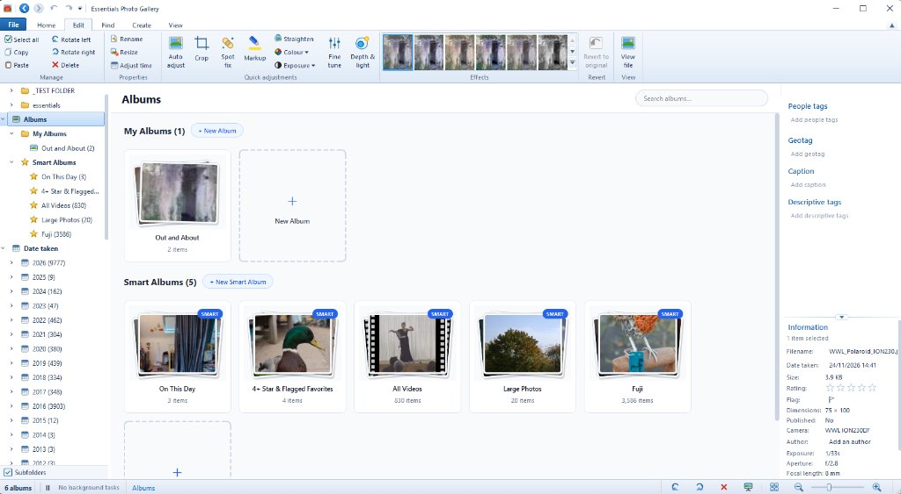

- **My Albums:** Group photos into non-destructive collections from the right-click menu (`Add to Album` or `New Album from Selection...`) without moving or copying anything on disk. Pick your favorite photo as the **Album Cover**, and browse your albums as stacked photo cards in the new **Albums** view.
- **Smart Albums:** Build live rule-based collections using 17+ metadata dimensions—including date/time of day, orientation, star rating, flags, tags, camera manufacturer, and detected face count—with an instant **Live Preview** of how many photos match before you save. Built-in presets like *On This Day*, *4+ Star & Flagged Favorites*, and *All Videos* are ready out of the box.

### Multi-Photo Compare & Light Table Mode

Picking the sharpest keeper from a burst of nearly identical shots shouldn't mean flipping back and forth in a single viewer. Press **`C`** (or choose **Compare** from the View ribbon or right-click menu) to open the new **Compare** light table.

- **Flexible Layouts & Wipe Slider:** Inspect 2-up side-by-side, 2-up top/bottom, 3-up columns, 2×2 quad grid, or drag an interactive **Wipe Slider** curtain across two photos.
- **Pin Champion & Cycle Challengers:** Pin your current favorite (`Pin`) and step through the rest of your selection using the arrow keys or the bottom candidate filmstrip—with optional **Auto-Advance** as soon as you rate or flag a shot.
- **Inspect Every Detail:** Lock pan and zoom across all panes at 60 FPS, press **`F`** to **Zoom to Face** on every photo at once, toggle **Focus Peaking** and **Clipping Warnings**, and spot exposure differences immediately thanks to amber-highlighted shutter/ISO values and automatic **`★ Sharpest`** indicators.
- **RAW & High-Bit-Depth Support:** Compare JPEGs, camera RAW files (`.arw`, `.cr2`, `.cr3`, `.nef`, `.dng`, `.raf`, `.rw2`, `.orf`, etc.), and raw-sensor TIFFs side by side, and rate, rotate, dismiss, or jump straight into the editor.

### Smoother Editing & a Fun Photo Fuse Upgrade

- **Fluid Live Adjustments:** Heavy adjustment passes now render on a background worker with stage caching and an interactive drag proxy, so dragging exposure, tone, dehaze, or Colour Pop tolerance sliders stays responsive without freezing the UI.
- **Photo Fuse (for Group & Burst Shots):** Taking a group photo where one person blinked and someone else looked great in the next frame? **Photo Fuse** is a niche but fun tool in the Create menu that aligns burst shots automatically, detects faces, and lets you swap in the best expression per person with seamless blending.

### Other Notable Improvements

- **Contextual World Map Ribbon & People View:** Switching to World Map brings up dedicated map styles, location search, and year/person/rating filters; People View adds a quick switcher in `View → Views` and fixes inline suggestion inspection and filtering.
- **Native Windows Framing & Aero Snap:** Restored native Win32/DWM window snapping (`Win+Left/Right/Up/Down` and drag-to-edge), drop shadows, and Windows 11 rounded corners while keeping the custom Ribbon title bar.

Full Technical Changelog

- **Photo Editor & Colour Pop Performance Overhaul (`src/ui/media_viewer.py`, `src/imaging/opencv_engine.py`, `src/imaging/creative_effects.py`, `src/ui/create_studio_dialogs.py`):**
  - **Background Full-Resolution Master Pass:** Moved the 250ms debounced `render_adjusted_image` master render onto a `QRunnable`/`QThreadPool` worker with generation-counter cancellation and synchronous `ensure_master_rendered()` before Save/Export, eliminating UI freezes after releasing sliders.
  - **Dirty-Stage Checkpoint Caching:** Added a thread-safe bounded `_STAGE_CACHE` (`dd_img`, `tl_img`, `bokeh_data`) in `render_adjusted_image` plus in-place `float32` buffers so downstream adjustments skip upstream Denoise, Dehaze, Tone/LAB, and Bokeh Blur passes.
  - **Two-Tier Adaptive Proxy:** Added a `960px` `scrub_proxy_rgb` during active slider dragging (`_is_sliding`) that snaps to the crisp `1280px` `display_proxy_rgb` immediately on release.
  - **Faster Colour Pop Selection & Tolerance Scrubbing:** Added `compute_multi_color_similarity_mask()` (single LAB conversion and single `guided_filter_matte` pass across all picked colours, skipping the guided filter during active tolerance slider drags) and cached `float32` proxy buffers in `ColourPopDialog`.
- **Photo Fuse Overhaul (`src/imaging/create_tools.py`, `src/ui/create_studio_dialogs.py`):**
  - Added InsightFace `det_10g` (with `CPUExecutionProvider`) + Haar fallback face detection, robust ECC/homography burst alignment with unalignable-shot reporting, cached alignment across base-shot switches, landmark-guided seamless Poisson face blending (`cv2.seamlessClone`), cleaner base-shot selection UX, and show/hide face box overlays.
- **Panorama Stitcher Stability (`src/imaging/create_tools.py`, `src/ui/create_studio_dialogs.py`):**
  - Disabled OpenCL (`cv2.ocl.setUseOpenCL(False)`) during stitching and downscaled oversized inputs to prevent native OpenCV/OpenCL driver crashes during panorama synthesis.
- **Batch People Tagging & Navigation Restore (`src/ui/batch_people_view.py`, `src/ui/main_window.py`):**
  - Guarded `None` `outlier_reason` values in `QStyledItemDelegate` `paint`/`editorEvent` and selection handlers, and restored Left Navigation pane visibility when returning from Batch People Tag to Thumbnail, People, or Album views.
- **Multi-Photo Compare & Light Table View (`src/ui/compare_view.py`):**
  - Added native multi-photo side-by-side light table comparison (`2-Up Side-by-Side`, `2-Up Top / Bottom`, `3-Up Columns`, `2×2 Quad Grid`, `Wipe Slider`), `Pin Champion & Cycle Challenger`, Candidate Filmstrip, `Auto-Advance`, 60 FPS synchronized pan/zoom, `Zoom to Face (F)`, Focus Peaking, Clipping Warnings, EXIF difference highlighting, RAW/TIFF decoding via `rawpy`/WIC, and non-destructive culling.
- **Albums View & Smart Albums (`src/ui/albums_view.py`, `src/ui/smart_album_dialog.py`, `src/db/repository.py`):**
  - Added `AlbumsView`, `My Albums` & `Smart Albums` in Left Navigation, `SmartAlbumDialog` 17-dimension boolean rule builder, `camera_make`/`camera_model` EXIF indexing, and custom album covers.
- **Contextual World Map Ribbon, Native Windows Framing & People Suggestions Fixes:**
  - Contextual Map ribbon tab, native Win32/DWM Aero Snap + drop shadow, and People View inline suggestion inspection fixes.

---

## Essentials Photo Gallery v0.11.0

This release upgrades Depth & Light with one-click subject cutouts, adds new group navigation tools, expands modern image format support, and introduces a simple `F12` fullscreen mode alongside refinements to Fluent styling and Map View.

### Highlights

- **Depth & Light & Subject Cutout Tools:** Added 1-click **Copy Subject** and **Remove Background** (to transparent PNG) with interactive **Boundary shift**, **Boundary feather**, and live mask preview, plus an atmospheric 3D haze/mist engine alongside Portrait Bokeh and 3D Depth Relighting.

- **New Group Tools & Scroll Indicator:** Scrolling through large libraries now displays a floating group & date indicator badge (`Group` / `Item` timestamp), and right-clicking a group header offers quick **Collapse Group**, **Collapse all groups**, and **Select All Group Items** actions.

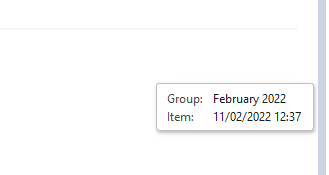

- **Extended Image Format Support:** Added native viewing and thumbnail generation for `AVIF`, `WebP`, `HEIC`/`HEIF`, and additional camera RAW formats.
- **Static Slideshow (`F12`):** Added a static fullscreen slideshow mode (`F12`) that works as a clean, distraction-free full-screen viewer alongside the animated pan-and-zoom slideshow.

### Other Notable Improvements

- **Fluent Style & Map View Refinements:** Further polish to Fluent icons, Ribbon controls, and theme switching, plus smoother flicker-free Map View zooming, reliable offline tile caching, and cluster pin navigation.
- **Filtering, Faces & Lighter Packaging:** Added Landscape/Portrait orientation filtering, a full-library Face Rescan option, Spot Fix / AI Object Eraser improvements, and removed `scipy` and `scikit-image` dependencies for a smaller installer and faster startup.

Full Technical Changelog

- **Depth & Light & Cutout Tools:** Added 1-click Subject Cutout (`Copy Subject` & `Remove Background` to transparent PNG), interactive mask boundary shift/feather with live preview, and an atmospheric 3D haze engine (optical bloom, horizon layering, soft-knee veiling).
- **Spot Fix & Inpainting:** Integrated AI Object Eraser (LaMa inpainting) alongside smart healing and red-eye correction.
- **Next-Gen Image Format Support:** Native viewing and thumbnail support for `AVIF`, `WebP`, `HEIC`/`HEIF`, and extended RAW formats.
- **Map View Refinements:** Smooth zooming without flicker, reliable offline tile caching, cluster pin navigation, and seamless view switching.
- **Face Detection:** Added full-library Rescan option, improved face thumbnail caching, and grouping stability.
- **Navigation & Filtering:** Added Orientation filter (`Landscape` / `Portrait`), persistent selection highlights across background refreshes, and smooth drag-and-drop file organization.
- **Static Slideshow (`F12`):** Added a static fullscreen presentation mode alongside animated pan-and-zoom.
- **Fluent Style & UI Themes:** Updated Fluent icons, refined Ribbon controls, and improved theme switching.
- **Lightweight Distribution:** Removed `scipy` and `scikit-image` dependencies to reduce installer and disk size while improving startup time.
- **Groups:** Added floating group scroll indicator and Group Context Menu options (`Collapse Group`, `Collapse all groups`, `Select All Group Items`).
- **Performance & Packaging:** 60 FPS interactive slider scrubbing for Fine Tune controls, synchronized `Ctrl + wheel` zoom, and PyInstaller ONNX model bundling and resolution fixes.

---

## Essentials Photo Gallery v0.10.0

v0.10.0 brings a major overhaul to the World Map view, introduces the offline **Places** browser in the navigation pane, and adds a new **Fluent** theme option for Windows 11.

### Highlights

- **World Map Overhaul:** Rebuilt the map experience with multiple map styles (`Clean (Light)`, `Street (OSM)`, `Satellite`, `Carto Dark`, and `Stamen Terrain`), clustered photo pins with thumbnail preview bubbles, and responsive zoom.

- **Places & Offline Reverse Geotagging:** Added an offline world gazetteer covering 25,000+ cities and regions and a **Places** tree (`Country / State / City`) in the Left Navigation pane so you can browse your library by where photos were taken.

- **New Fluent UI Option & Title Bar QAT:** Added a modern Windows 11 **Fluent** light theme and icon style option alongside Classic Aero and Dark modes, plus a Quick Access Toolbar (`Back`, `Forward`, `Undo`, `Redo`) integrated directly into the title bar.

### Other Notable Improvements

- **Batch People Tagging & Face Health:** Added `Review Outliers`, `Missing Face Boxes` auditing, and XMP face region recovery directly from original files on disk, alongside a dedicated Batch People Tagging ribbon.
- **RAW, Video & Navigation Polish:** Expanded camera RAW decoding (`DNG`, `CR2`, `CR3`, `NEF`, `ARW`, `RW2`, `ORF`, `PEF`), video thumbnailing/metadata (`MP4`, `MOV`, `WMV`, `AVI`, `MKV`, `M4V`), and back/forward history navigation across views.

Full Technical Changelog

- **Places and Offline Reverse Geotagging:** Offline world gazetteer with 25,000+ cities and regions; Places tree added to the Left Navigation dock (`Country / State / City` hierarchy).
- **World Map View Overhaul:** Multiple map styles supported (`OpenStreetMap Standard`, `Carto Light`, `Carto Dark`, `Satellite/Aerial`, `Stamen Terrain`), clustered photo pins with preview thumbnail bubbles, responsive zoom, and updated map view UI.
- **Batch People Tagging and Face Health:** `Review Outliers` mode (comparing face embeddings against person cluster centroids), `Missing Face Boxes` mode, XMP face region metadata recovery, Batch People Tagging Ribbon, and cleaned up Face Recognition Options dialog.
- **Modern Fluent Theme and Title Bar QAT:** Added Fluent (Windows 11) light theme alongside Classic Aero and Dark modes, and integrated Quick Access Toolbar (QAT) into the custom title bar header (defaults to `Back`, `Forward`, `Undo`, `Redo`).
- **Media Pipeline and RAW Support:** Expanded camera RAW decoding (`DNG`, `CR2`, `CR3`, `NEF`, `ARW`, `RW2`, `ORF`, `PEF`), thumbnail generation and metadata reading for video files (`MP4`, `MOV`, `WMV`, `AVI`, `MKV`, `M4V`), and automatic EXIF orientation normalization and color profile preservation.
- **Navigation and Interface Fixes:** Fixed back/forward history navigation across grid, single viewer, map, and batch tagging views; improved docking pane auto-hide and restore consistency; corrected dropdown border overlap in Quick Find People; fixed Gallery arrow key navigation.

---

## Essentials Photo Gallery v0.9.0 (Beta)

The first public release of Essentials Photo Gallery — a modern, 64-bit continuation recreating the classic Windows Live Photo Gallery (WLPG) experience while adding large-library performance, updated facial recognition, and Dark Mode.

> **Important (Development Beta):** This project is in active development. File write-back is turned off by default, and we recommend leaving it turned off when using existing photo libraries so tag and metadata updates stay in the local database rather than modifying original files. Always keep backups of important photos.

### Highlights

- **Classic WLPG Ribbon, Thumbnail Grid & Single Image View:** Recreates the familiar WLPG Ribbon (`Home`, `Edit`, `Find`, `Create`, `View`), Left Navigation pane, Right Info/Tagging pane, fast thumbnail grid browsing, and dedicated single-image viewer.

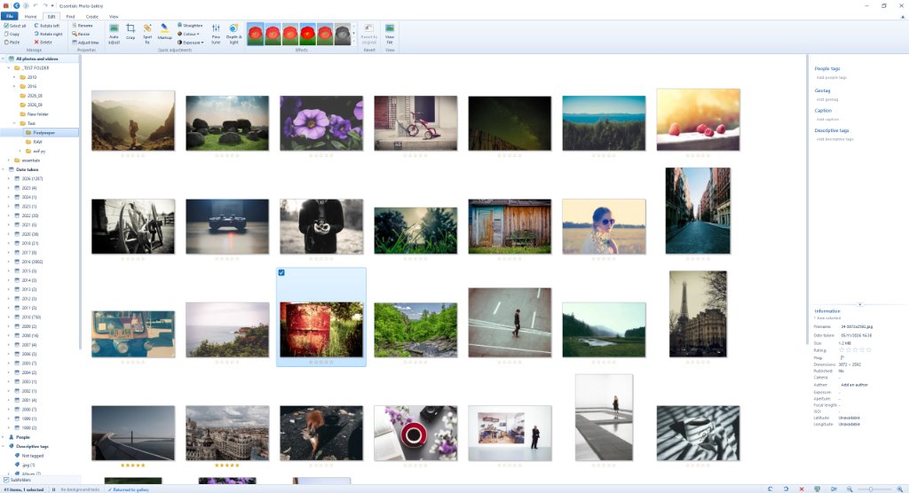

- **WLPG Hierarchical Tagging:** Nested descriptive tags, star ratings, flags, captions, and fast multi-tag filtering.
- **64-Bit Large-Library Architecture:** Eliminates 32-bit out-of-memory crashes and stays responsive across 500,000+ photo libraries.
- **Updated Facial Recognition & People View:** Local SCRFD + ArcFace (ONNX) face detection, a dedicated **People** view (`Named People` & `People to Name`), face crops view, and batch confirmation.

- **Dark Mode:** Full Light and Dark theme support across the Ribbon, navigation panes, grid, and single-image viewer.

### Other Notable Improvements

- **Early Preview Tools:** Includes initial work-in-progress versions of Portrait blur & relighting, interactive Markup, Duplicate & burst photo finder, creation tools, and Map view.
