# Essentials Photo Gallery — Releases

Release history matching the published GitHub Releases (`EssentialsPhotoGallery_Setup_x64.exe`).

---

## Essentials Photo Gallery v0.17.0 (Pre-Release)

> **Highlights:** Thumbnail-time Visual Signatures & undoable hardened Auto-Stacking, **Tiles** & portrait-priority **Masonry** grid layouts, optional **Cameras** & AI **Subjects** nav sections, `F1` Keyboard Shortcuts modal + `Alt+1..9` Quick-Tag hotkeys, and optional **MobileCLIP-S1** local semantic search (`File → Options → Add-ons`).

### Key Additions
- **Thumbnail-Time Visual Signatures & Undoable Hardened Auto-Stacking:**
  - `ThumbnailDecodeWorker` now computes `phash64`, `dhash64`, `laplacian_sharpness`, and `lab_haar` directly from the decoded in-memory `QImage` during thumbnail generation and coalesces writes into `thumbnails.db` (`media_signatures`) without re-opening source files.
  - Hardened `auto_stack_raw_jpeg_pairs()` and `auto_stack_bursts()` skip existing stacks, enforce `30.0s` burst windows + `dhash64` anchor Hamming distance checks, exclude single-stem RAW+JPEG pairs from burst clustering, pick the sharpest/best-rated/flagged head, support single-step `Ctrl+Z` undo/redo (`_StackMutationUndoCommand`), and automatically promote a new head via `reconcile_stack_after_delete()` if a stack head is deleted.
- **Additional Photo Layouts (`Tiles` & `Masonry`):**
  - Added **Tiles** (`"tiles"`, uniform square 4px-rounded tiles) and portrait-priority **Masonry** (`"masonry"`, shortest-first column waterfall) alongside existing **Grid** (`"wlpg_grid"`) and landscape **Mosaic** (`"mosaic"`) views—condensed in the Ribbon **View → Photo layout** group into a vertical split **`View mosaic ▾`** button (top button cycles Mosaic → Tiles → Masonry; bottom dropdown lets you pick directly) with `[♥/★ N]` squircle badges and `QSettings` persistence.
- **Optional Left Nav `Cameras` Section (Default Off) & `Places` Backfill:**
  - Added an optional **Cameras** collapsible section (toggled in **File → Options → General → Show Cameras**, default off) sorted alphabetically (`A–Z`) with live camera model counts, Make prefix deduplication, `__NO_CAMERA__` filter support, and `FilterQuerySpec.camera_model` SQL filtering.
  - Added automatic idempotent startup and write-path (`bulk_upsert_media`, `set_geotag`) resolution of `Country → State → City` via `resolve_location_hierarchy()` so geotagged libraries populate the **Places** tree immediately.
- **Keyboard Ergonomics & Discoverability (`F1` & `Alt+1..9`):**
  - Added `KeyboardShortcutsDialog` (`F1` / Ribbon **`?`** button next to the Settings cog) featuring a searchable shortcut catalog across navigation, rating/culling, viewer, Compare Mode, and batch face confirmation, plus type-to-filter `Alt+1..Alt+9` Quick-Tag hotkey pickers working across Grid View, Single Media Viewer, and Spacebar Quick Preview (and renamed **File → About and updates**).
- **Create Collage Animated Filmstrip & Right-Pane Clickable Folder Link:**
  - Replaced the Create Collage bottom card tray with a headerless, full-bleed 4:3 filmstrip featuring hover-only `✕` removal, mouse-wheel & edge-chevron scrolling, and smooth `OutCubic` animated drag-and-drop reordering that glides sibling tiles aside into a dashed destination socket.
  - Added a clickable **`Folder:`** row directly beneath `Filename:` in the right-hand **Information** pane to open the selected item's folder directly in Windows File Explorer (`Multiple folders` when a multi-selection spans directories).
- **Optional `MobileCLIP-S1` Semantic Search & AI Subjects Add-On:**
  - Added `SemanticEngine` (with pure-Python CLIP BPE `tokenizer.json`, shortest-edge 256 center-crop image preprocessing, and `input_ids`/`attention_mask` ONNX inference), `SemanticVectorRepository` (`semantic_vectors.db` with float16 vectors + cached L2-normalized search matrix), and background `SemanticIndexWorker` (automatically scheduled on startup, folder sync, worker resume, and add-on download, reading strictly from cached `thumbnails.db` blobs) alongside HTTP `Range` resumable model download in **File → Options → Add-ons** (with an automatic 1-click download prompt when **Subjects** is enabled or clicked before installation).
  - Powers privacy- and scope-aware Reciprocal Rank Fusion (`fuse_semantic_and_fts_scores`) in the Search Box and an optional **Subjects** left-nav section (`Show Subjects (AI)`, default off) covering 12 built-in visual concepts (`Family`, `Kids`, `Pets`, `Portraits`, `Food`, `Sports`, `Landscape`, `Night`, etc.).

---

## Essentials Photo Gallery v0.16.0

**Essentials Photo Gallery 0.16.0** delivers major **speed & responsiveness improvements** across World Map View and the thumbnail grid, a **borderless fullscreen Quick Preview (`Space`)**, a **redesigned draggable Filmstrip**, an **overhauled Export / Resize** workflow, **Favourites & Tri-State Culling Flags**, and an **auto-detecting Google Picasa importer**.

### Performance Improvements (Map View, Grid & RAW Pipeline)

- **World Map View Speed Overhaul (Zero-CDN & Web Worker Clustering):** Bundled Leaflet `1.9.4` + Web Worker clustering assets into `resources/leaflet/` and registered a `QWebEngineUrlSchemeHandler` (`gallerythumb://leaflet/...` & `gallerythumb://media/<id>`) so World Map View and Adjust Location open instantaneously offline without hitting `unpkg.com` or Base64-encoding thumbnails. Replaced per-pan SQLite queries with a lightweight ~1 km overview query (`query_map_overview_cells`) clustered off-thread in `map_clusters_worker.js`, lazy cluster member lookup, incremental marker diffing, `media_rtree`-backed bounds, `_map_data_dirty` caching, `"Current View vs. Entire Library"` scope toggle, and a 3-second post-launch idle pre-warm.
- **Two-Tier Fast Cache & Viewport-Center Priority Scheduler:** Split fast batched `thumbnails.db` reads (`BatchThumbCacheWorker` on `thumb_cache_pool`) from disk decodes (`thumbnail_pool`, compact viewport-center priority window of 12 in-flight workers), eliminating head-of-line blocking behind slow RAW/video decodes.
- **Batched DB Commits, Zero-SQL Paint & Tier-0 RAW Fast-Path:** Added `ThumbnailWriteCoalescer` for batched WebP commits, removed synchronous SQLite face queries from `MediaCardDelegate.paint()` in favor of off-thread `BatchFaceCropWorker` prefetching, added `extract_tiff_embedded_jpeg()` to extract embedded previews from TIFF-based camera RAWs without invoking `rawpy.imread()`, and added `ScanCrashTrace` (`active_scan_trace.json`) crash recovery.
- **HiDPI Panorama-Aware Thumbnail Pipeline:** Raised `THUMB_MAX_DIM` from `256` → `384` with a `240px` short-edge floor (up to `768px` long edge for panoramas), 2× pre-decode `SmoothTransformation`, WebP quality `85`, and one-click **Rebuild Thumbnail Cache (HiDPI & Panoramas)** in **Options → Database**.

### Quick Preview & Updated Filmstrip

- **Borderless Fullscreen Quick Preview (`Space`):** Press `Space` in Grid View for an instant borderless full-screen lightbox over a dimmed backdrop with floating filename, star rating, and vector Pick/Reject/Favourite HUD (`Enter` to open full view, `←`/`→` to browse, `0–5` to rate, `P` Pick, `X` Reject, `U` Unflag, `F` Favourite, `Space`/`Esc` or backdrop click to dismiss; auto-repeat `Space` ignored). Hold `Shift` with `0–5`, `P`, `X`, `U`, or `F` in Grid or Single Image View to apply and auto-advance.

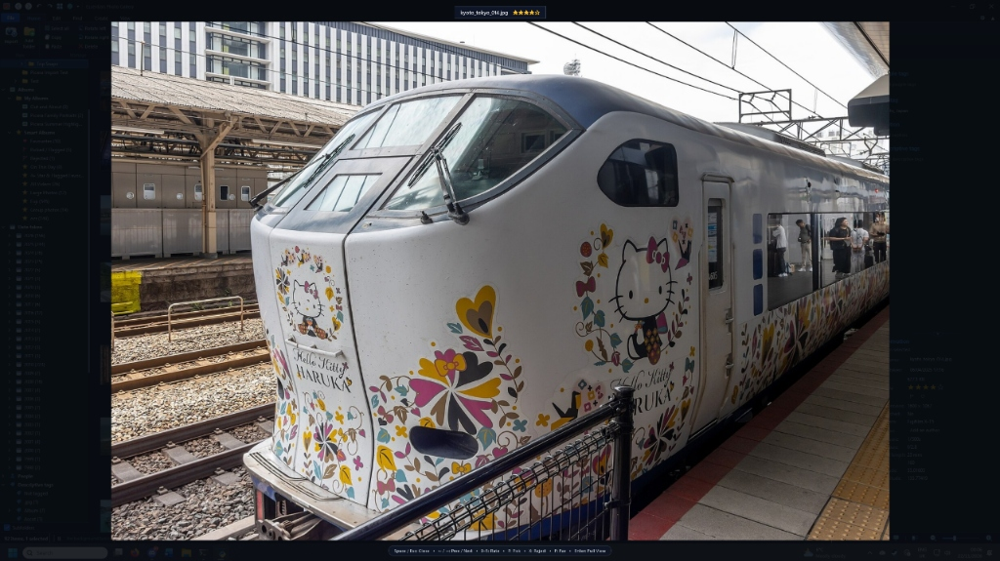

- **Updated Draggable Filmstrip & Flush Pull-Tab:** Headerless `BottomFilmstripDock` with smooth slide-up/down animation, translucent edge scroll buttons, and a welded bottom-left viewer pull-tab (`⌄` / `⌃`) aligned flush against the filmstrip border. Drag the filmstrip taller (up to `148px`) to scale thumbnails proportionally, with its height remembered across hide/show toggles and app restarts, and unified bottom-right squircle star/heart + rating pills.

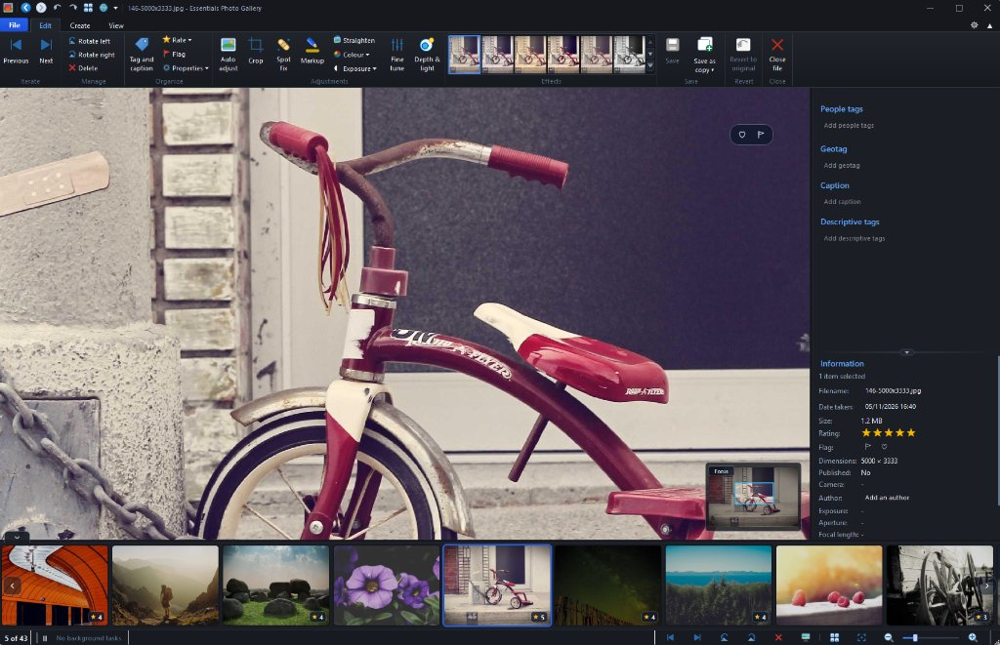

### Upgraded Export / Resize & Photographer Culling Toolkit

- **Overhauled Export / Resize Dialog:** Defaults cleanly to **Original size (No resize)** with an always-visible **Customize dimensions & scaling** toggle (housing **Fit within**, **Exact W × H**, **Percentage**, **Do not enlarge smaller photos**, and **+ Save Preset**), customizable **File name** patterns (`Auto`, `name_export`, `name_size`, `name_edited`, `Keep original name`, `Custom...`) with live italic `Filename:` preview, plain `Original → Output` readout, and in-session settings memory.

- **Zoom Minimap Navigator:** Floating bottom-right minimap in Single Image View and Compare Mode when zoomed beyond fit (`> 100%`), with click/drag panning and quick scroll-wheel zoom controls.
- **Batch Rename (`F2`) & Camera AF Area Overlay (`A`):** Template-driven batch renaming (`{name}`, `{date}`, `{seq}`, `{camera}`, etc.) with two-phase atomic staging and `.xmp` / `.OriginalFiles` syncing, plus on-demand EXIF/MakerNote AF focus point overlay (`A`) for Nikon, Canon, Sony, and Fujifilm.

### Favourites, Tri-State Flags, Picasa Importer & Polish

- **Favourites, Tri-State Pick/Reject Flags & Mosaic Polish:** Separated permanent **Favourites** (`F` / `Shift+F`) from **Pick / Neutral / Reject** culling flags (`P`/`X`/`U`) with unified centered squircle badges across Grid, Mosaic, and Filmstrip, a cycling Flag button and transparent cull buttons in the Information panel, **Options → General → Enable Favourites**, and permanent live-counted **Smart Albums** (`Favourites`, `Picked / Flagged`, `Rejected`, `Unflagged`). Mosaic View also features tighter `4px` tile spacing and a clearer blue selection frame.
- **Auto-Detecting Google Picasa Importer:** Automatically detects `.picasa.ini` and `contacts.xml` on folder scan to import Picasa stars (→ Favourites), captions, tags, face boxes/names, and `.album:` virtual albums.
- **Welcome Canvas, Dark Theme Fixes & Auto-Closing Updater:** Theme-aware 3-card `WelcomeEmptyOverlay` (defaulting folder import to your system Pictures folder), Dark Theme fixes for Quick Find People carousel and Depth & Light, and `AboutDialog` update checker that automatically closes the app cleanly when launching a downloaded installer.

---

## Essentials Photo Gallery v0.15.0

**Essentials Photo Gallery 0.15.0** introduces a **revamped Create Studio with integrated main-window UI** (replacing cramped popup dialogs with full-window Ribbon, Inspector, and Filmstrip workspaces), **Depth & Light 2.0 (3D Relight)** with interactive virtual lights and surface-normal relighting, a **unified Crop & Straighten bar**, an upgraded **Resize & Export** dialog, consolidated **ThemeTokens** contrast auditing, and key **reliability & data-safety hardening** for OneDrive libraries and third-party XMP sidecars.

### Revamped Create Studio (Integrated Main-Window UI)

- **Full-Window Studio Workspaces:** Replaced the cramped modal dialogs for **Collage**, **Photo Fuse**, **Panorama**, **Colour Pop**, and **3D Cinematic** with integrated main-window workspaces featuring a dedicated contextual Ribbon tab (with **Save New...** and **Cancel** anchored in the **Close** group on the right), a themed right-hand inspector pane, a zoomable live canvas with `Fit` / `100%` / zoom slider controls, and exact restoration of your previous view, ribbon tab, and dock layout when closing.
- **Collage (formerly Auto Collage):** Choose from **Blended**, **Grid**, **Polaroid**, and **Then Now** layouts, visual **Canvas Shape & Quality** presets (**Square**, **16:9 Wide**, **9:16 Phone**, **4:3 Wide**, **3:4 Tall**, **3:2 (6×4)**, **2:3 (4×6)**, **5:4 (10×8)**, **4:5 Social**, **A4 Wide**, **A4 Tall**), background colour swatches, smooth per-photo zoom and drag-to-pan framing (backed by cached preview proxies), and a drag-and-drop reorderable bottom photo strip.
- **Photo Fuse, Panorama, Colour Pop & 3D Cinematic:**
  - **Photo Fuse:** Full-canvas face/region expression swapping with a bottom thumbnail tray for base shot & expression selection, **Add Region**, **Show Boxes**, and **Compare Original**.
  - **Panorama:** Interactive stitching with projection modes, bottom source-photo tray, and optional **AI Fill Gaps** for uneven stitched borders.
  - **Colour Pop:** Full-canvas selective colour studio with Ribbon **Quick Styles** swatches (**Red Pop**, **Blue Pop**, **Green Pop**, **Warm Tones**, **Cool Tones**) and edge-aware contour snapping on the Add/Remove colour selection brushes.
  - **3D Cinematic:** 2.5D depth-parallax motion studio with camera presets and MP4 export.
- **Collapsible Bottom Filmstrip Dock:** Added `BottomFilmstripDock` (`src/ui/bottom_filmstrip_dock.py`) for quick photo navigation in Single Image View (hidden by default, toggleable on demand) and studio tray hosting across Classic Aero, Fluent, and Dark Studio themes.

### Depth & Light 2.0: 3D Relight & Virtual Light Studio

- **3D Surface-Normal Reconstruction & Albedo-Preserving De-Lighting:** Replaced flat Z-slice relighting with joint-guided depth edge refinement, multi-scale Scharr + hemispherical subject volume normals (`DepthAndMatteEngine.get_refined_depth_and_normals()`), optional ONNX normal-map model support (`dsine.onnx` / `normal_bae.onnx`), and linear-light ambient **Original light** suppression that keeps deep blacks rich without washing out into grey.
- **Up to 3 Interactive Virtual 3D Lights & On-Canvas Gizmos:** Add up to 3 independent **Point**, **Spot**, or **Rim** lights with draggable on-canvas source orbs and aim reticles, per-light **Temperature (1800K–10000K)** + color swatch picker, **Intensity**, **Softness**, **Distance (Close ↔ Far)**, **Spot cone**, **Fine Shaping** (Gloss, Depth Range, and procedural **Gobo** projections), and **Hold to Compare (Original)**.
- **1-Click "Relight Looks" Sphere Presets:** Six shaded visual lighting sphere presets (**Warm Streetlamp**, **Golden Rim**, **Rembrandt**, **Dual Neon**, **Moonlit**, **Window Gobo**) configure lights and ambient dimming in one click.

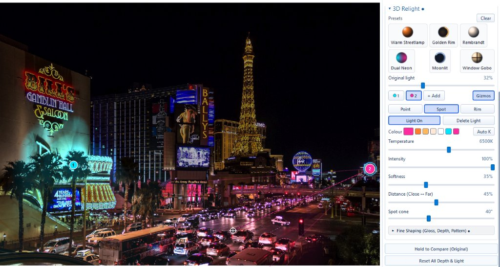

### Unified Crop & Straighten Tool

- **Draw-a-Line Straighten & Smooth Angle Slider:** Replaced the disconnected straighten flow with a unified **Crop & Straighten** bar featuring a checkable **Straighten** line-draw tool (*"Straighten the image by drawing a line on it"*, synced with Fine Tune), a `-15.0° .. +15.0°` slider with double-click reset, **Auto** horizon detection, and a temporary `9×9` fine alignment grid while rotating. Clicking **Straighten** on the Edit Ribbon auto-straightens and opens this unified bar directly.
- **Streamlined Aspect Ratios & Progressive Disclosure:** Removed reoriented duplicate presets (`3:4`, `2:3`, `4:5`, `9:16`) in favor of **↻ Flip** (`X`), hid `[W] : [H] [+ Save]` unless **Custom** is active, persisted saved custom ratios in `QSettings`, and restored a crisp `▾` chevron on the ratio selector across all themes.
- **Composition Grids, Scrim & AI Expand Preview:** Added **Grid ▾** (`G`) cycling through Rule of Thirds (`3×3`), Golden Ratio (`Phi`), Diagonals, Center Crosshair, and None; refined outer scrim opacity (~65% idle / ~40% dragging) with L-shaped corner brackets and `Shift + Drag` corner ratio lock; and added an `AI Expand` fill-zone preview with dynamic **Apply & Fill** labeling.

### Unified Resize & Export

- **Upgraded `Resize & Export` Dialog:** Available from both Gallery View (**Export / Resize...**) and Single Image View (**Save as copy ▾ → Resize & Export...**, baking active non-destructive edits and crops).
- **Flexible Modes, Presets & Privacy:** Supports **Fit within (Long Edge)**, **Exact W × H** (with **Lock aspect ratio** and **Center-crop to fill**), and **Percentage (`%`)**, alongside **Do not enlarge smaller photos**, `QSettings`-saved custom size presets, live output resolution & file-size estimates, `JPEG`/`WebP`/`PNG` format & quality controls, **Strip GPS & EXIF metadata**, and non-destructive collision naming.

### Context Menus, On-Demand OCR & Theme Architecture

- **WLPG-Faithful Context Menus & On-Demand OCR:** Aligned Gallery Grid and Single Image View right-click menus with a compact WLPG structure (`AI & Scan ▸` submenu with `Find Similar Photos...`, `Copy subject to clipboard`, `Remove background`, `Rescan for faces`, and on-demand `Scan for text (OCR)` even inside `scan_ocr = 0` folders, plus `Rename...` in Single Image View).
- **Central `ThemeTokens` & Contrast Auditing:** Consolidated theme colors into `ThemeTokens` and semantic `uiRole` properties across Classic Aero, Fluent, and Dark Studio stylesheets, backed by an automated headless contrast audit test suite (`tests/test_theme_contrast_audit.py`).

### Safety, Reliability & Bug Fixes

- **Windows OneDrive Files On-Demand Protection:** Background workers (`FolderSyncWorker`, `ThumbnailDecodeWorker`, `FaceDetectionWorker`, `OcrScanWorker`, `DuplicateDetectionEngine`, `FolderWatcher`, and `MetadataSyncDaemon`) now inspect Windows `st_file_attributes` (`OFFLINE | RECALL_ON_OPEN | RECALL_ON_DATA_ACCESS`) before reading file bytes, keeping cloud-only placeholders indexed without accidentally triggering gigabytes of OneDrive downloads.
- **Non-Destructive Third-Party XMP Preservation:** When optional file write-back is enabled, `merge_wlpg_xmp_packet()` now surgically updates only Essentials Photo Gallery's managed tags, ratings, captions, GPS, and face regions—preserving unrelated third-party namespaces such as Adobe Lightroom / Camera Raw develop edits (`crs:*`), darktable history (`darktable:*`), `dc:rights`, and `photoshop:Headline`, and updating existing Lightroom-style `<stem>.xmp` sidecars in place.
- **Clean Fresh Start Reset Worker Shutdown:** Fixed a typo (`thumb_pool` → `thumbnail_pool`) in `perform_fresh_start_reset()` and ensured all active thumbnail, scanner, face, OCR, map, and XMP workers are cleanly cancelled and awaited before resetting `catalog.db` and `thumbnails.db`.
- **World Map Worker Pool & Pause Integration:** Routed `WorldMapView` cluster thumbnail decoding through the application's managed `thumbnail_pool` with per-worker cancellation flags, viewport-change cancellation, and global Pause Background Tasks support.
- **Dark Theme & Re-Entrancy Polish:** Added `_applying_theme` re-entrancy guards in `create_studio_dialogs.py` and fixed dark-mode styling on the floating Crop toolbar, Quick find People carousel, and Create Studio / Filmstrip bottom trays.

---

## Essentials Photo Gallery v0.14.0

**Essentials Photo Gallery 0.14.0** takes a big step forward in both editing power and library cleanup—introducing **Advanced Fine Tune** with **Automatic Regional Masks**, a **revamped Duplicates Finder** paired with **Find Similar Photos**, and **Companion Phone GPS Matching** for automatic geotagging.

### Fine Tune Advanced Mode & Automatic Regional Masking

- **Advanced Fine Tune:** Fine Tune controls now have an **Advanced** mode (leaving the classic **Basic** controls untouched when you want simplicity), unlocking a live RGB histogram, **Smart Enhance**, **Whites** & **Blacks**, content-aware **Structure**, **Tone Curve** (`RGB` + `R`/`G`/`B` channels + S-Curve preset), **WB Eyedropper**, **8-Band Color Mixer (HSL)**, **Sharpen Masking**, **Color Noise**, **Vignette Feather**, **Orton Glow / Golden Hour**, and **Film Grain**.

- **Automatic Regional Masks (`Whole | Subject | Background | Sky`):** Isolate and adjust the **Subject**, **Background**, or **Sky** automatically using `DepthAndMatteEngine`, refine any region with the interactive **Add (+) / Subtract (-)** Smart Brush, and inspect a live **region-masked histogram**. The red mask overlay and dotted boundary can be toggled anytime (even while on **Whole Photo**), and the red fill automatically hides while dragging sliders so you can judge tonal changes clearly.

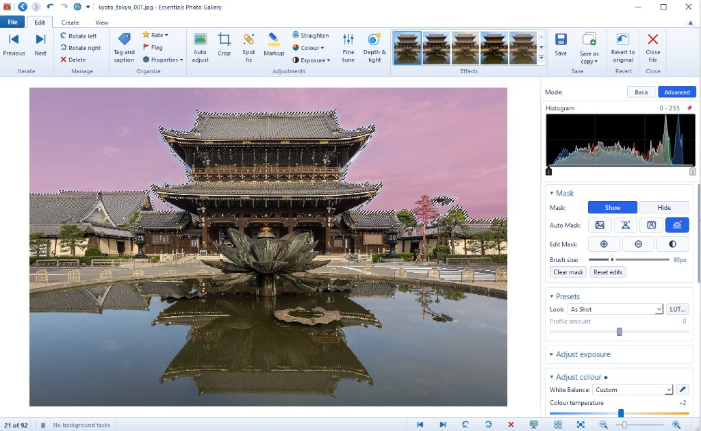

### Revamped Duplicates Finder & New Find Similar Photos

- **Revamped Duplicates & Bursts Workspace:** Redesigned around a dedicated contextual **`Duplicates`** Ribbon tab with **Compare Selected** (opening full Light Table Compare Mode), **Info Pane**, **Sort & Group**, **Auto-Pick** rules, **Metadata Merge** on delete, **Move Duplicates...**, and **Delete All Duplicates**, plus right-click **Show Card Details** toggles (`Filename`, `Folder Path`, `Resolution & Size`, `Date & Sharpness`).

- **New Find Similar Photos:** Right-click any photo in the Gallery or Single Image View and choose **Find Similar** to surface visually matching shots using spatial + position-invariant LAB color palette and perceptual hash matching. Fine-tune matches live between **70%–98%** (default **81%**) with the Scope Bar slider, expand from a folder to **Search all**, and jump right back to your photo's position when closing the search.

### Auto-Geotagging: Match Locations from Timed Photos

- **Companion Phone GPS Matching (`Home → Geotag ▾ → Match Locations from Timed Photos...`):** Copy GPS locations from your phone's geotagged photos (or a `.gpx` track) onto camera photos taken around the same time. Review side-by-side **Destination ← GPS Source** previews with enlarged hover cards, sort by any column, optionally sync a wrong camera clock using 2 photos, and undo in one step (`Ctrl+Z`).

### Other Notable Improvements & Fixes

- **Database Fresh Start & Empty-Library Prompt:** Added **Fresh Start (Reset Catalog & Thumbnails)...** in **Options → Database** (with confirmation warning, leaving files on disk untouched) and an empty-library `"No photos or videos in your gallery yet."` screen with a clickable **`Add a folder to your library...`** link.
- **Performance & Responsiveness:**
  - **Faster Face Recognition Model Loading:** Cached the loaded `FaceEngine` session across scans, skipped unused 2D/3D landmark and gender/age InsightFace models (`allowed_modules=["detection", "recognition"]`), and lowered background `FaceDetectionWorker` thread priority.
  - **Snappier Folder Manager:** Sped up opening and toggling via grouped `media_count` queries, batched policy commits, cached icons, deferred OCR probing, in-place tree/subfolder updates (no scroll jump), and deferred main-window refresh on close.
  - **Large Folder Indexing:** Improved UI responsiveness when adding large folders via **File → Add to Library**.
- **UX & Reliability Polish:**
  - **Tag & Caption Pane & Face Tagging:** Multi-selection people tags show `(All)` when shared across all selected photos and hide `(no box - add)`; clicking into the right pane closes an open face box, and the **Tag someone** popup fades out smoothly.
  - **Video Seek Bar, Immersive Mode & Navigation:** Clicking anywhere on the video seek bar jumps straight to that timestamp (`PointingHandCursor`), **Immersive Mode (`F4`)** keeps the draggable title bar and window controls visible, and Left Navigation / Folder Manager folders sort in true case-insensitive A–Z order.
  - **Home Ribbon `People` & `Geotag` Split Buttons:** Added the **Geotag ▾** dropdown menu and promoted **People** to a 2-part split button, plus improved narrow-screen Ribbon spacing.
  - **Bug Fixes:** Fixed **Object Eraser** and the 99% **LaMa Neural Inpainting** download hang from 0.13.0, fixed **Private Folders** unhide persistence and **Places** tree expansion persistence, reduced startup NVIDIA/DirectML probe popups, and prevented unprompted background ~280 MB face model downloads.

---

## Essentials Photo Gallery v0.13.0

Welcome to **Essentials Photo Gallery 0.13.0**! This release upgrades the core imaging and UI engine for faster everyday browsing, introduces a **Folder Manager & Private Folders** system, adds opt-in **Offline Text-in-Photo Search (OCR)**, and polishes **AI Inpainting** across **Crop AI Expand** and **Object Eraser**.

### Core Stack Upgrade, Faster RAWs & Cleaner Highlights

Under the hood, **0.13.0** moves to a newer runtime (**OpenCV 5.0**, **Qt 6.12**, **NumPy 2.5**, and **Pillow 13**) with noticeable speed and image-quality gains:

- **Instant RAW Browsing & Thumbnails:** Opening folders of camera RAW files (`.CR2`, `.CR3`, `.NEF`, `.ARW`, `.RAF`, `.DNG`) now extracts the camera's embedded JPEG preview for immediate thumbnails and Single Image View opening, only running full 16-bit demosaicing in the background when you actively edit sliders.
- **Natural Highlight Roll-Off in Fine Tune & Auto-Adjust:** Pushing **Exposure**, **Highlights**, or **Auto-Adjust** no longer clips bright skies or skin highlights into harsh yellow or magenta—extreme highlights now desaturate smoothly toward natural white.

### Inpainting: Crop AI Expand & Object Eraser

- **Cleaner Crop AI Expand & Straighten:** Expanding a photo's canvas or straightening crooked horizons now blends seamlessly into the edges and corners without leaving dark seam lines or edge artifacts.
- **Contextual AI Object Eraser:** Painting over unwanted objects in **Spot Fix -> Object Eraser** (or using **Crop AI Expand**) now offers a one-time contextual prompt to download the optional **LaMa Neural Inpainting** add-on (~208 MB), while keeping built-in basic inpainting ready out of the box.

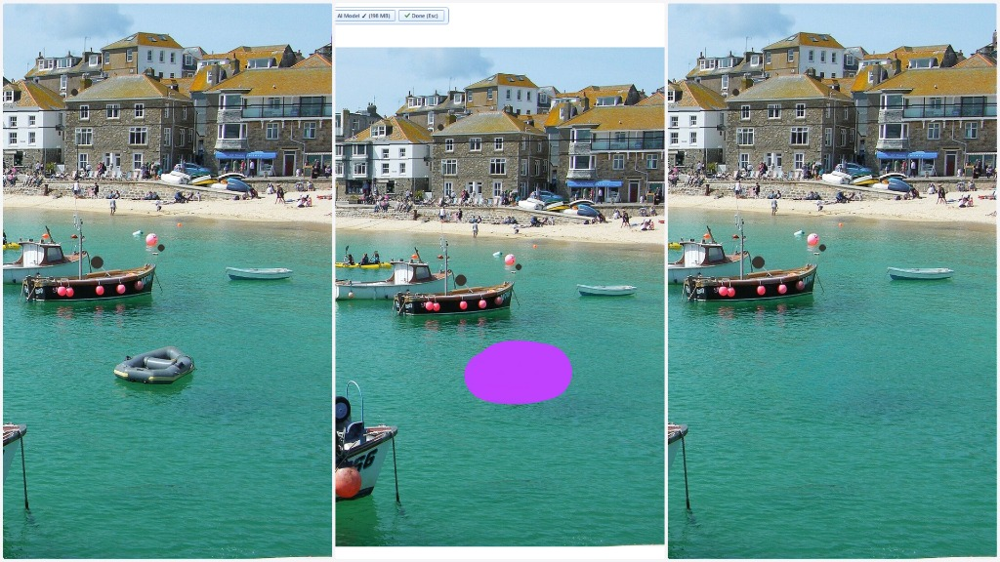

### Offline Text-in-Photo Search (OCR)

Find receipts, street signs, documents, and screenshots by the words inside them—completely offline:

- **Opt-In Per Folder:** Text recognition is off by default; enable it on any folder from **Folder Manager** (or run an on-demand **Scan Folder for Text Now**). If no OCR engine is installed yet, you'll be prompted to download **RapidOCR (~15 MB)** in one click, or point to an existing **Tesseract** or **Windows Native OCR** setup in **Options -> Add-ons**.
- **Search & Copy:** Extracted text is indexed in the local database for instant search and Smart Albums, and appears selectable/copyable right in the **Information** pane.

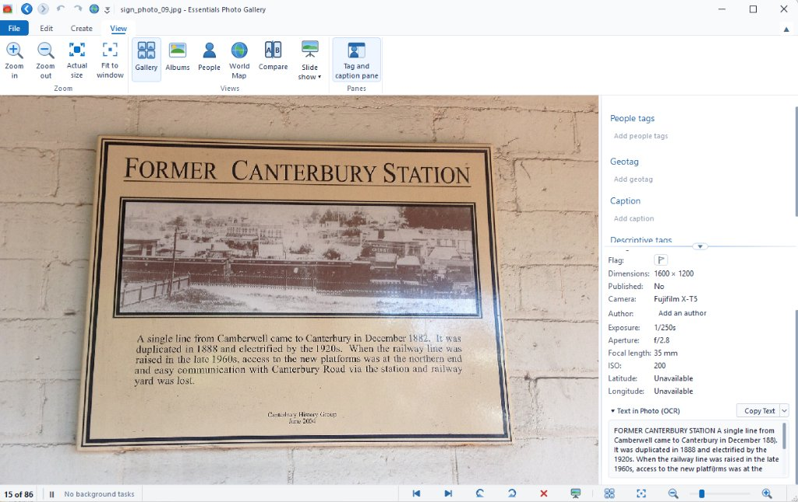

### Folder Manager & Private Folders

- **Folder Manager:** Open **Folder Manager** to add or remove catalog folders, filter the folder tree, switch folders between **Scan Always**, **Scan Once**, and **Exclude from catalog**, toggle Face Recognition and Text (OCR) per folder, and cascade settings to subfolders.
- **Private Folders & Flexible Unlock:** Mark sensitive folders as **Private** to hide their photos, people, tags, and places until unlocked from the **File** menu (hidden automatically when no private folders are in use). Protect unlocking with a **PIN / Passcode**, **Windows Login / Windows Hello**, or 1-click unlock, with optional idle auto-lock.

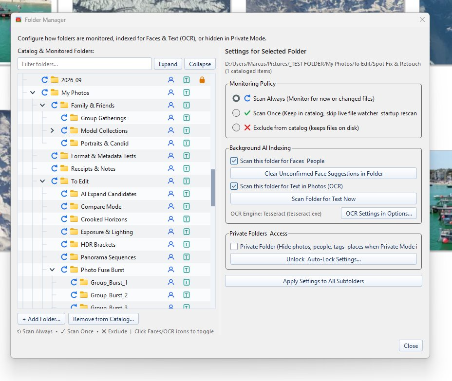

### Other Notable Improvements

- **USB Smartphone & Camera Import:** Native Windows **MTP/PTP** import with thumbnail previews, duplicate detection, and streamed transfers for iPhones, Android phones, and cameras.
- **Auto Collage Polish:** Reorder photos manually in all collage styles (including **Blended Collage**), drag cropped photos with the **Hand** tool to adjust framing, drag **Polaroids** freely across the canvas, and get count-aware Grid layouts (e.g. `3x1` / `1x3` for 3 photos).
- **Add-ons & In-App Update Check:** Renamed **Options -> Add-ons** with clearer status for LaMa and OCR, plus a **Check for Updates...** button in **About**.

Full Technical Changelog

- **Folder Manager, Private Mode, Missing Folder Recovery & Windows Rename Fix (`src/ui/folder_manager_dialog.py`, `src/ui/left_nav_dock.py`, `src/workers/folder_watcher.py`, `src/db/repository.py`, `src/ui/main_window.py`):**
  - Added `FolderManagerDialog` with `monitor_mode` (`always` / `once` / `excluded`), `scan_faces`, `scan_ocr` (default `0`), `is_private`, folder search/expand/collapse, and add/remove folder actions; PBKDF2 PIN hashing, Windows Login / Windows Hello (`UserConsentVerifier`) unlock mode, idle auto-lock, and conditional File menu Unlock visibility (`repo.has_private_folders()`).
  - Added guided *Locate* / *Remove* prompt when a library root folder is missing on startup, fixed `FolderWatcherDaemon.release_watched_subtree()` so Windows inline folder renaming succeeds without `QFileSystemWatcher` handle locks, and fixed clicking **Date taken** in the Navigation bar.
- **Offline OCR & Add-ons Management (`src/core/ocr_engine.py`, `src/workers/ocr_worker.py`, `src/ui/dialogs.py`, `src/ui/right_tag_dock.py`, `src/version.py`):**
  - Added multi-backend OCR (`rapidocr` via bundled `onnxruntime` runner or `rapidocr_onnxruntime`, `pytesseract`, `windows_media_ocr` / `winocr`) with 1-click AppData RapidOCR (~15 MB) download, FTS5 `media_ocr_fts` indexing, Smart Album `OCR Text` rule, and selectable/copyable OCR box in the Information pane.
  - Renamed Options tab to **Add-ons**, fixed `QMessageBox` import in `dialogs.py`, replaced editable-looking path boxes with selectable `QLabel`s, added contextual first-use prompts for LaMa (~208 MB) and RapidOCR (~15 MB), and added `AboutDialog` GitHub Releases update checking (`src/version.py`).
- **RAW Fast-Path, Highlight Roll-Off & Fine Tune Ergonomics (`src/imaging/image_loader.py`, `src/imaging/opencv_engine.py`, `src/ui/media_viewer.py`, `src/ui/right_tag_dock.py`):**
  - Added `decode_raw_embedded_preview()` + `_upgrade_raw_to_full_demosaic_async()`, CIE $L^*a^*b^*$ highlight chroma roll-off, focus-aware mouse-wheel sliders, live RGB/Luminance histogram, and Dark Studio bug fixes across Edit tools, Folder Manager, and Information pane.
- **Crop, AI Expand, Auto Collage & UI Polish (`src/ui/crop_tool.py`, `src/imaging/opencv_engine.py`, `src/imaging/create_tools.py`, `src/ui/create_studio_dialogs.py`, `src/ui/grid_view.py`, `src/ui/people_directory_view.py`):**
  - Fixed `straighten_with_ai_fill` (`BORDER_REPLICATE` + dilated mask + eroded feather) and `expand_canvas_with_ai_fill` seam lines, rotated inscribed crop bounds & rotated dimmed overlay, accidental grey-border click guard, quick *Clear Ratio* button, Auto Collage count-aware grids (`compute_grid_slots`), manual photo reordering across all styles, Hand-tool crop framing (`focus_center`), draggable Polaroids, view-aware title bar (`Map`, `People`, `Albums`, `Compare`), and hiding 0-photo entries in People View.
- **Core Stack, Alignment & Installer (`photogallery.spec`, `installer.iss`, `main.py`):**
  - Upgraded to **OpenCV 5.0.0**, **NumPy 2.5.4**, **PySide6 / Qt 6.12.0**, and **Pillow 13.0.0** (`pillow-heif 1.8.1`, `pillow-jxl-plugin 1.3.8`); upgraded burst/panorama alignment to `cv2.USAC_MAGSAC`; fixed OpenCV 5.0 `cv2.HoughLinesP` `(N, 4)` shape handling; hardened `installer.iss` with `AppMutex=EssentialsPhotoGallery_Mutex`, `CloseApplications=yes`, and optional uninstall AppData cleanup prompt.
- **Geotagging, Undo/Redo & Polish:**
  - Updated offline gazetteer and Geotagging fixes.
  - Added Revert to original into undo/redo queue.
  - Various UI refinements and bug fixes.

---

## Essentials Photo Gallery v0.12.0

Welcome to **Essentials Photo Gallery 0.12.0**! This release focuses on two of the most-requested ways to organize and cull a growing photo library: **Albums & Smart Albums** for curating collections without duplicating files, and a dedicated **Compare & Light Table Mode** for picking your best shots side by side. Alongside those headline additions, you'll also find smoother live photo editing, a much smarter **Photo Fuse**, a contextual World Map ribbon, and native Windows window snapping.

### Albums & Smart Albums

Whether you're pulling together highlights from a weekend trip or building dynamic collections that update themselves as you import new photos, **Albums** gives your library a new home right at the top of the navigation pane.

- **My Albums:** Group photos into non-destructive collections from the right-click menu (`Add to Album` or `New Album from Selection...`) without moving or copying anything on disk. Pick your favorite photo as the **Album Cover**, and browse your albums as stacked photo cards in the new **Albums** view.
- **Smart Albums:** Build live rule-based collections using 17+ metadata dimensions—including date/time of day, orientation, star rating, flags, tags, camera manufacturer, and detected face count—with an instant **Live Preview** of how many photos match before you save. Built-in presets like *On This Day*, *4+ Star & Flagged Favorites*, and *All Videos* are ready out of the box.

### Multi-Photo Compare & Light Table Mode

Picking the sharpest keeper from a burst of nearly identical shots shouldn't mean flipping back and forth in a single viewer. Press **`C`** (or choose **Compare** from the View ribbon or right-click menu) to open the new **Compare** light table.

- **Flexible Layouts & Wipe Slider:** Inspect 2-up side-by-side, 2-up top/bottom, 3-up columns, 2×2 quad grid, or drag an interactive **Wipe Slider** curtain across two photos.
- **Pin Champion & Cycle Challengers:** Pin your current favorite (`Pin`) and step through the rest of your selection using the arrow keys or the bottom candidate filmstrip—with optional **Auto-Advance** as soon as you rate or flag a shot.
- **Inspect Every Detail:** Lock pan and zoom across all panes at 60 FPS, press **`F`** to **Zoom to Face** on every photo at once, toggle **Focus Peaking** and **Clipping Warnings**, and spot exposure differences immediately thanks to amber-highlighted shutter/ISO values and automatic **`★ Sharpest`** indicators.
- **RAW & High-Bit-Depth Support:** Compare JPEGs, camera RAW files (`.arw`, `.cr2`, `.cr3`, `.nef`, `.dng`, `.raf`, `.rw2`, `.orf`, etc.), and raw-sensor TIFFs side by side, and rate, rotate, dismiss, or jump straight into the editor.

### Smoother Editing & a Fun Photo Fuse Upgrade

- **Fluid Live Adjustments:** Heavy adjustment passes now render on a background worker with stage caching and an interactive drag proxy, so dragging exposure, tone, dehaze, or Colour Pop tolerance sliders stays responsive without freezing the UI.
- **Photo Fuse (for Group & Burst Shots):** Taking a group photo where one person blinked and someone else looked great in the next frame? **Photo Fuse** is a niche but fun tool in the Create menu that aligns burst shots automatically, detects faces, and lets you swap in the best expression per person with seamless blending.

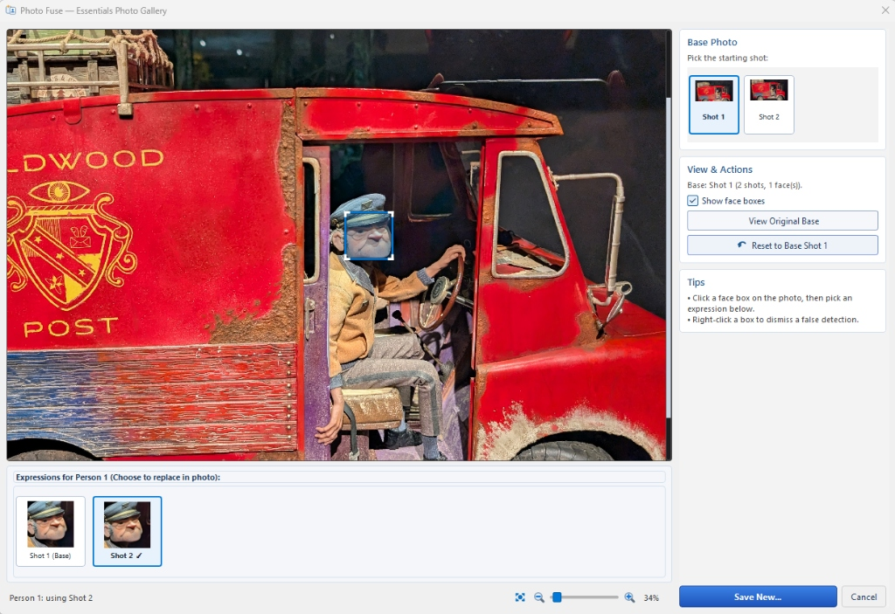

### Other Notable Improvements

- **Contextual World Map Ribbon & People View:** Switching to World Map brings up dedicated map styles, location search, and year/person/rating filters; People View adds a quick switcher in `View -> Views` and fixes inline suggestion inspection and filtering.
- **Native Windows Framing & Aero Snap:** Restored native Win32/DWM window snapping (`Win+Left/Right/Up/Down` and drag-to-edge), drop shadows, and Windows 11 rounded corners while keeping the custom Ribbon title bar.

Full Technical Changelog

- **Photo Editor & Colour Pop Performance Overhaul (`src/ui/media_viewer.py`, `src/imaging/opencv_engine.py`, `src/imaging/creative_effects.py`, `src/ui/create_studio_dialogs.py`):**
  - **Background Full-Resolution Master Pass:** Moved the 250ms debounced `render_adjusted_image` master render onto a `QRunnable`/`QThreadPool` worker with generation-counter cancellation and synchronous `ensure_master_rendered()` before Save/Export, eliminating UI freezes after releasing sliders.
  - **Dirty-Stage Checkpoint Caching:** Added a thread-safe bounded `_STAGE_CACHE` (`dd_img`, `tl_img`, `bokeh_data`) in `render_adjusted_image` plus in-place `float32` buffers so downstream adjustments skip upstream Denoise, Dehaze, Tone/LAB, and Bokeh Blur passes.
  - **Two-Tier Adaptive Proxy:** Added a `960px` `scrub_proxy_rgb` during active slider dragging (`_is_sliding`) that snaps to the crisp `1280px` `display_proxy_rgb` immediately on release.
  - **Faster Colour Pop Selection & Tolerance Scrubbing:** Added `compute_multi_color_similarity_mask()` (single LAB conversion and single `guided_filter_matte` pass across all picked colours, skipping the guided filter during active tolerance slider drags) and cached `float32` proxy buffers in `ColourPopDialog`.
- **Photo Fuse Overhaul (`src/imaging/create_tools.py`, `src/ui/create_studio_dialogs.py`):**
  - Added InsightFace `det_10g` (with `CPUExecutionProvider`) + Haar fallback face detection, robust ECC/homography burst alignment with unalignable-shot reporting, cached alignment across base-shot switches, landmark-guided seamless Poisson face blending (`cv2.seamlessClone`), cleaner base-shot selection UX, and show/hide face box overlays.
- **Panorama Stitcher Stability (`src/imaging/create_tools.py`, `src/ui/create_studio_dialogs.py`):**
  - Disabled OpenCL (`cv2.ocl.setUseOpenCL(False)`) during stitching and downscaled oversized inputs to prevent native OpenCV/OpenCL driver crashes during panorama synthesis.
- **Batch People Tagging & Navigation Restore (`src/ui/batch_people_view.py`, `src/ui/main_window.py`):**
  - Guarded `None` `outlier_reason` values in `QStyledItemDelegate` `paint`/`editorEvent` and selection handlers, and restored Left Navigation pane visibility when returning from Batch People Tag to Thumbnail, People, or Album views.
- **Multi-Photo Compare & Light Table View (`src/ui/compare_view.py`):**
  - Added native multi-photo side-by-side light table comparison (`2-Up Side-by-Side`, `2-Up Top / Bottom`, `3-Up Columns`, `2×2 Quad Grid`, `Wipe Slider`), `Pin Champion & Cycle Challenger`, Candidate Filmstrip, `Auto-Advance`, 60 FPS synchronized pan/zoom, `Zoom to Face (F)`, Focus Peaking, Clipping Warnings, EXIF difference highlighting, RAW/TIFF decoding via `rawpy`/WIC, and non-destructive culling.
- **Albums View & Smart Albums (`src/ui/albums_view.py`, `src/ui/smart_album_dialog.py`, `src/db/repository.py`):**
  - Added `AlbumsView`, `My Albums` & `Smart Albums` in Left Navigation, `SmartAlbumDialog` 17-dimension boolean rule builder, `camera_make`/`camera_model` EXIF indexing, and custom album covers.
- **Contextual World Map Ribbon, Native Windows Framing & People Suggestions Fixes:**
  - Contextual Map ribbon tab, native Win32/DWM Aero Snap + drop shadow, and People View inline suggestion inspection fixes.

---

## Essentials Photo Gallery v0.11.0

This release upgrades Depth & Light with one-click subject cutouts, adds new group navigation tools, expands modern image format support, and introduces a simple `F12` fullscreen mode alongside refinements to Fluent styling and Map View.

### Highlights

- **Depth & Light & Subject Cutout Tools:** Added 1-click **Copy Subject** and **Remove Background** (to transparent PNG) with interactive **Boundary shift**, **Boundary feather**, and live mask preview, plus an atmospheric 3D haze/mist engine alongside Portrait Bokeh and 3D Depth Relighting.

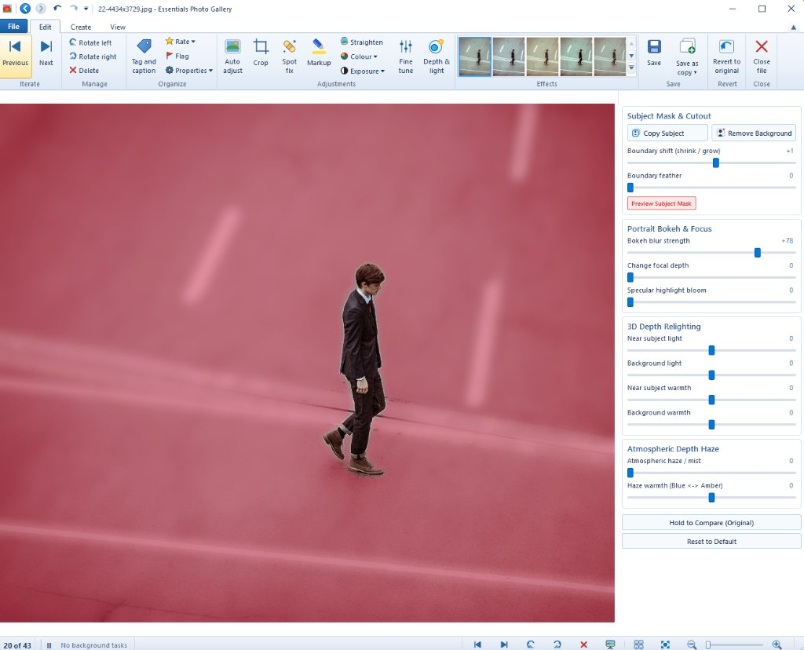

- **New Group Tools & Scroll Indicator:** Scrolling through large libraries now displays a floating group & date indicator badge (`Group` / `Item` timestamp), and right-clicking a group header offers quick **Collapse Group**, **Collapse all groups**, and **Select All Group Items** actions.

- **Extended Image Format Support:** Added native viewing and thumbnail generation for `AVIF`, `WebP`, `HEIC`/`HEIF`, and additional camera RAW formats.
- **Static Slideshow (`F12`):** Added a static fullscreen slideshow mode (`F12`) that works as a clean, distraction-free full-screen viewer alongside the animated pan-and-zoom slideshow.

### Other Notable Improvements

- **Fluent Style & Map View Refinements:** Further polish to Fluent icons, Ribbon controls, and theme switching, plus smoother flicker-free Map View zooming, reliable offline tile caching, and cluster pin navigation.
- **Filtering, Faces & Lighter Packaging:** Added Landscape/Portrait orientation filtering, a full-library Face Rescan option, Spot Fix / AI Object Eraser improvements, and removed `scipy` and `scikit-image` dependencies for a smaller installer and faster startup.

Full Technical Changelog

- **Depth & Light & Cutout Tools:** Added 1-click Subject Cutout (`Copy Subject` & `Remove Background` to transparent PNG), interactive mask boundary shift/feather with live preview, and an atmospheric 3D haze engine (optical bloom, horizon layering, soft-knee veiling).
- **Spot Fix & Inpainting:** Integrated AI Object Eraser (LaMa inpainting) alongside smart healing and red-eye correction.
- **Next-Gen Image Format Support:** Native viewing and thumbnail support for `AVIF`, `WebP`, `HEIC`/`HEIF`, and extended RAW formats.
- **Map View Refinements:** Smooth zooming without flicker, reliable offline tile caching, cluster pin navigation, and seamless view switching.
- **Face Detection:** Added full-library Rescan option, improved face thumbnail caching, and grouping stability.
- **Navigation & Filtering:** Added Orientation filter (`Landscape` / `Portrait`), persistent selection highlights across background refreshes, and smooth drag-and-drop file organization.
- **Static Slideshow (`F12`):** Added a static fullscreen presentation mode alongside animated pan-and-zoom.
- **Fluent Style & UI Themes:** Updated Fluent icons, refined Ribbon controls, and improved theme switching.
- **Lightweight Distribution:** Removed `scipy` and `scikit-image` dependencies to reduce installer and disk size while improving startup time.
- **Groups:** Added floating group scroll indicator and Group Context Menu options (`Collapse Group`, `Collapse all groups`, `Select All Group Items`).
- **Performance & Packaging:** 60 FPS interactive slider scrubbing for Fine Tune controls, synchronized `Ctrl + wheel` zoom, and PyInstaller ONNX model bundling and resolution fixes.

---

## Essentials Photo Gallery v0.10.0

v0.10.0 brings a major overhaul to the World Map view, introduces the offline **Places** browser in the navigation pane, and adds a new **Fluent** theme option for Windows 11.

### Highlights

- **World Map Overhaul:** Rebuilt the map experience with multiple map styles (`Clean (Light)`, `Street (OSM)`, `Satellite`, `Carto Dark`, and `Stamen Terrain`), clustered photo pins with thumbnail preview bubbles, and responsive zoom.

- **Places & Offline Reverse Geotagging:** Added an offline world gazetteer covering 25,000+ cities and regions and a **Places** tree (`Country / State / City`) in the Left Navigation pane so you can browse your library by where photos were taken.

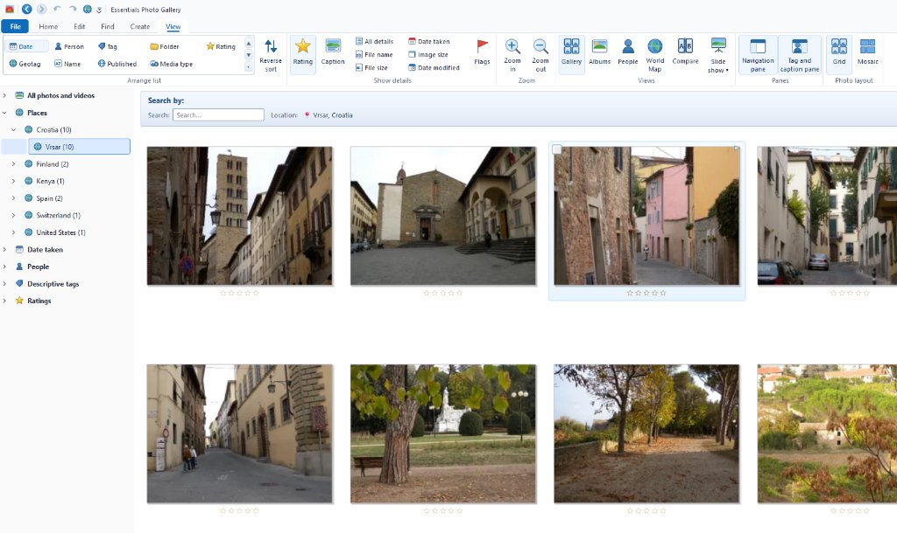

- **New Fluent UI Option & Title Bar QAT:** Added a modern Windows 11 **Fluent** light theme and icon style option alongside Classic Aero and Dark modes, plus a Quick Access Toolbar (`Back`, `Forward`, `Undo`, `Redo`) integrated directly into the title bar.

### Other Notable Improvements

- **Batch People Tagging & Face Health:** Added `Review Outliers`, `Missing Face Boxes` auditing, and XMP face region recovery directly from original files on disk, alongside a dedicated Batch People Tagging ribbon.
- **RAW, Video & Navigation Polish:** Expanded camera RAW decoding (`DNG`, `CR2`, `CR3`, `NEF`, `ARW`, `RW2`, `ORF`, `PEF`), video thumbnailing/metadata (`MP4`, `MOV`, `WMV`, `AVI`, `MKV`, `M4V`), and back/forward history navigation across views.

Full Technical Changelog

- **Places and Offline Reverse Geotagging:** Offline world gazetteer with 25,000+ cities and regions; Places tree added to the Left Navigation dock (`Country / State / City` hierarchy).
- **World Map View Overhaul:** Multiple map styles supported (`OpenStreetMap Standard`, `Carto Light`, `Carto Dark`, `Satellite/Aerial`, `Stamen Terrain`), clustered photo pins with preview thumbnail bubbles, responsive zoom, and updated map view UI.
- **Batch People Tagging and Face Health:** `Review Outliers` mode (comparing face embeddings against person cluster centroids), `Missing Face Boxes` mode, XMP face region metadata recovery, Batch People Tagging Ribbon, and cleaned up Face Recognition Options dialog.
- **Modern Fluent Theme and Title Bar QAT:** Added Fluent (Windows 11) light theme alongside Classic Aero and Dark modes, and integrated Quick Access Toolbar (QAT) into the custom title bar header (defaults to `Back`, `Forward`, `Undo`, `Redo`).
- **Media Pipeline and RAW Support:** Expanded camera RAW decoding (`DNG`, `CR2`, `CR3`, `NEF`, `ARW`, `RW2`, `ORF`, `PEF`), thumbnail generation and metadata reading for video files (`MP4`, `MOV`, `WMV`, `AVI`, `MKV`, `M4V`), and automatic EXIF orientation normalization and color profile preservation.
- **Navigation and Interface Fixes:** Fixed back/forward history navigation across grid, single viewer, map, and batch tagging views; improved docking pane auto-hide and restore consistency; corrected dropdown border overlap in Quick Find People; fixed Gallery arrow key navigation.

---

## Essentials Photo Gallery v0.9.0 (Beta)

The first public release of Essentials Photo Gallery — a modern, 64-bit continuation recreating the classic Windows Live Photo Gallery (WLPG) experience while adding large-library performance, updated facial recognition, and Dark Mode.

> **Important (Development Beta):** This project is in active development. File write-back is turned off by default, and we recommend leaving it turned off when using existing photo libraries so tag and metadata updates stay in the local database rather than modifying original files. Always keep backups of important photos.

### Highlights

- **Classic WLPG Ribbon, Thumbnail Grid & Single Image View:** Recreates the familiar WLPG Ribbon (`Home`, `Edit`, `Find`, `Create`, `View`), Left Navigation pane, Right Info/Tagging pane, fast thumbnail grid browsing, and dedicated single-image viewer.

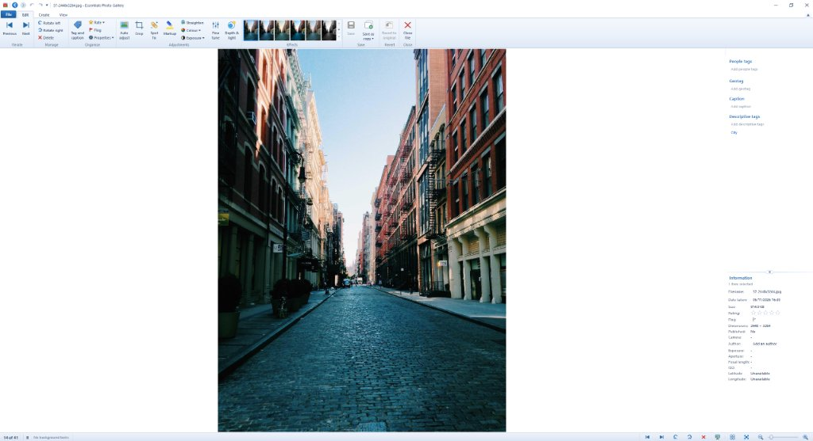

- **WLPG Hierarchical Tagging:** Nested descriptive tags, star ratings, flags, captions, and fast multi-tag filtering.
- **64-Bit Large-Library Architecture:** Eliminates 32-bit out-of-memory crashes and stays responsive across 500,000+ photo libraries.
- **Updated Facial Recognition & People View:** Local SCRFD + ArcFace (ONNX) face detection, a dedicated **People** view (`Named People` & `People to Name`), face crops view, and batch confirmation.

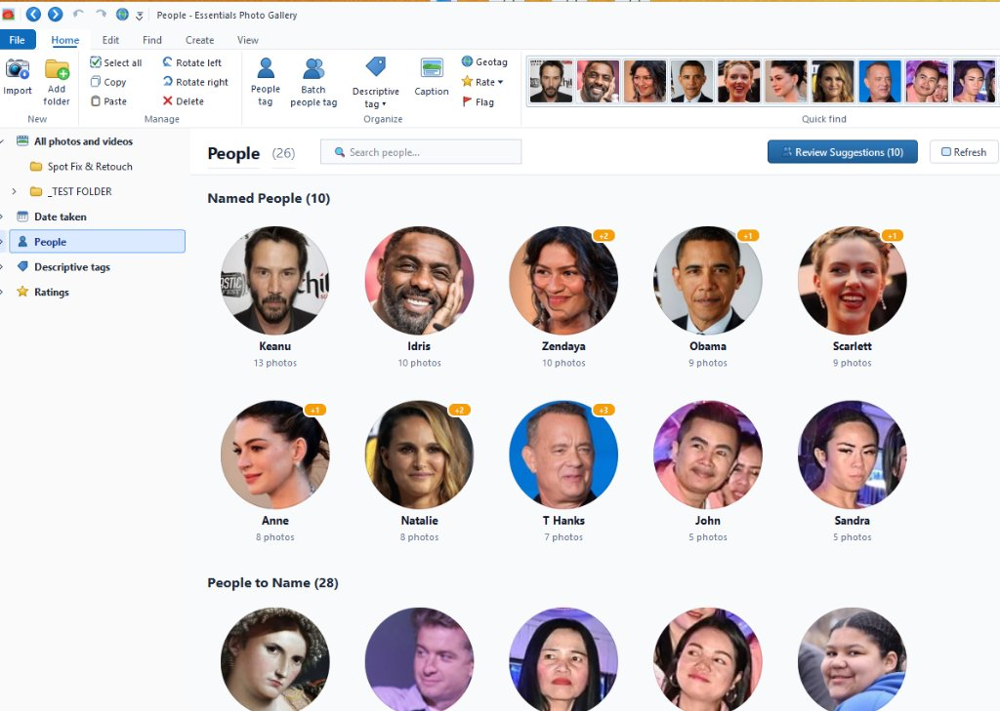

- **Dark Mode:** Full Light and Dark theme support across the Ribbon, navigation panes, grid, and single-image viewer.

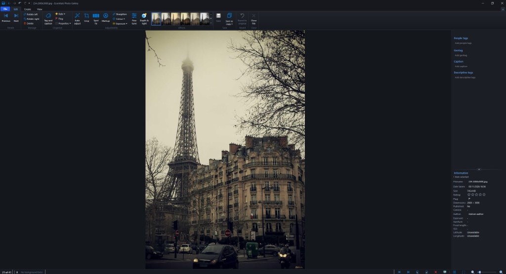

### Other Notable Improvements

- **Early Preview Tools:** Includes initial work-in-progress versions of Portrait blur & relighting, interactive Markup, Duplicate & burst photo finder, creation tools, and Map view.
