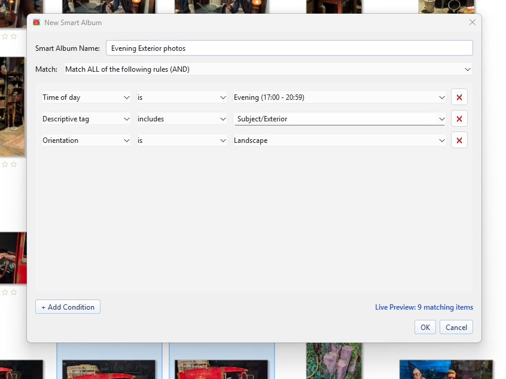
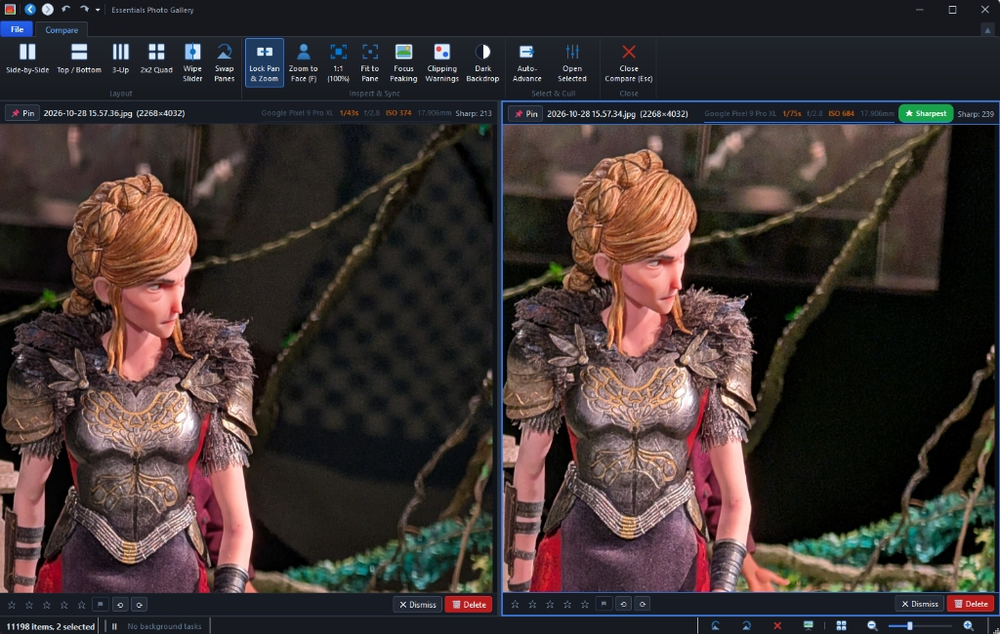
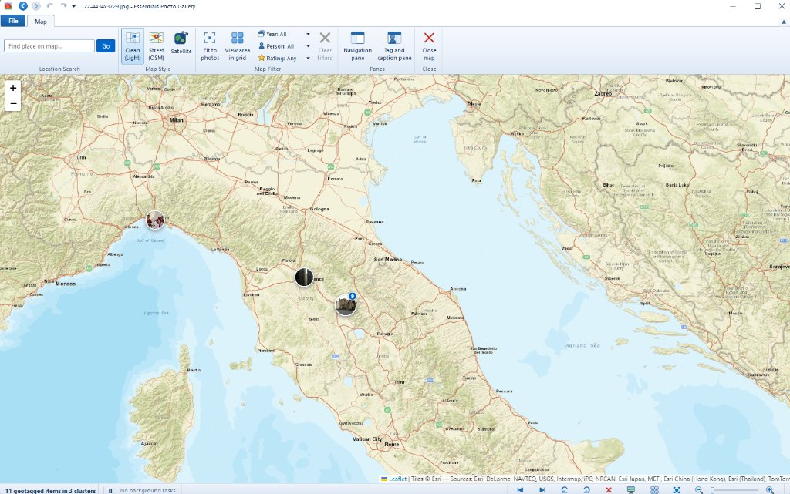
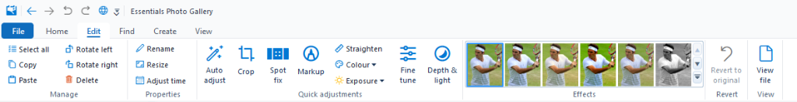

# Essentials Photo Gallery — Releases

Release history matching the published GitHub Releases (`EssentialsPhotoGallery_Setup_x64.exe`).

---

## Essentials Photo Gallery v0.12.0

Welcome to **Essentials Photo Gallery 0.12.0**! This release focuses on two of the most-requested ways to organize and cull a growing photo library: **Albums & Smart Albums** for curating collections without duplicating files, and a dedicated **Compare & Light Table Mode** for picking your best shots side by side. Alongside those headline additions, you'll also find smoother live photo editing, a much smarter **Photo Fuse**, a contextual World Map ribbon, and native Windows window snapping.

### Albums & Smart Albums

Whether you're pulling together highlights from a weekend trip or building dynamic collections that update themselves as you import new photos, **Albums** gives your library a new home right at the top of the navigation pane.

- **My Albums:** Group photos into non-destructive collections from the right-click menu (`Add to Album` or `New Album from Selection...`) without moving or copying anything on disk. Pick your favorite photo as the **Album Cover**, and browse your albums as stacked photo cards in the new **Albums** view.
- **Smart Albums:** Build live rule-based collections using 17+ metadata dimensions—including date/time of day, orientation, star rating, flags, tags, camera manufacturer, and detected face count—with an instant **Live Preview** of how many photos match before you save. Built-in presets like *On This Day*, *4+ Star & Flagged Favorites*, and *All Videos* are ready out of the box.

### Multi-Photo Compare & Light Table Mode

Picking the sharpest keeper from a burst of nearly identical shots shouldn't mean flipping back and forth in a single viewer. Press **`C`** (or choose **Compare** from the View ribbon or right-click menu) to open the new **Compare** light table.

- **Flexible Layouts & Wipe Slider:** Inspect 2-up side-by-side, 2-up top/bottom, 3-up columns, 2×2 quad grid, or drag an interactive **Wipe Slider** curtain across two photos.
- **Pin Champion & Cycle Challengers:** Pin your current favorite (`Pin`) and step through the rest of your selection using the arrow keys or the bottom candidate filmstrip—with optional **Auto-Advance** as soon as you rate or flag a shot.
- **Inspect Every Detail:** Lock pan and zoom across all panes at 60 FPS, press **`F`** to **Zoom to Face** on every photo at once, toggle **Focus Peaking** and **Clipping Warnings**, and spot exposure differences immediately thanks to amber-highlighted shutter/ISO values and automatic **`★ Sharpest`** indicators.
- **RAW & High-Bit-Depth Support:** Compare JPEGs, camera RAW files (`.arw`, `.cr2`, `.cr3`, `.nef`, `.dng`, `.raf`, `.rw2`, `.orf`, etc.), and raw-sensor TIFFs side by side, and rate, rotate, dismiss, or jump straight into the editor.

### Smoother Editing & a Fun Photo Fuse Upgrade

- **Fluid Live Adjustments:** Heavy adjustment passes now render on a background worker with stage caching and an interactive drag proxy, so dragging exposure, tone, dehaze, or Colour Pop tolerance sliders stays responsive without freezing the UI.
- **Photo Fuse (for Group & Burst Shots):** Taking a group photo where one person blinked and someone else looked great in the next frame? **Photo Fuse** is a niche but fun tool in the Create menu that aligns burst shots automatically, detects faces, and lets you swap in the best expression per person with seamless blending.

### Other Notable Improvements

- **Contextual World Map Ribbon & People View:** Switching to World Map brings up dedicated map styles, location search, and year/person/rating filters; People View adds a quick switcher in `View -> Views` and fixes inline suggestion inspection and filtering.
- **Native Windows Framing & Aero Snap:** Restored native Win32/DWM window snapping (`Win+Left/Right/Up/Down` and drag-to-edge), drop shadows, and Windows 11 rounded corners while keeping the custom Ribbon title bar.

Full Technical Changelog

- **Photo Editor & Colour Pop Performance Overhaul (`src/ui/media_viewer.py`, `src/imaging/opencv_engine.py`, `src/imaging/creative_effects.py`, `src/ui/create_studio_dialogs.py`):**
  - **Background Full-Resolution Master Pass:** Moved the 250ms debounced `render_adjusted_image` master render onto a `QRunnable`/`QThreadPool` worker with generation-counter cancellation and synchronous `ensure_master_rendered()` before Save/Export, eliminating UI freezes after releasing sliders.
  - **Dirty-Stage Checkpoint Caching:** Added a thread-safe bounded `_STAGE_CACHE` (`dd_img`, `tl_img`, `bokeh_data`) in `render_adjusted_image` plus in-place `float32` buffers so downstream adjustments skip upstream Denoise, Dehaze, Tone/LAB, and Bokeh Blur passes.
  - **Two-Tier Adaptive Proxy:** Added a `960px` `scrub_proxy_rgb` during active slider dragging (`_is_sliding`) that snaps to the crisp `1280px` `display_proxy_rgb` immediately on release.
  - **Faster Colour Pop Selection & Tolerance Scrubbing:** Added `compute_multi_color_similarity_mask()` (single LAB conversion and single `guided_filter_matte` pass across all picked colours, skipping the guided filter during active tolerance slider drags) and cached `float32` proxy buffers in `ColourPopDialog`.
- **Photo Fuse Overhaul (`src/imaging/create_tools.py`, `src/ui/create_studio_dialogs.py`):**
  - Added InsightFace `det_10g` (with `CPUExecutionProvider`) + Haar fallback face detection, robust ECC/homography burst alignment with unalignable-shot reporting, cached alignment across base-shot switches, landmark-guided seamless Poisson face blending (`cv2.seamlessClone`), cleaner base-shot selection UX, and show/hide face box overlays.
- **Panorama Stitcher Stability (`src/imaging/create_tools.py`, `src/ui/create_studio_dialogs.py`):**
  - Disabled OpenCL (`cv2.ocl.setUseOpenCL(False)`) during stitching and downscaled oversized inputs to prevent native OpenCV/OpenCL driver crashes during panorama synthesis.
- **Batch People Tagging & Navigation Restore (`src/ui/batch_people_view.py`, `src/ui/main_window.py`):**
  - Guarded `None` `outlier_reason` values in `QStyledItemDelegate` `paint`/`editorEvent` and selection handlers, and restored Left Navigation pane visibility when returning from Batch People Tag to Thumbnail, People, or Album views.
- **Multi-Photo Compare & Light Table View (`src/ui/compare_view.py`):**
  - Added native multi-photo side-by-side light table comparison (`2-Up Side-by-Side`, `2-Up Top / Bottom`, `3-Up Columns`, `2×2 Quad Grid`, `Wipe Slider`), `Pin Champion & Cycle Challenger`, Candidate Filmstrip, `Auto-Advance`, 60 FPS synchronized pan/zoom, `Zoom to Face (F)`, Focus Peaking, Clipping Warnings, EXIF difference highlighting, RAW/TIFF decoding via `rawpy`/WIC, and non-destructive culling.
- **Albums View & Smart Albums (`src/ui/albums_view.py`, `src/ui/smart_album_dialog.py`, `src/db/repository.py`):**
  - Added `AlbumsView`, `My Albums` & `Smart Albums` in Left Navigation, `SmartAlbumDialog` 17-dimension boolean rule builder, `camera_make`/`camera_model` EXIF indexing, and custom album covers.
- **Contextual World Map Ribbon, Native Windows Framing & People Suggestions Fixes:**
  - Contextual Map ribbon tab, native Win32/DWM Aero Snap + drop shadow, and People View inline suggestion inspection fixes.

---

## Essentials Photo Gallery v0.11.0

This release upgrades Depth & Light with one-click subject cutouts, adds new group navigation tools, expands modern image format support, and introduces a simple `F12` fullscreen mode alongside refinements to Fluent styling and Map View.

### Highlights

- **Depth & Light & Subject Cutout Tools:** Added 1-click **Copy Subject** and **Remove Background** (to transparent PNG) with interactive **Boundary shift**, **Boundary feather**, and live mask preview, plus an atmospheric 3D haze/mist engine alongside Portrait Bokeh and 3D Depth Relighting.

- **New Group Tools & Scroll Indicator:** Scrolling through large libraries now displays a floating group & date indicator badge (`Group` / `Item` timestamp), and right-clicking a group header offers quick **Collapse Group**, **Collapse all groups**, and **Select All Group Items** actions.

- **Extended Image Format Support:** Added native viewing and thumbnail generation for `AVIF`, `WebP`, `HEIC`/`HEIF`, and additional camera RAW formats.
- **Static Slideshow (`F12`):** Added a static fullscreen slideshow mode (`F12`) that works as a clean, distraction-free full-screen viewer alongside the animated pan-and-zoom slideshow.

### Other Notable Improvements

- **Fluent Style & Map View Refinements:** Further polish to Fluent icons, Ribbon controls, and theme switching, plus smoother flicker-free Map View zooming, reliable offline tile caching, and cluster pin navigation.
- **Filtering, Faces & Lighter Packaging:** Added Landscape/Portrait orientation filtering, a full-library Face Rescan option, Spot Fix / AI Object Eraser improvements, and removed `scipy` and `scikit-image` dependencies for a smaller installer and faster startup.

Full Technical Changelog

- **Depth & Light & Cutout Tools:** Added 1-click Subject Cutout (`Copy Subject` & `Remove Background` to transparent PNG), interactive mask boundary shift/feather with live preview, and an atmospheric 3D haze engine (optical bloom, horizon layering, soft-knee veiling).
- **Spot Fix & Inpainting:** Integrated AI Object Eraser (LaMa inpainting) alongside smart healing and red-eye correction.
- **Next-Gen Image Format Support:** Native viewing and thumbnail support for `AVIF`, `WebP`, `HEIC`/`HEIF`, and extended RAW formats.
- **Map View Refinements:** Smooth zooming without flicker, reliable offline tile caching, cluster pin navigation, and seamless view switching.
- **Face Detection:** Added full-library Rescan option, improved face thumbnail caching, and grouping stability.
- **Navigation & Filtering:** Added Orientation filter (`Landscape` / `Portrait`), persistent selection highlights across background refreshes, and smooth drag-and-drop file organization.
- **Static Slideshow (`F12`):** Added a static fullscreen presentation mode alongside animated pan-and-zoom.
- **Fluent Style & UI Themes:** Updated Fluent icons, refined Ribbon controls, and improved theme switching.
- **Lightweight Distribution:** Removed `scipy` and `scikit-image` dependencies to reduce installer and disk size while improving startup time.
- **Groups:** Added floating group scroll indicator and Group Context Menu options (`Collapse Group`, `Collapse all groups`, `Select All Group Items`).
- **Performance & Packaging:** 60 FPS interactive slider scrubbing for Fine Tune controls, synchronized `Ctrl + wheel` zoom, and PyInstaller ONNX model bundling and resolution fixes.

---

## Essentials Photo Gallery v0.10.0

v0.10.0 brings a major overhaul to the World Map view, introduces the offline **Places** browser in the navigation pane, and adds a new **Fluent** theme option for Windows 11.

### Highlights

- **World Map Overhaul:** Rebuilt the map experience with multiple map styles (`Clean (Light)`, `Street (OSM)`, `Satellite`, `Carto Dark`, and `Stamen Terrain`), clustered photo pins with thumbnail preview bubbles, and responsive zoom.

- **Places & Offline Reverse Geotagging:** Added an offline world gazetteer covering 25,000+ cities and regions and a **Places** tree (`Country / State / City`) in the Left Navigation pane so you can browse your library by where photos were taken.

- **New Fluent UI Option & Title Bar QAT:** Added a modern Windows 11 **Fluent** light theme and icon style option alongside Classic Aero and Dark modes, plus a Quick Access Toolbar (`Back`, `Forward`, `Undo`, `Redo`) integrated directly into the title bar.

### Other Notable Improvements

- **Batch People Tagging & Face Health:** Added `Review Outliers`, `Missing Face Boxes` auditing, and XMP face region recovery directly from original files on disk, alongside a dedicated Batch People Tagging ribbon.
- **RAW, Video & Navigation Polish:** Expanded camera RAW decoding (`DNG`, `CR2`, `CR3`, `NEF`, `ARW`, `RW2`, `ORF`, `PEF`), video thumbnailing/metadata (`MP4`, `MOV`, `WMV`, `AVI`, `MKV`, `M4V`), and back/forward history navigation across views.

Full Technical Changelog

- **Places and Offline Reverse Geotagging:** Offline world gazetteer with 25,000+ cities and regions; Places tree added to the Left Navigation dock (`Country / State / City` hierarchy).
- **World Map View Overhaul:** Multiple map styles supported (`OpenStreetMap Standard`, `Carto Light`, `Carto Dark`, `Satellite/Aerial`, `Stamen Terrain`), clustered photo pins with preview thumbnail bubbles, responsive zoom, and updated map view UI.
- **Batch People Tagging and Face Health:** `Review Outliers` mode (comparing face embeddings against person cluster centroids), `Missing Face Boxes` mode, XMP face region metadata recovery, Batch People Tagging Ribbon, and cleaned up Face Recognition Options dialog.
- **Modern Fluent Theme and Title Bar QAT:** Added Fluent (Windows 11) light theme alongside Classic Aero and Dark modes, and integrated Quick Access Toolbar (QAT) into the custom title bar header (defaults to `Back`, `Forward`, `Undo`, `Redo`).
- **Media Pipeline and RAW Support:** Expanded camera RAW decoding (`DNG`, `CR2`, `CR3`, `NEF`, `ARW`, `RW2`, `ORF`, `PEF`), thumbnail generation and metadata reading for video files (`MP4`, `MOV`, `WMV`, `AVI`, `MKV`, `M4V`), and automatic EXIF orientation normalization and color profile preservation.
- **Navigation and Interface Fixes:** Fixed back/forward history navigation across grid, single viewer, map, and batch tagging views; improved docking pane auto-hide and restore consistency; corrected dropdown border overlap in Quick Find People; fixed Gallery arrow key navigation.

---

## Essentials Photo Gallery v0.9.0 (Beta)

The first public release of Essentials Photo Gallery — a modern, 64-bit continuation recreating the classic Windows Live Photo Gallery (WLPG) experience while adding large-library performance, updated facial recognition, and Dark Mode.

> **Important (Development Beta):** This project is in active development. File write-back is turned off by default, and we recommend leaving it turned off when using existing photo libraries so tag and metadata updates stay in the local database rather than modifying original files. Always keep backups of important photos.

### Highlights

- **Classic WLPG Ribbon, Thumbnail Grid & Single Image View:** Recreates the familiar WLPG Ribbon (`Home`, `Edit`, `Find`, `Create`, `View`), Left Navigation pane, Right Info/Tagging pane, fast thumbnail grid browsing, and dedicated single-image viewer.

- **WLPG Hierarchical Tagging:** Nested descriptive tags, star ratings, flags, captions, and fast multi-tag filtering.
- **64-Bit Large-Library Architecture:** Eliminates 32-bit out-of-memory crashes and stays responsive across 500,000+ photo libraries.
- **Updated Facial Recognition & People View:** Local SCRFD + ArcFace (ONNX) face detection, a dedicated **People** view (`Named People` & `People to Name`), face crops view, and batch confirmation.

- **Dark Mode:** Full Light and Dark theme support across the Ribbon, navigation panes, grid, and single-image viewer.

### Other Notable Improvements

- **Early Preview Tools:** Includes initial work-in-progress versions of Portrait blur & relighting, interactive Markup, Duplicate & burst photo finder, creation tools, and Map view.
