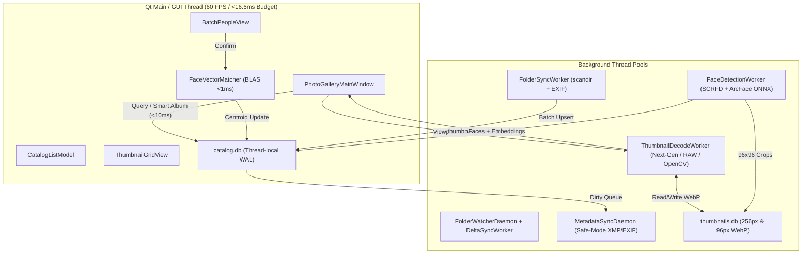

# Essentials Photo Gallery — System Specification & Architecture (`docs/ARCHITECTURE.md`)

**Target System:** High-Performance 64-Bit Desktop Photo Management & Non-Destructive Editing Workstation (Python 3.11–3.13, PySide6)  
**Inspiration & Heritage:** Authentic Windows Live Photo Gallery (WLPG) Wave 4 (2012) UX elevated with modern computer vision, biometric face clustering, interactive world map geotagging, 17-dimension Boolean Smart Albums, multi-photo creation studio, and 32-bit perceptual image processing  
**Companion Documentation:**
- **[Image Editing & Multi-Photo Studio Engine (`editing_engine.md`)](editing_engine.md)**
- **[Scale Benchmarks 100k & 500k (`BENCHMARKS.md`)](BENCHMARKS.md)**
- **[Future Innovation Roadmap (`futureideas.md`)](futureideas.md)**

---

## 0. Executive System Goals & Scale Requirements

- **Library Scale:** Manage **500,000+ photos and videos** with sub-10ms catalog query/filtering and sustained **60 FPS** scrolling via `QListView` (`IconMode`) virtualization (`CatalogListModel` lightweight tuple store + asynchronous `QPixmap` LRU cache).
- **Zero Cloud / 100% Local Privacy:** Local SCRFD + ArcFace ONNX face recognition, local offline gazetteer (3,500+ settlements), and local WAL-mode SQLite databases.
- **Non-Destructive Lifecycle:** Originals stashed into `<folder>/.OriginalFiles/` before on-disk writes; proprietary camera RAW containers remain untouched with `.xmp` sidecar sync.
- **Zero Main-Thread Blocking I/O:** Background worker pools handle directory scanning, thumbnail generation, live folder watching, face clustering, and XMP write-back.

---

## 1. Project Directory & Module Tree

```text
Gallery/
├── main.py                                      # Application bootstrap, codec init, QApplication lifecycle, QSS theme loader
├── README.md                                    # Project overview, download, quickstart & feature summary
├── RELEASES.md                                  # Release history matching GitHub Windows installer builds
├── requirements.txt                             # Python runtime dependencies
├── photogallery.spec                            # PyInstaller standalone 64-bit --onedir build specification
├── 1_build_exe.bat / 2_test_exe.bat             # PyInstaller executable build and smoke test scripts
├── 3_build_installer.bat / installer.iss        # Inno Setup 6 Windows x64 installer packaging
├── docs/
│   ├── ARCHITECTURE.md                          # Master system specification, schema & concurrency architecture
│   ├── editing_engine.md                        # Unified Edit & Create engine spec (math, LUTs, Depth & Light, markup UX)
│   ├── BENCHMARKS.md                            # Verified 100k & 500k synthetic catalog benchmark report
│   ├── futureideas.md                           # Forward-looking roadmap (CLIP search, OCR, GPX tracks, LUTs)
│   └── images/                                  # Screenshots referenced by README.md (excluded from PyInstaller dist)
├── db/
│   └── schema.sql                               # Complete SQLite DDL: WAL, R*Tree, closure tables, albums, indexes, triggers
├── assets/ & resources/
│   ├── icons/ & resources/icons/                # High-DPI UI icons, SVG vectors, app icon
│   └── themes/                                  # wlpg_aero.qss, dark.qss, modern.qss
├── src/
│   ├── __init__.py
│   ├── core/
│   │   ├── __init__.py
│   │   ├── duplicate_finder.py                  # Exact hashing, multi-index perceptual pHash/dHash, burst sharpness analysis
│   │   ├── face_engine.py                       # InsightFace SCRFD + ArcFace ONNX wrapper & OpenCV fallback
│   │   ├── face_matcher.py                      # NumPy N×512 BLAS cosine similarity & incremental cluster centroids
│   │   ├── gazetteer_data.py                    # Built-in offline gazetteer (3,500+ world cities & UK settlements)
│   │   └── geotag_resolver.py                   # Offline reverse geocoding, KD-tree nearest search & Nominatim SQLite cache
│   ├── db/
│   │   ├── __init__.py
│   │   ├── connection.py                        # DualDatabaseEngine: WAL connections, schema migrations, online backups
│   │   └── repository.py                        # CatalogRepository & ThumbnailRepository: faceted queries, 17-dim Smart Album compiler
│   ├── imaging/
│   │   ├── __init__.py
│   │   ├── image_loader.py                      # Next-gen codecs (HEIC/HEIF/AVIF/JXL) & LittleCMS2 Display P3 -> sRGB conversion
│   │   ├── opencv_engine.py                     # 32-bit float/LUT tone engine, U-Point, auto-straighten, frequency separation
│   │   ├── create_tools.py                      # Panorama stitcher (ICE crop), Collages, Then & Now, Photo Fuse
│   │   └── creative_effects.py                  # Depth & Light (bokeh, relight, haze), Color Pop, 3D Cinematic Motion MP4
│   ├── ui/
│   │   ├── __init__.py
│   │   ├── albums_view.py                       # AlbumsView: Stack preview cards for static & smart albums
│   │   ├── batch_people_view.py                 # Virtualised face confirmation grid & Spacebar full-photo preview popover
│   │   ├── compare_view.py                      # CompareMediaView: Multi-photo Light Table (2-Up, 3-Up, Quad, Wipe slider, Sync zoom)
│   │   ├── create_studio_dialogs.py             # Interactive Panorama, Collage, Photo Fuse, Colour Pop & 3D Motion studios
│   │   ├── crop_tool.py                         # Interactive Rule-of-Thirds CropOverlayItem with aspect-ratio & Uncrop support
│   │   ├── dialogs.py                           # Relative Δt Time Shift, File Properties, Merge People & maintenance dialogs
│   │   ├── duplicate_finder_dialog.py           # Side-by-side comparison workspace, auto-select rules, safe Recycle Bin delete
│   │   ├── grid_model.py                        # CatalogListModel (O(log G) binary-searched collapsible section headers)
│   │   ├── grid_view.py                         # ThumbnailGridView (QListView IconMode) & Polaroid MediaCardDelegate
│   │   ├── icon_provider.py                     # Multi-theme vector/raster icon provider (Aero, Fluent, Minimalist)
│   │   ├── import_dialog.py                     # Device scanning, folder structure presets, progress monitor
│   │   ├── left_nav_dock.py                     # LeftNavigationDock: Albums, Folders, Dates, Places, Tags (AND/OR/NOT), People, Ratings
│   │   ├── main_window.py                       # PhotoGalleryMainWindow: Central coordinator, thread pools, status bar & shortcuts
│   │   ├── map_view.py                          # WorldMapView: QWebEngineView + Leaflet + R*Tree clustering + drag-zoom + vector fallback
│   │   ├── markup_overlay.py                    # MarkupOverlayView: Vector arrows, shapes, text pills, 2.5x loupe & privacy redactions
│   │   ├── media_viewer.py                      # SingleMediaViewer: Async full-res proxy/master studio, video player, face overlay
│   │   ├── options_dialog.py                    # AppSettingsDialog: General, People/AI, Backups, Save/Edit options
│   │   ├── people_directory_view.py             # PeopleDirectoryView: Immich-style 130px circular cards & unnamed clusters
│   │   ├── person_header_bar.py                 # Timeline strip with 1-click [Confirm all] verification
│   │   ├── print_dialog.py                      # Photo print layout & contact sheet dialog
│   │   ├── ribbon_toolbar.py                    # RibbonToolbar: Integrated Title Bar, QAT, Home/Edit/Find/Create/View & contextual Map tab
│   │   ├── right_tag_dock.py                    # TagAndCaptionDock: Info (Ctrl+I), Fine Tune (Ctrl+F), Depth & Light
│   │   ├── search_scope_bar.py                  # Breadcrumb path/album/map chip bar & instant clearable search box
│   │   ├── slideshow_view.py                    # FullscreenSlideshowDialog: Ken Burns Pan/Zoom, Cross-fade & HUD
│   │   ├── smart_album_dialog.py                # SmartAlbumDialog: Interactive Boolean rule builder with live match preview
│   │   ├── tag_hierarchy_dialog.py              # Interactive tag tree editor & Duplicate Root Tags merger
│   │   └── tag_someone_dialog.py                # Autocomplete face-tagging dialog
│   ├── utils/
│   │   ├── __init__.py
│   │   ├── geotag_resolver.py                   # Compatibility bridge to src.core.geotag_resolver
│   │   ├── paths.py                             # AppData, user libraries, temp caches & frozen bundle resource resolver
│   │   └── scan_logger.py                       # Persistent scan & crash diagnostics logger
│   └── workers/
│       ├── __init__.py
│       ├── face_worker.py                       # 3-stage ONNX face detector, 96x96 WebP crop extractor & backfill
│       ├── folder_watcher.py                    # QFileSystemWatcher & startup delta reconciliation
│       ├── scanner_thumb_worker.py              # FolderSyncWorker & ThumbnailDecodeWorker (QImageReader, RAW, Next-Gen, OpenCV)
│       └── xmp_sync_worker.py                   # MetadataSyncDaemon: Safe-mode-aware XMP/EXIF write-back & mtime preservation
└── tests/                                       # Automated pytest regression suites (70+ suites) & scale benchmark harness
```

---

## 2. Dual-Database Storage Architecture (`catalog.db` & `thumbnails.db`)

SQLite WAL mode (`PRAGMA journal_mode = WAL; PRAGMA synchronous = NORMAL; PRAGMA busy_timeout = 5000;`) isolates bulk thumbnail BLOB caching from sub-10ms relational, spatial, and Boolean Smart Album metadata queries. See complete DDL in [`db/schema.sql`](../db/schema.sql).

```text
+-----------------------------------------------------------------+
|                        User Application                         |
+-------------------------------+---------------------------------+
                                |
              +-----------------+-----------------+
              |                                   |
              v                                   v
+---------------------------+       +-----------------------------+
|        catalog.db         |       |        thumbnails.db        |
| (Metadata, Vectors, Rules)|       |     (Fast WebP BLOBs)       |
+---------------------------+       +-----------------------------+
| - folders                 |       | - thumbnails                |
| - media (incl. camera/geo)|       |   (256x256 PG64THMB WebP)   |
| - albums & album_items    |       | - face_thumbnails           |
| - smart_albums            |       |   (96x96 portrait crops)    |
| - tags & tag_closure      |       +-----------------------------+
| - media_tags              |
| - people & media_people   |
| - face_rejected_sugg.     |
| - saved_places            |
| - media_rtree (Spatial)   |
+---------------------------+
```

### 2.1 `catalog.db` Schema & Specialized Indexes
- **`folders`**: `(id, path UNIQUE, name, parent_id, mtime, is_favourite)`
- **`media`**: `(id, folder_id, filename, ext, size, mtime, date_taken, rating, flag, width, height, orientation, lat, lon, location_name, location_country, location_state, location_city, caption, camera_make, camera_model, author, exposure_time, f_number, focal_length, iso, published, is_video, duration_ms, video_codec, video_fps, original_backup_path, edited_at, metadata_dirty, face_scan_version, is_missing)`
- **`albums` & `album_items`**: Static albums `(id, name UNIQUE, description, cover_media_id, created_at)` joined via `album_items(album_id, media_id, sort_order)` with cascading delete (`ON DELETE CASCADE`) so removing an item from an album never deletes the photo file or catalog entry.
- **`smart_albums`**: `(id, name UNIQUE, rules_json, created_at)` storing JSON rule specs compiled into parameterized SQL (`compile_smart_album_where`) across **17+ dimensions** (`people`, `tag`, `place`, `time_of_day`, `on_this_day`, `date_taken`, `year`, `month`, `camera`, `rating`, `flag`, `media_type`, `file_ext`, `orientation`, `file_size_mb`, `megapixels`, `folder`, `caption`/`filename`). Seeded out of the box with *"On This Day"*, *"4+ Star & Flagged Favorites"*, and *"All Videos"*.
- **`tags` & `tag_closure`**: Transitive closure hierarchy maintained by triggers (`trg_tags_after_insert`, `trg_tags_after_update_parent`) enabling sub-5ms Boolean tree filtering (`AND`, `OR`, `NOT`).
- **`media_tags`**: Composite primary key `(media_id, tag_id)` without rowid.
- **`people` & `media_people`**: Biometric identity clusters storing 512-d ArcFace centroid embeddings (`2048` bytes), normalized face rectangles, and `state` (`-2` = ignored, `-1` = rejected, `0` = suggestion, `1` = confirmed).
- **`face_rejected_suggestions` / `face_rejections`**: Persistent suggestion exclusions.
- **`saved_places`**: Cached geocoding entries from offline lookup and OpenStreetMap Nominatim (`lat, lon, formatted_address, country, admin1, admin2`).
- **`media_rtree`**: SQLite R*Tree virtual table `(id, min_lat, max_lat, min_lon, max_lon)` synced by triggers for $<5\text{ms}$ map viewport queries.

#### Optimized Partial & Composite Indexes
```sql
CREATE INDEX idx_media_folder_id ON media(folder_id);
CREATE INDEX idx_media_effective_date ON media(COALESCE(date_taken, mtime, 0) DESC, id ASC);
CREATE INDEX idx_media_rating_date ON media(rating DESC, date_taken DESC, id ASC);
CREATE INDEX idx_media_places ON media(location_country, location_state, location_city) WHERE location_country IS NOT NULL;
CREATE INDEX idx_media_camera ON media(camera_model, camera_make);
CREATE INDEX idx_media_flag_partial ON media(flag, date_taken DESC) WHERE flag = 1;
CREATE INDEX idx_media_dirty_partial ON media(id) WHERE metadata_dirty = 1;
CREATE INDEX idx_media_face_scan ON media(face_scan_version) WHERE is_video = 0;
CREATE INDEX idx_media_is_missing ON media(is_missing) WHERE is_missing = 1;
CREATE INDEX idx_media_people_suggested ON media_people(suggested_person_id, similarity_score DESC) WHERE state = 0;
CREATE INDEX idx_album_items_media ON album_items(media_id);
```

### 2.2 `thumbnails.db` Schema
- **`thumbnails (media_id PRIMARY KEY, webp_blob, mtime, width, height)`**: $256 \times 256$ WebP blobs prefixed with the 8-byte `PG64THMB` magic header.
- **`face_thumbnails (face_id PRIMARY KEY, crop_webp)`**: $96 \times 96$ WebP portrait crops rendered directly in Batch People Tag and Quick Find People.

---

## 3. UI Component Architecture & Visual Specifications

```text
+------------------------------------------------------------------------------------+
| Ribbon [Home | Edit | Find | Create | View]  (or contextual [Map] / [Compare] / ...)   |
+---------------------+------------------------------------------+-------------------+
| Left Navigation:    | Center Workspace (QStackedWidget):       | Right Dock:       |
| - Albums            | 1. Thumbnail Grid View (QListView)       | [Info (Ctrl+I)]   |
|   • My Albums       | 2. Albums View (Stack preview cards)     | - People tags     |
|   • Smart Albums    | 3. Multi-Photo Compare / Light Table     | - Geotag & Places |
| - Folders (Subrec)  | 4. Single Media Viewer (Non-destructive) | - Caption         |
| - Date Taken Tree   | 5. Batch People Tag View (Face clusters) | - Tag chips/EXIF  |
| - Places Hierarchy  | 6. People Directory (130px cards)        |                   |
| - Tags (AND/OR/NOT) | 7. World Map View (Leaflet + R*Tree)     | [Fine Tune        |
| - People & Ratings  | 8. Fullscreen Slideshow (Ken Burns)      |  & Depth (Ctrl+F)]|
+---------------------+------------------------------------------+-------------------+
| Status Bar: Item / Map Stats | Zoom Slider | Background Tasks Menu | Pause Workers |
+------------------------------------------------------------------------------------+
```

### 3.1 Ribbon Toolbar & Integrated Title Bar (`src/ui/ribbon_toolbar.py`)
- **Primary Tabs:** `Home`, `Edit`, `Find`, `Create`, `View` (with **People**, **Gallery**, **World Map**, **Compare** with distinct `A | B` icon, and **Slide show** buttons in `View -> Views`).
- **Contextual Map Ribbon Mode:** Switching into World Map View replaces the standard editing tabs with a dedicated **`Map`** tab containing **Location Search** (embedded gazetteer/Nominatim search box + `Go`), **Map Style** (`Clean (Light)`, `Street (OSM)`, `Satellite`), **Map Filters** (`Year`, `Person`, `Rating` dropdowns synchronized live with the `SearchScopeBar`), **Navigation / Fit** (`Fit to photos`, `View area in grid`), **Panes** toggles, and **`Close map` (`Esc`)** at the far right.
- **Contextual Compare Ribbon Mode:** Triggering multi-photo comparison (`Compare` / `C`) activates the dedicated **`Compare`** tab providing **Layout** controls (`Side-by-Side`, `Top / Bottom`, `3-Up`, `2x2 Quad`, `Wipe Slider`, `Swap Panes`), **Inspect & Sync** (`Lock Pan & Zoom`, `Zoom to Face (F)`, `1:1 (100%)`, `Fit to Pane`, `Focus Peaking`, `Clipping Warnings`, and `Dark Backdrop` toggle), **Select & Cull** (`Auto-Advance`, `Open Selected in Editor`), and **`Close Compare` (`Esc`)** immediately adjacent.
- **Integrated Custom Title Bar & QAT:** Merges window chrome, customizable Quick Access Toolbar actions (`QSettings`), and ribbon context menu (*Customize QAT*, *Above/Below Ribbon*, *Minimize* `Ctrl+F1`).
- **Responsive Collapse & Themes:** Multi-stage width compaction (`>1550px` down to `<750px`) across **Classic Aero**, **Microsoft Fluent (Windows 11)**, and **Dark Studio**.
- **Quick Find People, Effects & Tag Split Controls:** Expandable corner-resizable Quick Find People dropdown, 8 live photographic preset tiles, Save as Copy split button, and Tag management split button.

### 3.2 Left Navigation Dock (`src/ui/left_nav_dock.py`)
- **Albums (Top Section):** Collapsible **My Albums** (Static Albums with live item counts; right-click `New Album...`, `Rename Album...`, `Delete Album`) and **Smart Albums** (dynamic live-evaluated rules; right-click `New Smart Album...`, `Edit Rules...`, `Rename...`, `Delete`, `Save Current Filter as Smart Album...`).
- **Folders:** Directory hierarchy with *Include subfolders*, Favourites, and drag-and-drop move/copy.
- **Date Taken & Places:** `Year -> Month -> Day` counts and `Country -> State / County -> City / Town` hierarchy.
- **Descriptive Tags:** Drag-and-drop reparenting, live counts, 3-state Boolean checkboxes (`Checked = Include`, `Right-click/Alt = Exclude`), and *Clean Up Duplicate Root Tags*.
- **People & Ratings:** Circular person avatars with counts, plus 5-star to 1-star and Unrated filters.

### 3.3 Center Area (`QStackedWidget`)
1. **Thumbnail Grid View (`grid_view.py`, `grid_model.py`):** Virtualized `QListView` in `IconMode`, $O(\log G)$ binary-searched collapsible section headers (all 19 `Group by` / `Arrange by` modes), Polaroid cards with interactive inline stars/flags, `Add to Album ▸` / `Remove from Album` context menu, self-healing paint queue, and browser-style `Alt+Left`/`Alt+Right` navigation history.
2. **Albums View (`albums_view.py`):** Visual stack preview cards displaying multi-photo fan/stack thumbnails for both static and smart albums with fast creation buttons (`New Album +`, `New Smart Album +`).
3. **Multi-Photo Compare / Light Table View (`compare_view.py`):** Multi-pane split workspace (2-Up, 3-Up, 4-Up Quad, interactive Before/After Wipe Slider), candidate filmstrip with status badges (`P`, `⚑`, `★N`), synchronized normalized pan/zoom, 1-click zoom to face cycling, focus peaking, highlight/shadow clipping warnings, camera RAW decoding via `rawpy`, non-destructive ratings/flags/rotation, and auto-advance culling.
4. **Single Media Viewer (`media_viewer.py`):** Hardware-accelerated full-res viewer + integrated video player, 1920px interactive proxy / full-res master adjustment pipeline, hover/click-to-rename face tagging overlay, Crop/Uncrop, Spot Fix, and Markup toolbars.
5. **Batch People Tag View (`batch_people_view.py`):** $96 \times 96$ face crop confirmation grid, `Space` non-modal full-photo preview popover, `Enter`/`Del`/`I`/`Esc` shortcuts.
6. **People Directory View (`people_directory_view.py`):** Immich-style 130px circular cards, unnamed clusters ($\ge 3$ faces) with inline naming, and horizontal person timeline strip (`person_header_bar.py`).
7. **World Map View (`map_view.py`):** Full-height `QWebEngineView` Leaflet canvas driven by contextual Map Ribbon controls, R*Tree bounding-box clustering, drag-rectangle zoom, persistent disk tile caching (`Clean`, `Street`, `Satellite`), offline vector canvas fallback, and status bar geotagged/cluster reporting.
8. **Fullscreen Slideshow (`slideshow_view.py`):** Ken Burns Pan/Zoom, cross-fades, and floating HUD controls.

### 3.4 Specialized Dialogs (`dialogs.py`, `smart_album_dialog.py`, `options_dialog.py`, `duplicate_finder_dialog.py`, `print_dialog.py`, `tag_hierarchy_dialog.py`)
- **`SmartAlbumDialog`:** Name + Match Mode (`ALL`/`ANY`), scrollable dynamic condition rows across all 17+ dimensions with database-backed autocomplete and real-time `"Live Preview: X matching items"`.
- **`AppSettingsDialog`:** Theme & icon set pairing, Safe Mode write-back toggle, face sensitivity sliders & heal maintenance, `.OriginalFiles` retention, online catalog backups, and Save/Copy naming presets.
- **`DuplicateFinderDialog`:** Exact hash, multi-index pHash/dHash, and burst Laplacian sharpness analysis with Recycle Bin cleanup.
- **`ChangeTimeTakenDialog`:** Relative $\Delta t = T_{\text{lead\_new}} - T_{\text{lead\_orig}}$ multi-selection timestamp shifting.
- **`TagHierarchyDialog` & `PrintDialog`:** Drag-and-drop tag tree cleanup and Windows printing / contact sheets.

---

## 4. Threading Concurrency Model & Signal Bus



---

## 5. Production Safeguards, Next-Gen Codecs & Benchmarks

1. **Safe Mode File Write-Back (`MetadataSyncDaemon`):** Off by default (`catalog-only mode`); metadata changes queue in `metadata_dirty = 1` until explicitly enabled. Background Tasks status menu links directly to Options to toggle `Write to files` or `Face detection`, plus displays delete/save confirmations in the status bar.
2. **Next-Gen Image Codecs & Color Management (`src/imaging/image_loader.py`):** Centralizes `register_nextgen_codecs()` for **HEIC/HEIF/HIF** (`pillow-heif`), **AVIF** (`pillow-avif-plugin`), and **JPEG XL** (`pillow-jxl-plugin`), converting embedded Display P3 / wide-gamut ICC profiles to calibrated sRGB (`ImageCms.profileToProfile`) while preserving alpha transparency and EXIF orientation consistency.
3. **Camera RAW Container Isolation:** RAW formats (`.raf`, `.cr2`, `.cr3`, `.nef`, `.arw`, `.dng`, `.orf`, `.rw2`) are never modified destructively; edits serialize strictly to `.xmp` sidecars.
4. **Online SQLite Backups & Maintenance:** Uses `sqlite3.Connection.backup()` for zero-lock snapshots, `ANALYZE;` after bulk scans, and `PRAGMA optimize;` on exit.
5. **Verified 500,000-Item Scale:** Benchmarked in [`BENCHMARKS.md`](BENCHMARKS.md) (`set_records()` `25.7 ms`, `notify_pixmap_ready()` `1.02 ms`, `60+ FPS` continuous scroll with `0` frame hitches).
